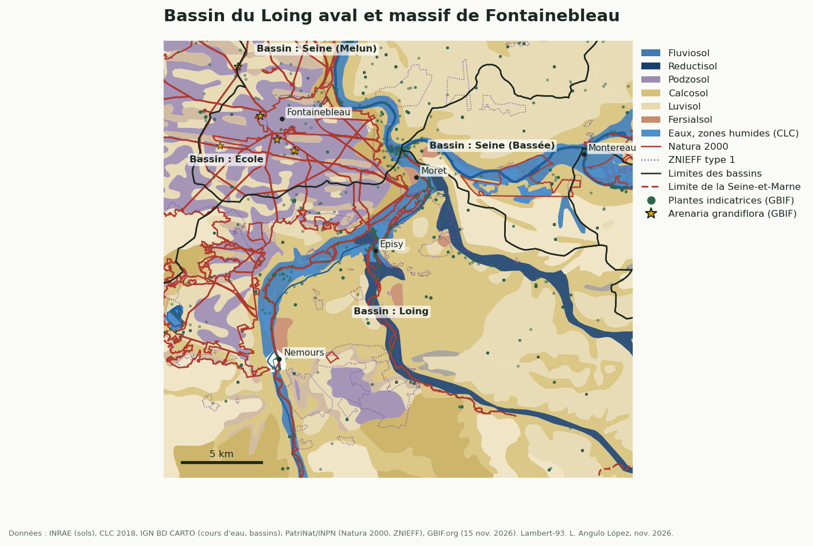

# 5 · Le Loing aval et la forêt de Fontainebleau

Trois bassins se rejoignent à Moret-Loing-et-Orvanne : le Loing, la Seine de la Bassée et la Seine à Melun. Sols humides des vallées, sables secs de la forêt et sites protégés se côtoient à quelques kilomètres.

(i) **La vallée.** Des fluviosols le long du Loing de Nemours à Saint-Mammès, et des réductisols sombres le long du Lunain et de l'Orvanne : des sols engorgés la plus grande partie de l'année. Le marais d'Episy se trouve à la rencontre de ces vallées, dans le site Natura 2000 *Basse vallée du Loing* (FR1100801).

(ii) **La forêt.** Des podzosols sur les sables de Fontainebleau, dans le site Natura 2000 *Massif de Fontainebleau* (FR1100795 et FR1110795). C'est là que la sabline à grandes fleurs, *Arenaria grandiflora*, a été sauvée par une translocation à sources mélangées en 1999 (Maurice et al. 2013 ; Brisset et al. 2025) ; le GBIF en compte 211 observations depuis 2000 (étoiles). Elle est extrêmement rare et protégée en Île-de-France, et en danger critique (CR) sur la liste rouge régionale (DRIEAT, liste ZNIEFF 2023).

(iii) **Les observations.** Les plantes indicatrices se concentrent le long du Loing, autour d'Episy et de Moret ; les plateaux cultivés entre les vallées en comptent peu.

[Suite : les zones humides seules →](wetlands.md){ .md-button }
