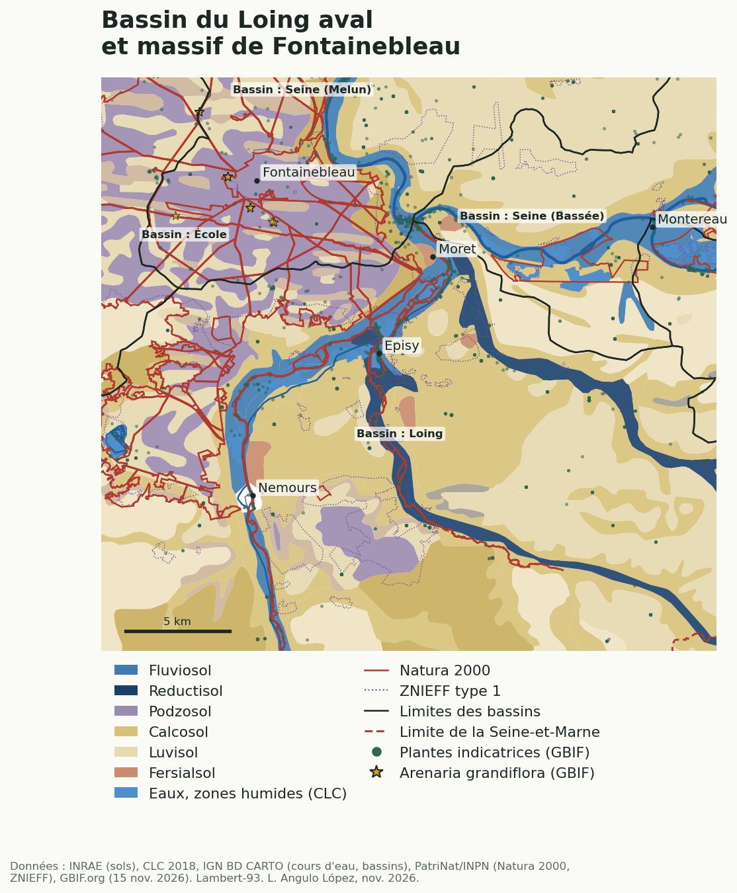

# 5 · The lower Loing and the Fontainebleau forest

Three catchments meet at Moret-Loing-et-Orvanne: the Loing, the Seine of the Bassée and the Seine at Melun. Wet valley soils, dry forest sands and protected sites sit within a few kilometres of each other.

(i) **The valley.** Fluviosols along the Loing from Nemours to Saint-Mammès, and dark Réductisols along the Lunain and the Orvanne: soils waterlogged for most of the year. The Marais d'Episy sits where these valleys meet, inside the Natura 2000 site *Basse vallée du Loing* (FR1100801).

(ii) **The forest.** Podzosols on the Fontainebleau sands, under the Natura 2000 site *Massif de Fontainebleau* (FR1100795 and FR1110795). Here the large-flowered sandwort, *Arenaria grandiflora*, was saved by a mixed-source translocation in 1999 (Maurice et al. 2013; Brisset et al. 2025), and GBIF holds 211 records since 2000 (stars). It is extremely rare and protected in Île-de-France, and Critically Endangered on the regional red list (DRIEAT, ZNIEFF list 2023).

(iii) **The records.** Indicator plant records crowd along the Loing and around Episy and Moret; the plateau fields between the valleys have few.

[Explore it on the interactive map →](map.md){ .md-button }
