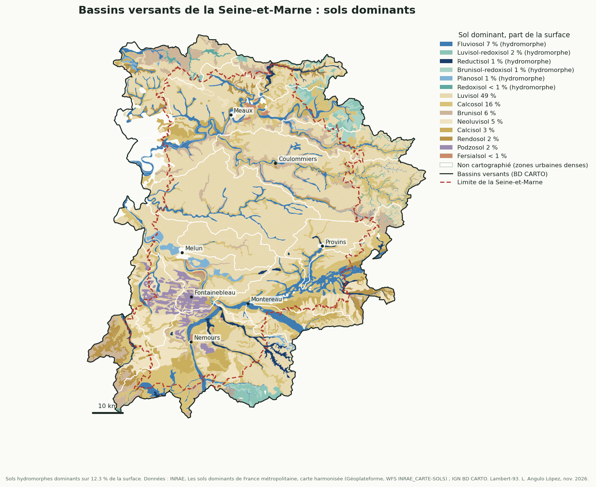

# 2 · Les sols

La moitié des bassins repose sur des luvisols profonds des plateaux limoneux. Les sols humides suivent les vallées : les sols hydromorphes dominent 12,3 % de la surface, les fluviosols seuls 7 %.

(i) **Les plateaux.** Des luvisols (49 %) sur les limons de la Brie et du Multien, des calcosols et calcisols (19 % à eux deux) sur les versants calcaires. Ce sont les sols des grandes cultures.

(ii) **Les vallées.** Des fluviosols dans les alluvions de la Seine, de la Marne, du Loing, du Grand et du Petit Morin ; des réductisols, sols engorgés en permanence, en bandes étroites le long du Lunain et de l'Orvanne au sud de Moret et dans une partie de la Bassée. Des luvisols- et brunisols-rédoxisols, engorgés en hiver, couvrent des plateaux argileux aux marges nord-est et sud de la zone.

(iii) **Fontainebleau.** Des podzosols sur les sables de Fontainebleau, acides et secs : les sols des landes et des pinèdes, et des platières de grès où pousse la sabline à grandes fleurs.

!!! note "Lire la carte"
    C'est la carte harmonisée au 1/1 000 000 : chaque polygone montre son sol *dominant*, pas tous les sols qu'il contient. La délimitation des zones humides se fait à la parcelle, à la tarière jusqu'à environ 1,20 m (arrêté du 24 juin 2008) : cette carte indique où chercher, pas où se trouve une zone humide.

[Suite : la végétation →](vegetation.md){ .md-button }
