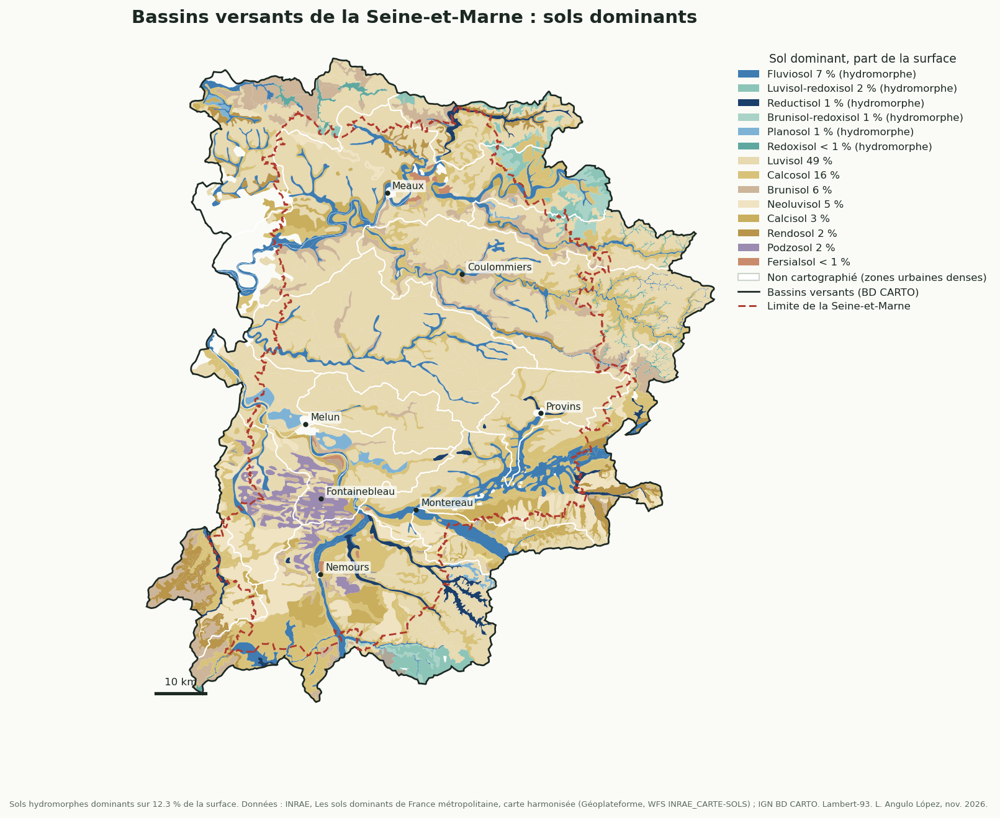

# 2 · Soils

Half the catchments sit on deep Luvisols of the loess plateaus. The wet soils follow the valleys: hydromorphic soils dominate 12.3 % of the area, Fluviosols alone 7 %.

(i) **Plateaus.** Luvisols (49 %) on the Brie and Multien loess, with Calcosols and Calcisols (19 % together) on the limestone slopes. These are the soils of the large arable fields.

(ii) **Valleys.** Fluviosols in the alluvium of the Seine, Marne, Loing, Grand and Petit Morin; Réductisols, the permanently waterlogged soils, in narrow bands along the Lunain and Orvanne south of Moret and in parts of the Bassée. Luvisol- and Brunisol-rédoxisols, waterlogged in winter, cover clay plateaus at the north-eastern and southern edges of the area.

(iii) **Fontainebleau.** Podzosols on the Fontainebleau sands, acid and dry: the soils of the heaths and pine stands, and of the sandstone rocks where the large-flowered sandwort grows.

!!! note "Reading the map"
    This is the 1:1,000,000 harmonised soil map: each polygon shows its *dominant* soil, not every soil inside it. Wetland delimitation in France works at the field scale, with an auger to about 1.20 m (arrêté of 24 June 2008), so this map points to where to look, not where a wetland is.

[Next: vegetation →](vegetation.md){ .md-button }
