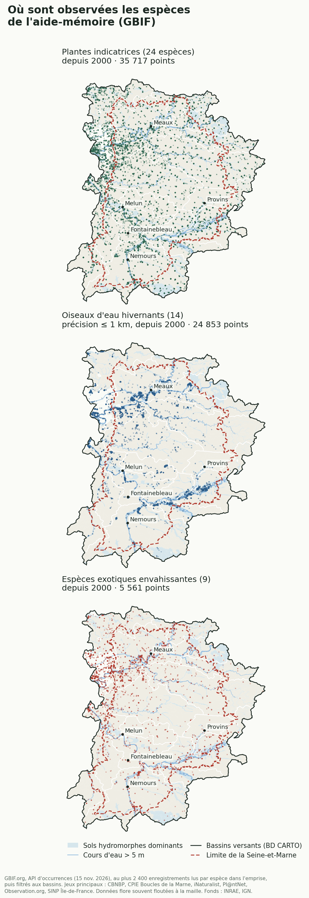

# 4 · Les espèces dans le GBIF

66 342 observations GBIF depuis 2000 des espèces d'un aide-mémoire sur les zones humides tombent dans les bassins, issues de 593 jeux de données. Les plantes suivent toutes les vallées ; les oiseaux d'eau se regroupent dans les boucles de la Marne, la Bassée et le Loing.

(i) **Les plantes.** 24 espèces indicatrices de zones humides au sens de la réglementation française (roseau, laîches, joncs, reine-des-prés, salicaire, aulne). La plupart des données viennent du Conservatoire botanique national du Bassin parisien, et beaucoup sont publiées à la maille : un point peut représenter un carré de plusieurs kilomètres, pas une plante.

(ii) **Les oiseaux.** 14 oiseaux d'eau hivernants, seulement les observations localisées à 1 km près ou mieux : les plans d'eau de gravières de la Marne près de Meaux et de la Bassée ressortent nettement.

(iii) **Les espèces envahissantes.** Ragondin, bernache du Canada, renouée du Japon et écrevisse de Louisiane sont bien renseignés ; les jussies (*Ludwigia*) n'ont que quelques observations précises, ce qui en dit peut-être plus sur la prospection que sur la plante.

## Observations dans le département, par espèce

Nombre d'observations GBIF avec coordonnées en Seine-et-Marne (GADM FRA.8.4_1), toutes années et depuis 2000. Tableau complet : [gbif_summary.json](data/gbif_summary.json).

| Espèce | Groupe | Toutes années | Depuis 2000 |
| --- | --- | ---: | ---: |
| *Eupatorium cannabinum*, eupatoire chanvrine | plante | 7 503 | 6 788 |
| *Lythrum salicaria*, salicaire | plante | 6 965 | 6 255 |
| *Iris pseudacorus*, iris des marais | plante | 6 250 | 5 566 |
| *Filipendula ulmaria*, reine-des-prés | plante | 5 161 | 4 656 |
| *Phragmites australis*, roseau | plante | 4 035 | 3 422 |
| *Caltha palustris*, populage des marais | plante | 795 | 654 |
| *Fulica atra*, foulque macroule | oiseau | 24 878 | 7 005 * |
| *Tachybaptus ruficollis*, grèbe castagneux | oiseau | 11 501 | 3 208 * |
| *Rallus aquaticus*, râle d'eau | oiseau | 3 389 | 930 * |
| *Branta canadensis*, bernache du Canada | envahissante | 14 818 | 3 905 * |
| *Myocastor coypus*, ragondin | envahissante | 2 638 | 999 * |
| *Ludwigia grandiflora*, jussie | envahissante | 21 | 4 * |
| *Arenaria grandiflora*, sabline à grandes fleurs | Fontainebleau | 392 | 211 |

\* Oiseaux et espèces envahissantes : observations depuis 2000 localisées à 1 km près ou mieux.

[Suite : la vallée du Loing →](loing.md){ .md-button }
