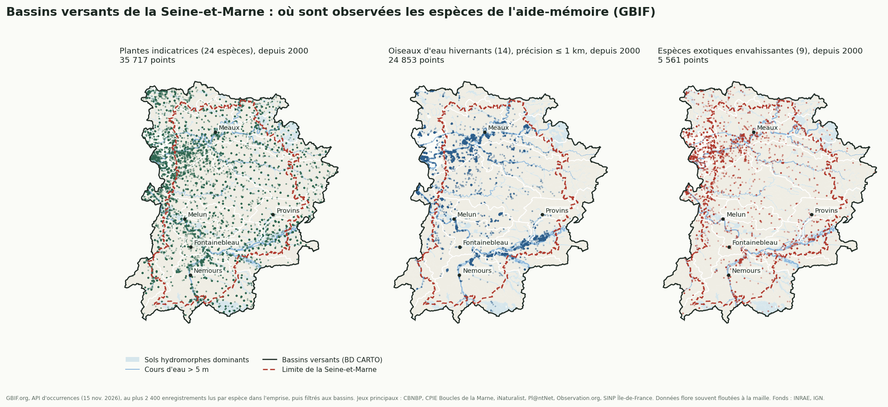

# 4 · Species in GBIF

66,342 GBIF records since 2000 for the species of a wetland aide-mémoire fall inside the catchments, from 593 datasets. Plants spread along every valley; waterbirds gather on the Marne loops, the Bassée and the Loing.

(i) **Plants.** 24 wetland indicator species of the French wetland rules (reed, sedges, rushes, meadowsweet, purple loosestrife, alder). Most records come from the Conservatoire botanique national du Bassin parisien, and many are published on a grid, so a dot can stand for a grid square of several kilometres, not a plant.

(ii) **Birds.** 14 wintering waterbirds, only records located to 1 km or better: the gravel-pit lakes of the Marne near Meaux and of the Bassée stand out.

(iii) **Invasive species.** Coypu, Canada goose, Japanese knotweed and red swamp crayfish are well recorded; water primrose (*Ludwigia*) has only a handful of precise records, which may say more about recording than about the plant.

## Records in the département, by species

GBIF counts with coordinates in Seine-et-Marne (GADM FRA.8.4_1), all years and since 2000. Full table: [gbif_summary.json](data/gbif_summary.json).

| Species | Group | All years | Since 2000 |
| --- | --- | ---: | ---: |
| *Eupatorium cannabinum*, eupatoire chanvrine | plant | 7,503 | 6,788 |
| *Lythrum salicaria*, salicaire | plant | 6,965 | 6,255 |
| *Iris pseudacorus*, iris des marais | plant | 6,250 | 5,566 |
| *Filipendula ulmaria*, reine-des-prés | plant | 5,161 | 4,656 |
| *Phragmites australis*, roseau | plant | 4,035 | 3,422 |
| *Caltha palustris*, populage des marais | plant | 795 | 654 |
| *Fulica atra*, foulque macroule | bird | 24,878 | 7,005 * |
| *Tachybaptus ruficollis*, grèbe castagneux | bird | 11,501 | 3,208 * |
| *Rallus aquaticus*, râle d'eau | bird | 3,389 | 930 * |
| *Branta canadensis*, bernache du Canada | invasive | 14,818 | 3,905 * |
| *Myocastor coypus*, ragondin | invasive | 2,638 | 999 * |
| *Ludwigia grandiflora*, jussie | invasive | 21 | 4 * |
| *Arenaria grandiflora*, sabline à grandes fleurs | Fontainebleau | 392 | 211 |

\* Birds and invasive species: records since 2000 located to 1 km or better.

[Next: the Loing valley →](loing.md){ .md-button }
