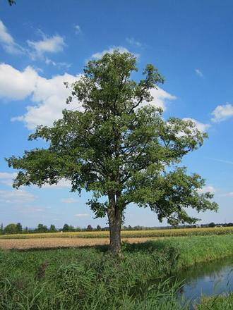
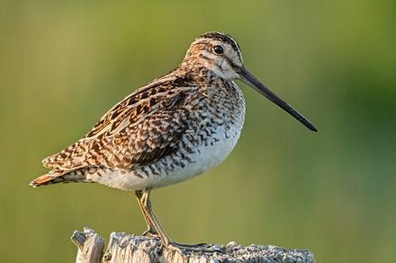
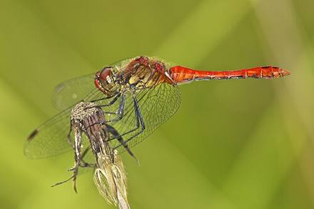
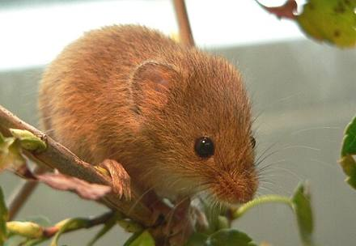
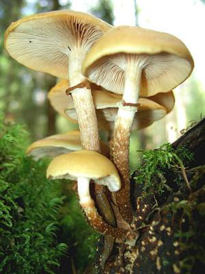
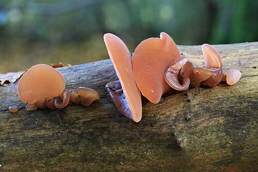

# L'automne dans les zones humides de Seine-et-Marne

Six posts pour septembre à novembre : les graines d'aulne au fil de l'eau, la bécassine de passage, les dernières libellules rouges, le rat des moissons, un champignon au sosie mortel, et les feuilles qui nourrissent les ruisseaux.

**Quand publier :** à partir de l'équinoxe d'automne, jeudi 23 septembre 2027, un post par jour.

## Jour 1, plante: Aulne glutineux

{ width="320" }

> 🌳🍂 Comment un arbre voyage-t-il par la rivière ?
>
> En automne, les petits cônes ligneux de l'aulne glutineux (Alnus glutinosa) s'ouvrent et libèrent des graines munies de petites ailes pleines d'air, qui flottent. La rivière les emporte vers de nouvelles berges. Le GBIF en compte 4 649 observations en Seine-et-Marne depuis 2000, dont 1 042 (22 %) de septembre à novembre.
>
> Ses racines tiennent les berges et portent des nodules à bactéries qui fixent l'azote de l'air. Les aulnaies-frênaies des rivières sont un habitat prioritaire de l'UE, 91E0*.
>
> Jour 1 sur six, les zones humides de Seine-et-Marne en automne : une plante, un oiseau, un insecte, un animal, un champignon, puis tout l'écosystème.
>
> Cartes et sources: 👉 https://lindangulopez.github.io/wetlands-seine-et-marne/fr/story/autumn/
>
> #ZonesHumides #SeineEtMarne #Biodiversite #GBIF #DonneesOuvertes #Alder #Trees #Riverbanks

*Statut :* Préoccupation mineure (UICN).

## Jour 2, oiseau: Bécassine des marais

{ width="320" }

> 🐦🍂 Quel oiseau sonde la vase avec un bec aussi long que la tête ?
>
> En automne, la bécassine des marais (Gallinago gallinago) arrive du nord et de l'est et se nourrit dans les prés boueux et au bord des mares, en sondant la vase à la recherche de vers et de larves. Levée, elle s'envole en zigzag rapide. Le GBIF en compte 5 800 observations en Seine-et-Marne depuis 2000, dont 2 235 (39 %) de septembre à novembre.
>
> Il lui faut un sol mou et humide, non drainé. En France, c'est une espèce chassable, ce qui rend l'état de ses prés humides d'autant plus important.
>
> Jour 2 sur six, les zones humides de Seine-et-Marne en automne : une plante, un oiseau, un insecte, un animal, un champignon, puis tout l'écosystème.
>
> Cartes et sources: 👉 https://lindangulopez.github.io/wetlands-seine-et-marne/fr/story/autumn/
>
> #ZonesHumides #SeineEtMarne #Biodiversite #GBIF #DonneesOuvertes #Snipe #Birds #Migration

*Statut :* Préoccupation mineure (UICN) ; espèce chassable en France.

## Jour 3, insecte: Sympétrum sanguin

{ width="320" }

> ❤️🍂 Quelle libellule vole encore en octobre ?
>
> Le sympétrum sanguin (Sympetrum sanguineum) est l'une des dernières libellules de l'année ; les mâles rouge sang se posent sur les tiges au soleil d'automne. Le GBIF en compte 5 258 observations en Seine-et-Marne depuis 2000, dont 906 (17 %) de septembre à novembre.
>
> Il pond au bord des mares qui s'assèchent puis se remplissent ; les œufs attendent le retour de l'eau.
>
> Jour 3 sur six, les zones humides de Seine-et-Marne en automne : une plante, un oiseau, un insecte, un animal, un champignon, puis tout l'écosystème.
>
> Cartes et sources: 👉 https://lindangulopez.github.io/wetlands-seine-et-marne/fr/story/autumn/
>
> #ZonesHumides #SeineEtMarne #Biodiversite #GBIF #DonneesOuvertes #Dragonflies #Odonata

*Statut :* Préoccupation mineure (UICN) ; non protégé.

## Jour 4, animal: Rat des moissons

{ width="320" }

> 🐭🌾 Qui construit une boule d'herbe dans les roseaux ?
>
> Le rat des moissons (Micromys minutus) est le plus petit rongeur d'Europe. Il grimpe dans les roseaux et les hautes herbes avec une queue préhensile et tisse un nid en boule entre les tiges. Le GBIF en compte 82 observations en Seine-et-Marne depuis 2000, dont 25 (30 %) de septembre à novembre.
>
> On le voit rarement : ce sont ses nids, plus faciles à trouver en automne et en hiver, qui donnent la plupart des observations. Faucher d'un coup toute la végétation haute d'une berge lui retire son abri.
>
> Jour 4 sur six, les zones humides de Seine-et-Marne en automne : une plante, un oiseau, un insecte, un animal, un champignon, puis tout l'écosystème.
>
> Cartes et sources: 👉 https://lindangulopez.github.io/wetlands-seine-et-marne/fr/story/autumn/
>
> #ZonesHumides #SeineEtMarne #Biodiversite #GBIF #DonneesOuvertes #HarvestMouse #Mammals

*Statut :* Préoccupation mineure (UICN).

## Jour 5, champignon: Pholiote changeante

{ width="320" }

> 🍄⚠️ Pourquoi les cueilleurs craignent-ils le sosie de celui-ci ?
>
> La pholiote changeante (Kuehneromyces mutabilis) pousse en touffes sur les souches de saule, d'aulne et de peuplier ; son chapeau change de couleur en séchant et reste un temps bicolore. Le GBIF en compte 24 observations en Seine-et-Marne depuis 2000, dont 16 (67 %) de septembre à novembre.
>
> Elle est comestible, mais elle pousse aux mêmes endroits que la galère marginée (Galerina marginata), qui contient les mêmes toxines mortelles que l'amanite phalloïde. Pour la reconnaissance seulement : ne la mangez jamais sans l'avis d'un pharmacien ou d'un mycologue.
>
> Jour 5 sur six, les zones humides de Seine-et-Marne en automne : une plante, un oiseau, un insecte, un animal, un champignon, puis tout l'écosystème.
>
> Cartes et sources: 👉 https://lindangulopez.github.io/wetlands-seine-et-marne/fr/story/autumn/
>
> #ZonesHumides #SeineEtMarne #Biodiversite #GBIF #DonneesOuvertes #Fungi #Mushrooms #MushroomSafety

*Statut :* Comestible, sosie mortel : à éviter. Préoccupation mineure (UICN).

## Jour 6, écosystème: La chute des feuilles nourrit les ruisseaux

{ width="320" }

> 🍂💧 De quoi se nourrissent les mares en automne ?
>
> En automne, les feuilles des aulnes et des saules tombent dans les fossés, les ruisseaux et les mares. Champignons et bactéries les ramollissent, des larves d'insectes les déchiquettent ; ces larves nourrissent poissons, grenouilles et oiseaux tout l'hiver.
>
> L'automne est aussi la saison des champignons : en Seine-et-Marne, le GBIF compte 18 296 observations de champignons depuis 2000, dont 53 % de septembre à novembre. Une zone humide sans ses arbres et son bois mort perd une grande part de ce qui la nourrit.
>
> Jour 6 sur six, les zones humides de Seine-et-Marne en automne : une plante, un oiseau, un insecte, un animal, un champignon, puis tout l'écosystème.
>
> Cartes et sources: 👉 https://lindangulopez.github.io/wetlands-seine-et-marne/fr/story/autumn/
>
> #ZonesHumides #SeineEtMarne #Biodiversite #GBIF #DonneesOuvertes #LeafLitter #Decomposition #Ecosystems

## Sources

(i) GBIF.org, recherche d'occurrences, 15 nov. 2026 : observations avec coordonnées en Seine-et-Marne (GADM FRA.8.4_1), 2000 à 2026, comptées par mois ; catégories UICN via l'API espèces du GBIF.

(ii) Protection en France : arrêté du 29 octobre 2009 (oiseaux), arrêté du 8 janvier 2021 (amphibiens et reptiles), arrêté du 23 avril 2007 (mammifères, dont toutes les chauves-souris). Parts de zones humides : [diapositive 6](../wetlands.md).

(iii) Photos : images principales des articles de Wikipédia en anglais, issues de Wikimedia Commons ; une photo Commons pour le lactaire des flaques. Crédits : [crédits photo](../sources.md#photo-credits).
