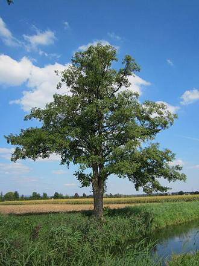
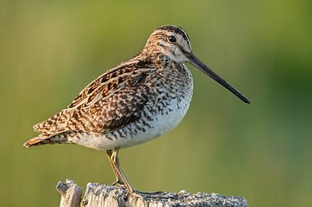
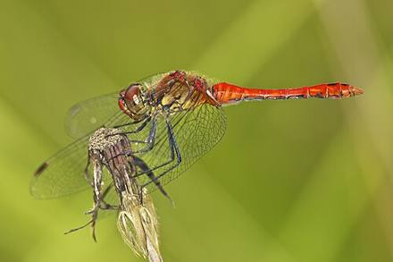
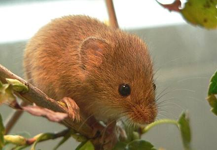
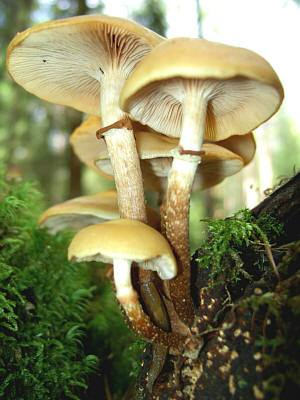
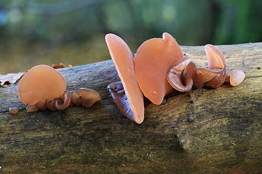

# Autumn in the wetlands of Seine-et-Marne

Six posts for September to November: alder seeds on the water, the snipe on passage, the last red dragonflies, the harvest mouse, a mushroom with a deadly look-alike, and the leaves that feed the streams.

**When to post:** from the autumn equinox, Thursday 23 September 2027, one post a day.

## Day 1, plant: Alder, aulne glutineux

{ width="320" }

> 🌳🍂 How does a tree travel by river?
>
> In autumn the small woody cones of the aulne glutineux, alder (Alnus glutinosa), open and let out seeds with tiny air-filled wings that float. The river carries them downstream to new banks. GBIF holds 4,649 records of it in Seine-et-Marne since 2000; 1,042 of them (22 %) were made from September to November.
>
> Its roots hold the banks and carry nodules with bacteria that fix nitrogen from the air. Alder and ash woods along rivers are a priority EU habitat, 91E0*.
>
> Day 1 of six on the wetlands of Seine-et-Marne in autumn: a plant, a bird, an insect, an animal, a fungus, then the whole ecosystem.
>
> Maps and sources: 👉 https://lindangulopez.github.io/wetlands-seine-et-marne/story/autumn/
>
> #ZonesHumides #Wetlands #SeineEtMarne #Biodiversity #GBIF #OpenData #Alder #Trees #Riverbanks

*Status:* Least Concern (IUCN).

## Day 2, bird: Common snipe, bécassine des marais

{ width="320" }

> 🐦🍂 Which bird probes the mud with a bill as long as its head?
>
> In autumn the bécassine des marais, common snipe (Gallinago gallinago), arrives from the north and east and feeds in muddy meadows and pond edges, probing for worms and larvae. Flushed, it rises in a fast zigzag. GBIF holds 5,800 records of it in Seine-et-Marne since 2000; 2,235 of them (39 %) were made from September to November.
>
> It needs soft, wet ground that has not been drained. In France it is a game species, which makes the state of its wet meadows all the more important.
>
> Day 2 of six on the wetlands of Seine-et-Marne in autumn: a plant, a bird, an insect, an animal, a fungus, then the whole ecosystem.
>
> Maps and sources: 👉 https://lindangulopez.github.io/wetlands-seine-et-marne/story/autumn/
>
> #ZonesHumides #Wetlands #SeineEtMarne #Biodiversity #GBIF #OpenData #Snipe #Birds #Migration

*Status:* Least Concern (IUCN); game species in France.

## Day 3, insect: Ruddy darter, sympétrum sanguin

{ width="320" }

> ❤️🍂 Which dragonfly is still flying in October?
>
> The sympétrum sanguin, ruddy darter (Sympetrum sanguineum), is one of the last dragonflies of the year; the blood-red males perch on stems in the autumn sun. GBIF holds 5,258 records of it in Seine-et-Marne since 2000; 906 of them (17 %) were made from September to November.
>
> It lays its eggs at the edges of ponds that dry out and fill again; the eggs wait for the water to come back.
>
> Day 3 of six on the wetlands of Seine-et-Marne in autumn: a plant, a bird, an insect, an animal, a fungus, then the whole ecosystem.
>
> Maps and sources: 👉 https://lindangulopez.github.io/wetlands-seine-et-marne/story/autumn/
>
> #ZonesHumides #Wetlands #SeineEtMarne #Biodiversity #GBIF #OpenData #Dragonflies #Odonata

*Status:* Least Concern (IUCN); not protected.

## Day 4, animal: Harvest mouse, rat des moissons

{ width="320" }

> 🐭🌾 Who builds a ball of grass in the reeds?
>
> The rat des moissons, harvest mouse (Micromys minutus), is the smallest rodent in Europe. It climbs reeds and tall grass with a tail that grips, and weaves a ball-shaped nest between the stems. GBIF holds 82 records of it in Seine-et-Marne since 2000; 25 of them (30 %) were made from September to November.
>
> It is rarely seen, and its nests, easiest to find in autumn and winter, are how most records are made. Cutting all the tall vegetation of a bank at once removes its home.
>
> Day 4 of six on the wetlands of Seine-et-Marne in autumn: a plant, a bird, an insect, an animal, a fungus, then the whole ecosystem.
>
> Maps and sources: 👉 https://lindangulopez.github.io/wetlands-seine-et-marne/story/autumn/
>
> #ZonesHumides #Wetlands #SeineEtMarne #Biodiversity #GBIF #OpenData #HarvestMouse #Mammals

*Status:* Least Concern (IUCN).

## Day 5, fungus: Sheathed woodtuft, pholiote changeante

{ width="320" }

> 🍄⚠️ Why do mushroom hunters fear this one's twin?
>
> The pholiote changeante, sheathed woodtuft (Kuehneromyces mutabilis), grows in tufts on stumps of willow, alder and poplar; its cap changes colour as it dries, two-toned for a while. GBIF holds 24 records of it in Seine-et-Marne since 2000; 16 of them (67 %) were made from September to November.
>
> It is edible, but it grows in the same places as the galère marginée (Galerina marginata), which contains the same deadly toxins as the death cap. For recognition only: never eat it without a check by a pharmacist or a mycologist.
>
> Day 5 of six on the wetlands of Seine-et-Marne in autumn: a plant, a bird, an insect, an animal, a fungus, then the whole ecosystem.
>
> Maps and sources: 👉 https://lindangulopez.github.io/wetlands-seine-et-marne/story/autumn/
>
> #ZonesHumides #Wetlands #SeineEtMarne #Biodiversity #GBIF #OpenData #Fungi #Mushrooms #MushroomSafety

*Status:* Edible, deadly look-alike: avoid. Least Concern (IUCN).

## Day 6, ecosystem: Leaf fall feeds the streams

{ width="320" }

> 🍂💧 What do ponds eat in autumn?
>
> In autumn the leaves of alders and willows fall into ditches, streams and ponds. Fungi and bacteria soften them, and insect larvae shred them; those larvae feed fish, frogs and birds through the winter.
>
> Autumn is also the season of fungi: in Seine-et-Marne, GBIF holds 18,296 records of fungi since 2000, and 53 % were made from September to November. A wetland without its trees and its dead wood loses much of what feeds it.
>
> Day 6 of six on the wetlands of Seine-et-Marne in autumn: a plant, a bird, an insect, an animal, a fungus, then the whole ecosystem.
>
> Maps and sources: 👉 https://lindangulopez.github.io/wetlands-seine-et-marne/story/autumn/
>
> #ZonesHumides #Wetlands #SeineEtMarne #Biodiversity #GBIF #OpenData #LeafLitter #Decomposition #Ecosystems

## Sources

(i) GBIF.org occurrence search, 15 Nov 2026: records with coordinates in Seine-et-Marne (GADM FRA.8.4_1), 2000 to 2026, counted by month; IUCN categories from the GBIF species API.

(ii) Protection in France: arrêté of 29 October 2009 (birds), arrêté of 8 January 2021 (amphibians and reptiles), arrêté of 23 April 2007 (mammals, including all bats). Wetland shares: [slide 6](../wetlands.md).

(iii) Photos: lead images of the English Wikipedia articles, from Wikimedia Commons; one Commons photo for the puddle milkcap. Credits: [photo credits](../sources.md#photo-credits).
