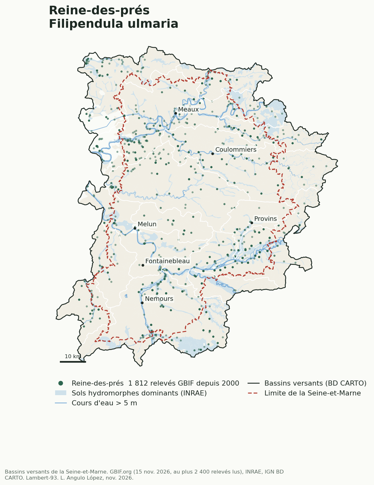

# Jour 1, plante : la reine-des-prés en novembre

**Reine-des-prés**, *Filipendula ulmaria*. Fleurs crème parfumées ; la mégaphorbiaie.

## Le récit

*À quoi ressemble une fleur de zone humide en novembre ?*

La reine-des-prés (Filipendula ulmaria) borde les rivières et les fossés de Seine-et-Marne de fleurs crème et parfumées en juillet. En novembre, ses tiges brunissent, coiffées de petits fruits vrillés, et resteront debout tout l'hiver. Cela suffit pour la repérer, et ces tiges signalent la mégaphorbiaie, la frange de hautes herbes des sols humides que la directive Habitats de l'UE classe comme habitat 6430. Le GBIF compte 4 656 observations de la plante dans le département depuis 2000, par des botanistes et des naturalistes bénévoles.

Les tiges restées debout abritent insectes et araignées en hiver, et montrent où le sol reste humide. Les mégaphorbiaies sont en général fauchées seulement tous les quelques ans, pour que saules et aulnes ne les referment pas. La plante a aussi sa place en médecine : dans les années 1830, des chimistes ont obtenu de l'acide salicylique de ses boutons floraux, et Bayer a nommé l'aspirine d'après son ancien nom botanique, Spiraea ulmaria.

## Sources des faits

(i) GBIF.org, recherche d'occurrences, 15 nov. 2026 : *Filipendula ulmaria* (taxon 2987999) en Seine-et-Marne (GADM FRA.8.4_1), avec coordonnées, 2000 à 2026 : 4 656 observations (5 161 toutes années).

(ii) Habitat 6430, mégaphorbiaies hygrophiles : Manuel d'interprétation des habitats de l'Union européenne (Commission européenne) et *Cahiers d'habitats* Natura 2000.

(iii) Acide salicylique et nom de l'aspirine : [Filipendula ulmaria, Wikipédia en anglais](https://en.wikipedia.org/wiki/Filipendula_ulmaria), lu le 15 nov. 2026.

(iv) La carte ci-dessus : observations GBIF depuis 2000 dans les 14 bassins, sur les sols hydromorphes de la carte INRAE. Voir [Sources et méthode](../sources.md).
