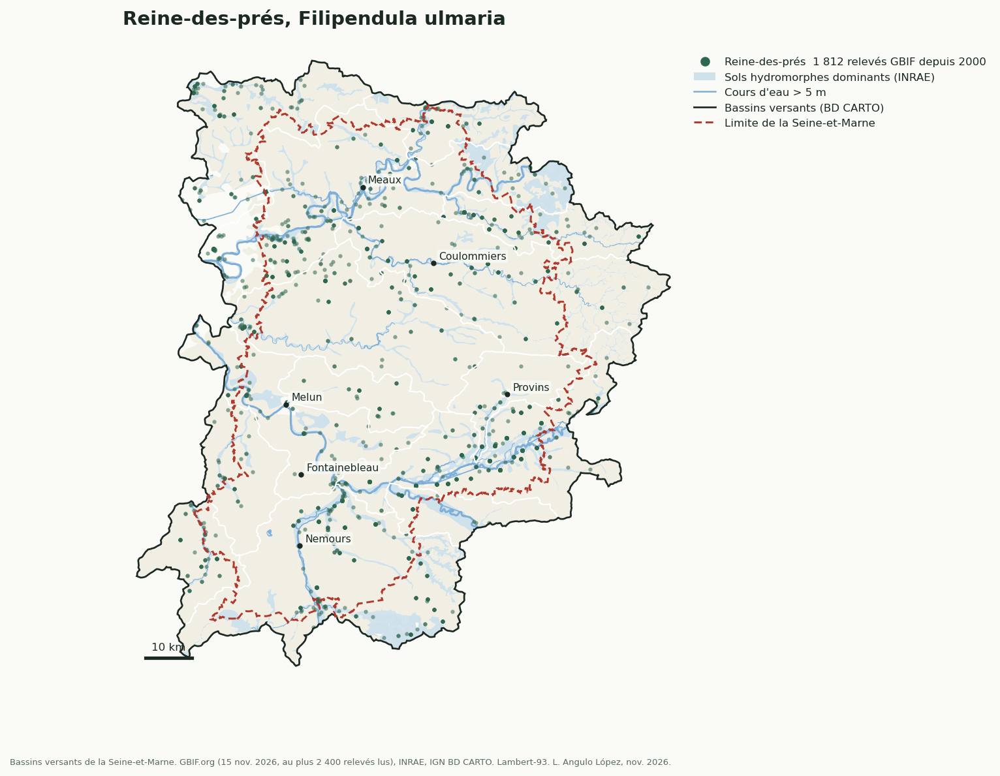

# Day 1, plant: meadowsweet in winter

**Reine-des-prés**, meadowsweet, *Filipendula ulmaria*. Fleurs crème parfumées ; la mégaphorbiaie.

## The post

> 🌾❄️ What does a wetland flower look like in January?
>
> Reine-des-prés, meadowsweet (Filipendula ulmaria), lines the rivers and ditches of Seine-et-Marne with cream, scented flowers in July. In winter only its brown stems stand, topped with small twisted seed heads. They are enough to find it, and they mark the mégaphorbiaie, the tall-herb fringe of wet soils that the EU Habitats Directive lists as habitat 6430. GBIF holds 4,656 records of the plant in the department since 2000, from botanists and volunteer naturalists.
>
> The standing stems give winter cover to insects and spiders, and they show where the soil stays wet. Mégaphorbiaies are usually left uncut and mown only every few years, so that willows and alders do not close them. The plant also has a place in medicine: in the 1830s chemists obtained salicylic acid from its flower buds, and Bayer named aspirin after its old botanical name, Spiraea ulmaria.
>
> This week I follow the wetlands of Seine-et-Marne in winter, catchment by catchment: a plant, a bird, an insect, an animal and a soil, then the whole ecosystem on Saturday.
>
> Maps and sources: 👉 https://lindangulopez.github.io/wetlands-seine-et-marne/story/
>
> #ZonesHumides #Wetlands #SeineEtMarne #Meadowsweet #FilipendulaUlmaria #Botany #WinterEcology #Natura2000 #GBIF #OpenData

**Author comment, under the post:**

> Tomorrow, a bird that winters on the same rivers: the little grebe, the grèbe castagneux.
>
> Which wetland plants still stand in your valley this winter?

## Sources for the facts

(i) GBIF.org occurrence search, 15 Nov 2026: *Filipendula ulmaria* (taxon 2987999) in Seine-et-Marne (GADM FRA.8.4_1), with coordinates, 2000 to 2026: 4,656 records (5,161 in all years).

(ii) Habitat 6430, hydrophilous tall herb fringe communities: Interpretation Manual of European Union Habitats (European Commission) and the French *Cahiers d'habitats*.

(iii) Salicylic acid and the name aspirin: [Filipendula ulmaria, Wikipedia](https://en.wikipedia.org/wiki/Filipendula_ulmaria), read 15 Nov 2026.

(iv) The map above: GBIF records since 2000 inside the 14 catchments, over the hydromorphic soils of the INRAE map. See [Sources and method](../sources.md).
