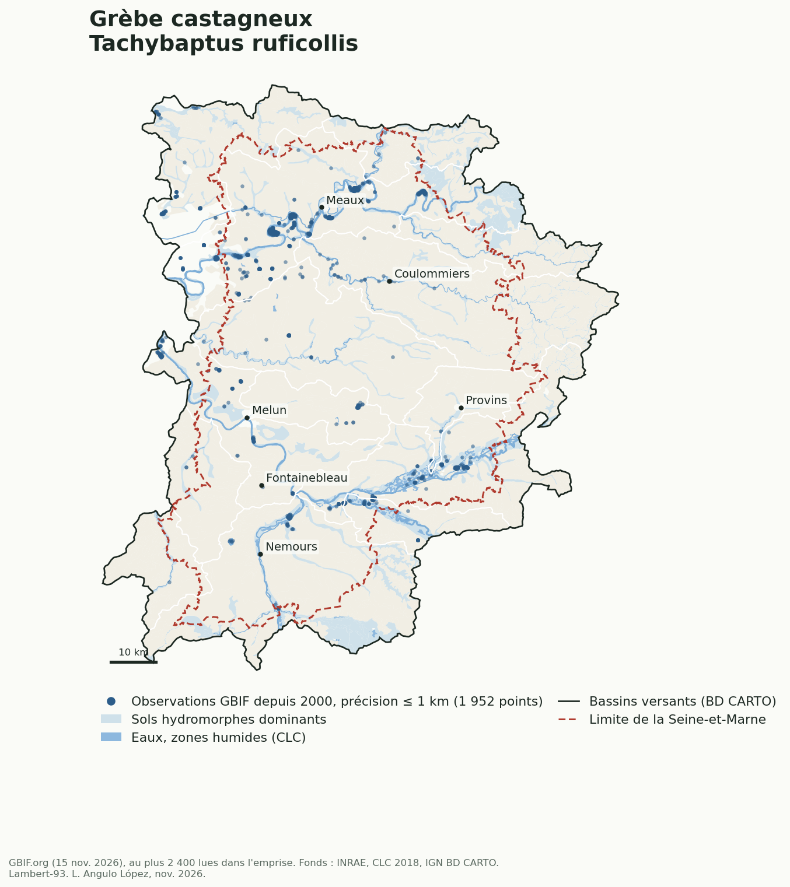

# Jour 2, oiseau : le grèbe castagneux en novembre

**Grèbe castagneux**, *Tachybaptus ruficollis*. Petit grèbe rond qui plonge ; hiverne sur les étangs.

## Le récit

*Où les grèbes castagneux de Seine-et-Marne passent-ils l'hiver ?*

Le grèbe castagneux (Tachybaptus ruficollis) est le plus petit grèbe d'Europe, un oiseau rond et brun qui plonge et réapparaît quelques mètres plus loin. En novembre, il quitte les petites mares où il a niché et se regroupe sur les eaux libres qui ne gèlent pas : les plans d'eau de gravières de la Bassée, les boucles de la Marne près de Meaux et les étangs du Loing. Le GBIF compte 11 208 observations de l'espèce dans le département depuis 2000, dont 1 129 faites en novembre.

Il se nourrit de ce qui vit sous la surface : larves d'insectes, petits poissons, têtards. C'est donc le signe d'un étang vivant jusque dans sa vase. Beaucoup des lacs où il hiverne existent parce que les alluvions de la Seine et de la Marne ont été creusées pour le granulat ; une fois les fosses en eau et leurs berges couvertes de roseaux, elles sont redevenues des zones humides.

## Valeur culturelle et statut

**Nom et culture.** *Castagneux* vient du moyen français *castaign*, châtain, « à cause de la couleur de cet oiseau » (écrit *castaigneux* par Pierre Belon en 1555). En anglais, on l'appelle aussi *dabchick*. Les grèbes construisent des nids flottants de plantes aquatiques, et les poussins voyagent souvent sur le dos d'un parent.

**Statut.** Préoccupation mineure (LC) sur la Liste rouge de l'UICN. Protégé en France, comme tous les grèbes, par la liste des oiseaux protégés sur l'ensemble du territoire (arrêté du 29 octobre 2009). Commun, mais lié aux étangs à l'eau claire et aux berges végétalisées.

## Sources des faits

(i) GBIF.org, recherche d'occurrences, 15 nov. 2026 : *Tachybaptus ruficollis* (taxon 2482048) en Seine-et-Marne (GADM FRA.8.4_1), avec coordonnées, 2000 à 2026 : 11 208 observations, dont 1 129 en novembre. La carte montre les observations depuis 2000 localisées à 1 km près ou mieux.

(ii) Nom : [CNRTL, étymologie de *castagneux*](https://www.cnrtl.fr/etymologie/castagneux) (Trésor de la langue française).

(iii) Statut : catégorie UICN via l'API espèces du GBIF, 15 nov. 2026 ; protection : [arrêté du 29 octobre 2009 fixant la liste des oiseaux protégés](https://aida.ineris.fr/reglementation/arrete-291009-fixant-liste-oiseaux-proteges-lensemble-territoire-modalites).

(iv) Gravières et sites d'hivernage : cartes d'occupation du sol et GBIF de ce site, voir [Végétation](../vegetation.md) et [Espèces](../species.md).
