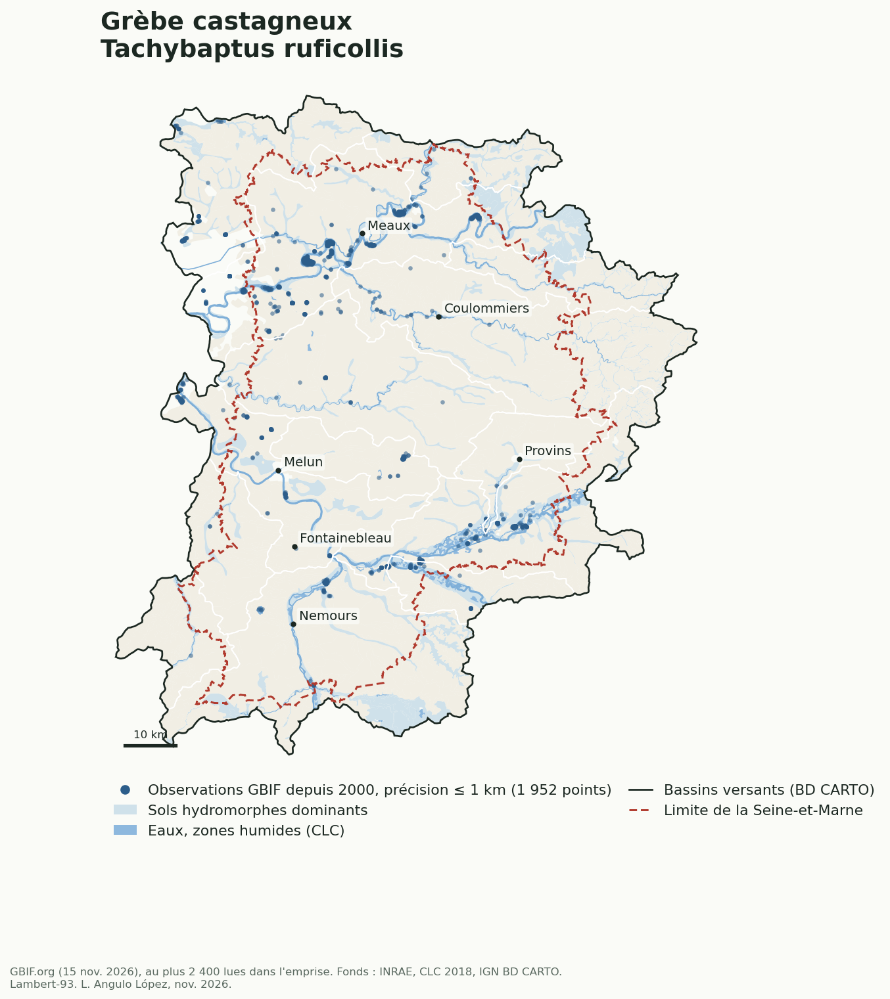

# Day 2, bird: the little grebe in November

**Grèbe castagneux**, little grebe, *Tachybaptus ruficollis*. Petit grèbe rond qui plonge ; hiverne sur les étangs.

## The post

> 🐦💧 Where do the little grebes of Seine-et-Marne spend the winter?
>
> The grèbe castagneux, little grebe (Tachybaptus ruficollis), is the smallest grebe in Europe, a round brown bird that dives and comes up a few metres further on. In November it leaves the small ponds where it nested and gathers on open water that stays free of ice: the gravel-pit lakes of the Bassée, the loops of the Marne near Meaux and the ponds of the Loing. GBIF holds 11,208 records of the species in the department since 2000, and 1,129 of them were made in November.
>
> It feeds on what lives under the surface: insect larvae, small fish, tadpoles. That makes it a good sign of a pond with life in its mud. Many of the lakes where it winters exist because the alluvium of the Seine and the Marne was dug for gravel; once the pits filled with water and their banks grew reeds, they became wetlands again.
>
> Day 2 of a week on the wetlands of Seine-et-Marne as winter sets in: a plant, a bird, an insect, an animal and a soil, then the whole ecosystem on Saturday.
>
> Maps and sources: 👉 https://lindangulopez.github.io/wetlands-seine-et-marne/story/day-2-little-grebe/
>
> #ZonesHumides #Wetlands #SeineEtMarne #LittleGrebe #GrebeCastagneux #Birds #Waterbirds #LaBassee #GBIF #OpenData

**Author comment, under the post:**

> Tomorrow, one of the things it hunts: the larva of the emperor dragonfly, which spends the winter in the pond mud.
>
> Have you seen a little grebe on your local lake this month?

## Cultural value and status

**Name and culture.** *Castagneux* comes from Middle French *castaign*, chestnut-brown, "because of the colour of this bird" (first written *castaigneux* by Pierre Belon in 1555). In English it is also called the dabchick. Grebes build floating nests of water plants, and the chicks often ride on a parent's back.

**Status.** Least Concern on the IUCN Red List. Protected in France, like all grebes, under the list of birds protected on the whole national territory (arrêté of 29 October 2009). Common, but tied to ponds with clean water and vegetated banks.

## Sources for the facts

(i) GBIF.org occurrence search, 15 Nov 2026: *Tachybaptus ruficollis* (taxon 2482048) in Seine-et-Marne (GADM FRA.8.4_1), with coordinates, 2000 to 2026: 11,208 records, 1,129 in November. The map shows records since 2000 located to 1 km or better.

(ii) Name: [CNRTL, étymologie de *castagneux*](https://www.cnrtl.fr/etymologie/castagneux) (Trésor de la langue française).

(iii) Status: IUCN category from the GBIF species API, 15 Nov 2026; protection: [arrêté du 29 octobre 2009 fixant la liste des oiseaux protégés](https://aida.ineris.fr/reglementation/arrete-291009-fixant-liste-oiseaux-proteges-lensemble-territoire-modalites).

(iv) Gravel-pit lakes and wintering sites: the land cover and GBIF maps of this site, see [Vegetation](../vegetation.md) and [Species](../species.md).
