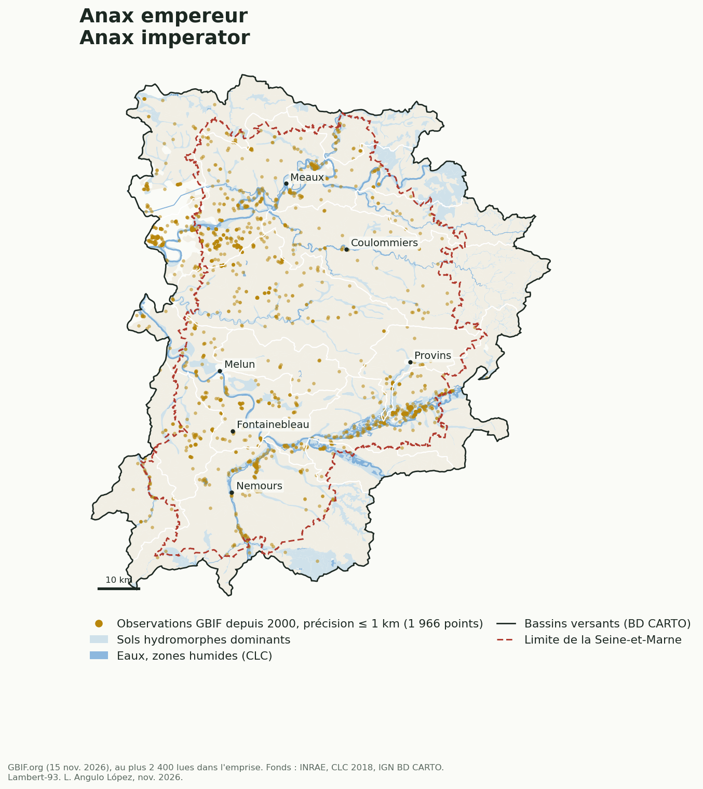

# Jour 3, insecte : l'anax empereur en novembre

**Anax empereur**, *Anax imperator*.

## Le post

> 🐉💧 Où est une libellule en novembre ?
>
> L'anax empereur (Anax imperator) est l'une des plus grandes libellules d'Europe, bleue et verte, qui patrouille au-dessus des mares de la fin du printemps au début de l'automne. Le GBIF en compte 5 151 observations en Seine-et-Marne depuis 2000 : presque toutes entre mai et septembre, et aucune en novembre. Les adultes sont morts. L'espèce passe l'hiver à l'état de larve au fond des mares, où dans le nord de son aire la plupart mettent deux ans à grandir.
>
> La larve est une chasseuse. Elle attend dans la vase et les herbiers, et projette une lèvre inférieure articulée pour saisir larves d'insectes, têtards et petits poissons. À la fin du printemps, elle grimpe hors de l'eau le long d'un roseau ou d'une tige restée debout, et l'adulte sort de sa peau de larve. Il faut à une mare de l'eau claire, des plantes aquatiques et de hautes tiges sur ses berges pour tout le cycle : c'est pourquoi les libellules servent à lire l'état d'une zone humide.
>
> Jour 3 d'une semaine sur les zones humides de Seine-et-Marne à l'entrée de l'hiver : une plante, un oiseau, un insecte, un animal et un sol, puis tout l'écosystème samedi.
>
> Cartes et sources : 👉 https://lindangulopez.github.io/wetlands-seine-et-marne/fr/story/day-3-emperor-dragonfly/
>
> #ZonesHumides #SeineEtMarne #Libellules #Odonates #AnaxImperator #Insectes #Biodiversite #Novembre #GBIF #DonneesOuvertes

**Commentaire de l'autrice, sous le post :**

> Demain, un animal dont les têtards partagent ces mares avec les larves de libellules : la grenouille agile.
>
> Saviez-vous que les libellules de l'été passent l'essentiel de leur vie sous l'eau ?

## Valeur culturelle et statut

**Nom et culture.** *Anax* signifie seigneur ou roi en grec, et *imperator* empereur en latin : un double titre pour la plus grande libellule que l'on croise au bord d'une mare. Les libellules ont de vieux noms populaires en français comme en anglais ; elles sont aujourd'hui un sujet favori des photographes naturalistes et des sciences participatives, et l'observatoire des odonates de GeoNat'îdF en collecte les observations en Île-de-France.

**Statut.** Préoccupation mineure (LC) sur la Liste rouge de l'UICN et sur la Liste rouge des libellules de France métropolitaine (2016). Non protégée. Commune, mais ses larves ont besoin de mares sans empoissonnement et avec des herbiers.

## Sources des faits

(i) GBIF.org, recherche d'occurrences, 15 nov. 2026 : *Anax imperator* (taxon 5051775) en Seine-et-Marne (GADM FRA.8.4_1), avec coordonnées, 2000 à 2026 : 5 151 observations ; par mois, 5 024 de mai à septembre et aucune en novembre. La carte montre les observations depuis 2000 localisées à 1 km près ou mieux.

(ii) Cycle larvaire de deux ans dans les populations du nord : étude des larves d'*Anax imperator* en France, *European Journal of Entomology* 2019 ([eje.cz](https://www.eje.cz/pdfs/eje/2019/01/31.pdf)), d'après Corbet (2006).

(iii) Statut : catégorie UICN via l'API espèces du GBIF, 15 nov. 2026 ; [Liste rouge des libellules de France métropolitaine (2016)](https://odonates.pnaopie.fr/wp-content/uploads/2013/01/Tableau_Liste_rouge_Libellules_de_France_metropolitaine.pdf) ; [réserves naturelles de Strasbourg, anax empereur](https://reserves-naturelles.strasbourg.eu/en/rohrschollen-island/discover/emperor-dragonfly/).
