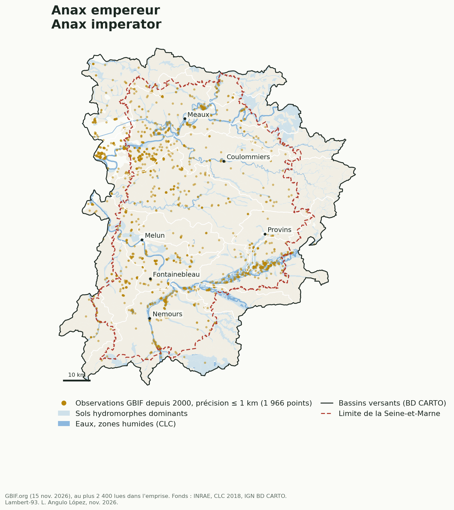

# Day 3, insect: the emperor dragonfly in November

**Anax empereur**, emperor dragonfly, *Anax imperator*.

## The post

> 🐉💧 Where is a dragonfly in November?
>
> The anax empereur, emperor dragonfly (Anax imperator), is one of the largest dragonflies in Europe, blue and green, patrolling ponds from late spring to early autumn. GBIF holds 5,151 records of it in Seine-et-Marne since 2000: almost all between May and September, and not one in November. By now the adults are dead. The species lives on as larvae at the bottom of ponds, where in the north of its range most take two years to grow.
>
> The larva is a hunter. It waits in the mud and the water plants, and shoots out a hinged lower lip to catch insect larvae, tadpoles and small fish. In late spring it climbs a reed or a standing stem out of the water and the adult breaks free of its larval skin. A pond needs clean water, water plants and tall stems on its banks for the whole cycle, which is why dragonflies are used to read the state of a wetland.
>
> Day 3 of a week on the wetlands of Seine-et-Marne as winter sets in: a plant, a bird, an insect, an animal and a soil, then the whole ecosystem on Saturday.
>
> Maps and sources: 👉 https://lindangulopez.github.io/wetlands-seine-et-marne/story/day-3-emperor-dragonfly/
>
> #ZonesHumides #Wetlands #SeineEtMarne #Dragonflies #Odonata #AnaxImperator #Insects #Biodiversity #GBIF #OpenData

**Author comment, under the post:**

> Tomorrow, an animal whose tadpoles share these ponds with the dragonfly larvae: the agile frog.
>
> Did you know the dragonflies of summer spend most of their lives under water?

## Cultural value and status

**Name and culture.** *Anax* is Greek for lord or king, and *imperator* Latin for emperor: a double title for the largest dragonfly most people meet at a pond. In French as in English, dragonflies carry old folk names; today they are a favourite of nature photographers and of citizen science, and the Île-de-France observatory of dragonflies on GeoNat'îdF collects records.

**Status.** Least Concern on the IUCN Red List and on the Red List of dragonflies of mainland France (2016). Not protected. Common, but its larvae need ponds without fish stocking and with water plants.

## Sources for the facts

(i) GBIF.org occurrence search, 15 Nov 2026: *Anax imperator* (taxon 5051775) in Seine-et-Marne (GADM FRA.8.4_1), with coordinates, 2000 to 2026: 5,151 records; by month, 5,024 from May to September and none in November. The map shows records since 2000 located to 1 km or better.

(ii) Two-year larval cycle in northern populations: study of *Anax imperator* larvae in France, *European Journal of Entomology* 2019 ([eje.cz](https://www.eje.cz/pdfs/eje/2019/01/31.pdf)), citing Corbet (2006).

(iii) Status: IUCN category from the GBIF species API, 15 Nov 2026; [Liste rouge des libellules de France métropolitaine (2016)](https://odonates.pnaopie.fr/wp-content/uploads/2013/01/Tableau_Liste_rouge_Libellules_de_France_metropolitaine.pdf); [Strasbourg nature reserves, emperor dragonfly](https://reserves-naturelles.strasbourg.eu/en/rohrschollen-island/discover/emperor-dragonfly/).
