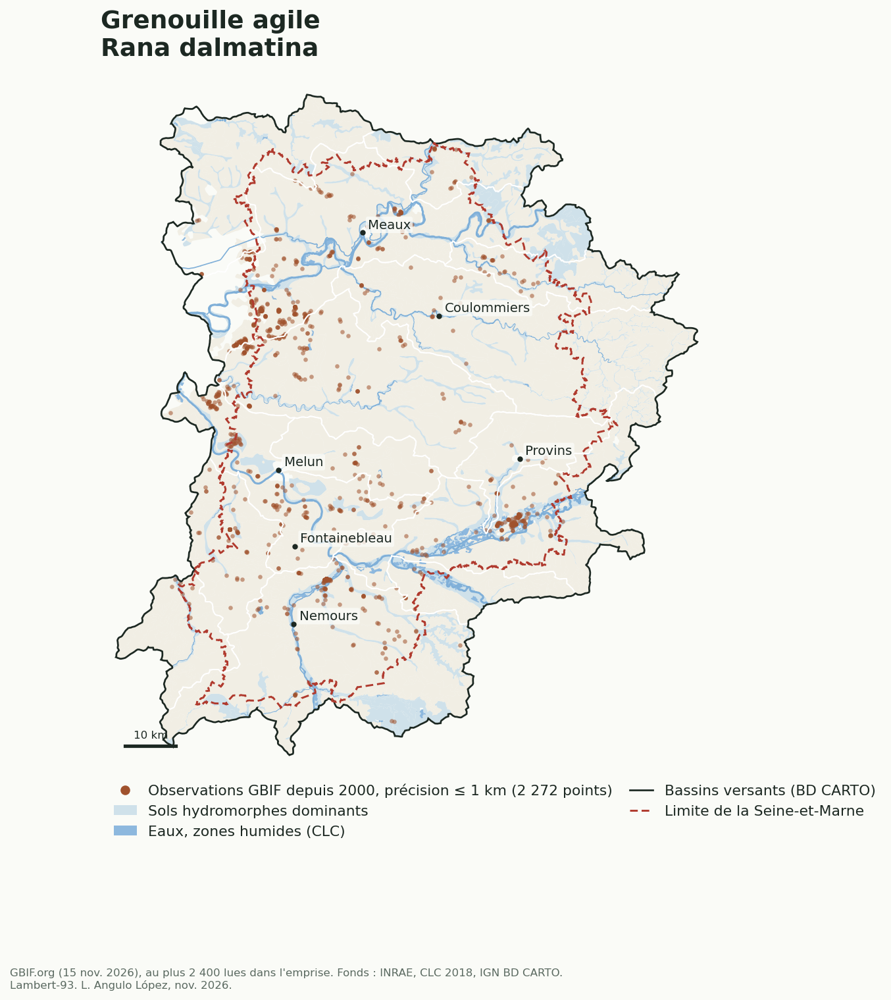

# Jour 4, animal : la grenouille agile en novembre

**Grenouille agile**, *Rana dalmatina*.

## Le post

> 🐸🍂 Pourquoi voit-on si peu de grenouilles en novembre ?
>
> La grenouille agile (Rana dalmatina) est une grenouille brune et élancée des bois humides, aux pattes arrière très longues ; elle peut sauter jusqu'à deux mètres. En novembre, elle gagne son abri d'hiver, dans la litière de feuilles, sous une souche ou au fond d'une mare, et disparaît presque des observations. Le GBIF en compte 7 414 en Seine-et-Marne depuis 2000 : seulement 10 en novembre, mais 70 % en février et mars, quand elle revient parmi les premiers amphibiens pondre dans les mares.
>
> Elle pond ses œufs en amas fixés aux brindilles et aux tiges sous l'eau, dans les mêmes mares où chassent les larves de libellules d'hier et où se nourrissent les grèbes castagneux. Il lui faut deux milieux à quelques centaines de mètres l'un de l'autre, un bois et une mare, et le chemin entre les deux. Mares drainées, fossés comblés et routes fréquentées coupent ce chemin : c'est pourquoi l'espèce est protégée en France.
>
> Jour 4 d'une semaine sur les zones humides de Seine-et-Marne à l'entrée de l'hiver : une plante, un oiseau, un insecte, un animal et un sol, puis tout l'écosystème samedi.
>
> Cartes et sources : 👉 https://lindangulopez.github.io/wetlands-seine-et-marne/fr/story/day-4-agile-frog/
>
> #ZonesHumides #SeineEtMarne #Amphibiens #GrenouilleAgile #RanaDalmatina #Mares #Biodiversite #Novembre #GBIF #DonneesOuvertes

**Commentaire de l'autrice, sous le post :**

> Demain, ce qui garde toutes ces mares et ces berges humides : les sols des vallées.
>
> Savez-vous où les grenouilles traversent la route près de chez vous en février ?

## Valeur culturelle et statut

**Culture.** La grenouille agile fait partie des amphibiens que des bénévoles aident à traverser les routes lors des migrations de fin d'hiver, une porte d'entrée fréquente vers la protection de la nature. Dans les îles Britanniques, l'espèce ne survit qu'à Jersey, où elle fait l'objet d'un long programme de restauration.

**Statut.** Préoccupation mineure (LC) sur la Liste rouge de l'UICN. Protégée en France, avec son habitat, par l'article 2 de l'arrêté du 8 janvier 2021 sur les amphibiens et reptiles protégés, et inscrite à l'annexe IV de la directive Habitats de l'UE (protection stricte). En danger critique sur la Liste rouge de Grande-Bretagne.

## Sources des faits

(i) GBIF.org, recherche d'occurrences, 15 nov. 2026 : *Rana dalmatina* (taxon 2426760) en Seine-et-Marne (GADM FRA.8.4_1), avec coordonnées, 2000 à 2026 : 7 414 observations ; par mois, 1 313 en février, 3 867 en mars, 10 en novembre. La carte montre les observations depuis 2000 localisées à 1 km près ou mieux.

(ii) Biologie (sauts jusqu'à deux mètres, pontes fixées aux branches et tiges immergées, ponte en mars en Europe centrale ; LC, en danger critique en Grande-Bretagne) : [Agile frog, Wikipédia en anglais](https://en.wikipedia.org/wiki/Agile_frog), lu le 15 nov. 2026.

(iii) Protection en France : [arrêté du 8 janvier 2021, article 2, Légifrance](https://www.legifrance.gouv.fr/jorf/article_jo/JORFARTI000043113968).
