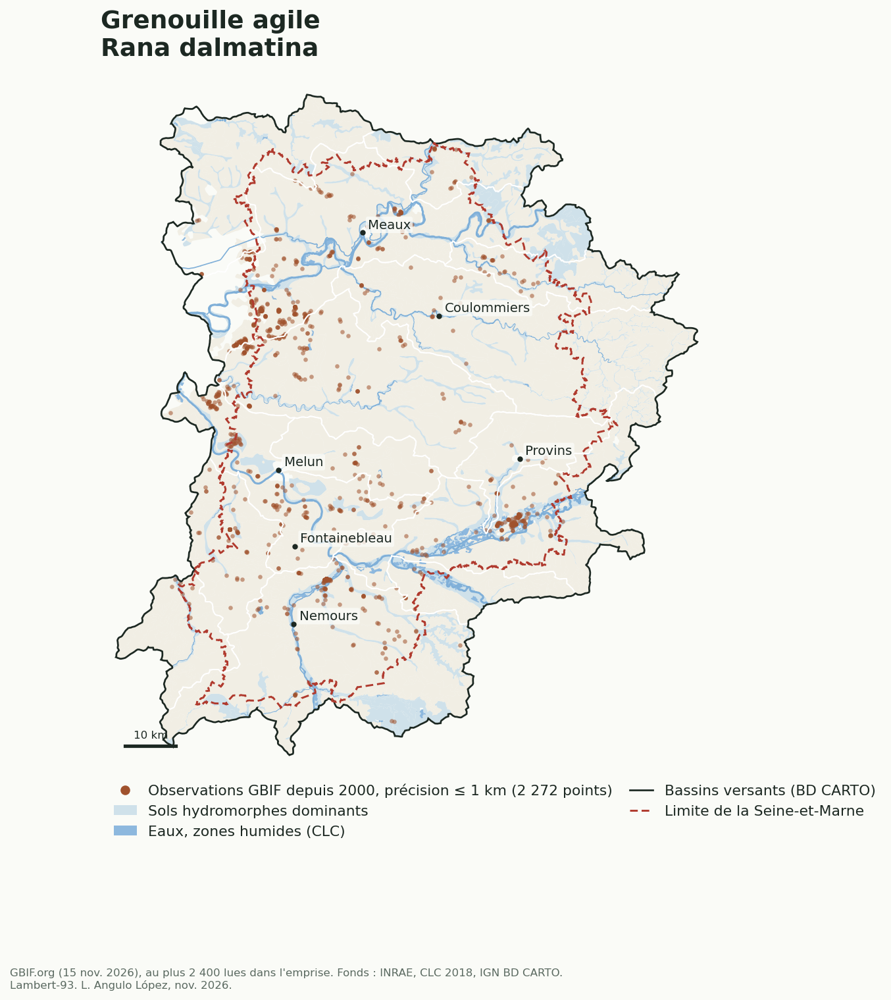

# Day 4, animal: the agile frog in November

**Grenouille agile**, agile frog, *Rana dalmatina*.

## The story

*Why do we see so few frogs in November?*

The grenouille agile, agile frog (Rana dalmatina), is a slim brown frog of damp woods with very long hind legs; it can jump up to two metres. In November it settles into its winter shelter, in the leaf litter, under logs or at the bottom of a pond, and almost disappears from the records. GBIF holds 7,414 records of it in Seine-et-Marne since 2000: only 10 in November, but 70 % in February and March, when it is among the first amphibians back at the ponds to spawn.

It lays its eggs in clumps fixed to twigs and stems under water, in the same ponds where the dragonfly larvae of yesterday's story hunt and where the little grebes feed. It needs two habitats a few hundred metres apart, a wood and a pond, and the path between them. Drained ponds, filled ditches and busy roads cut that path, which is why the species is protected in France.

## Cultural value and status

**Culture.** Agile frogs are among the amphibians that volunteers help across roads during the spring migrations, one of the most common entries into nature conservation for many people. In the British Isles the species survives only in Jersey, where it is the subject of a long-running recovery programme.

**Status.** Least Concern on the IUCN Red List. Protected in France, with its habitat, under article 2 of the arrêté of 8 January 2021 on protected amphibians and reptiles, and listed in Annex IV of the EU Habitats Directive (strict protection). On the Great Britain Red List it is Critically Endangered.

## Sources for the facts

(i) GBIF.org occurrence search, 15 Nov 2026: *Rana dalmatina* (taxon 2426760) in Seine-et-Marne (GADM FRA.8.4_1), with coordinates, 2000 to 2026: 7,414 records; by month, 1,313 in February, 3,867 in March, 10 in November. The map shows records since 2000 located to 1 km or better.

(ii) Biology (jumps up to two metres, egg clumps on submerged branches and stems, spawning in March in Central Europe; Least Concern, Critically Endangered on the Great Britain Red List): [Agile frog, Wikipedia](https://en.wikipedia.org/wiki/Agile_frog), read 15 Nov 2026.

(iii) Protection in France: [arrêté du 8 janvier 2021, article 2, Légifrance](https://www.legifrance.gouv.fr/jorf/article_jo/JORFARTI000043113968).
