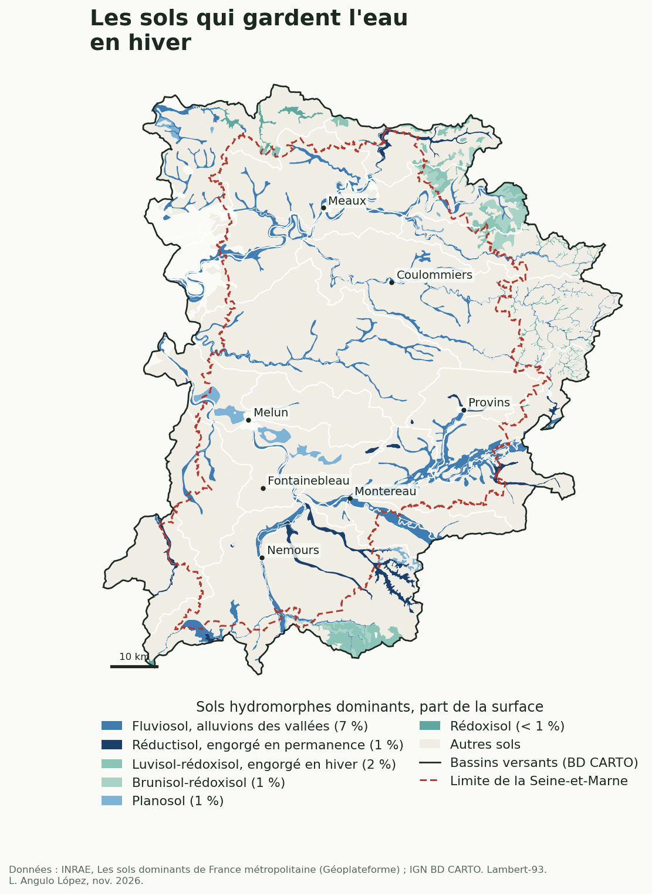

# Jour 5, sol : les sols humides des vallées en novembre

**Fluviosols, réductisols et rédoxisols**, les sols hydromorphes des vallées.

## Le récit

*À quoi ressemble une zone humide sous terre ?*

Plantez une tarière dans un fond de vallée de Seine-et-Marne en novembre, et le sol vous dit combien de temps il reste mouillé. Des taches couleur rouille : la nappe monte et descend, le fer se dissout puis s'oxyde à nouveau, c'est un rédoxisol. Une terre gris-bleu près de la surface : l'eau ne part presque jamais, le fer reste réduit, c'est un réductisol. Avec les pluies d'automne, la nappe remonte en ce moment, et ce sont ces marques que lisent botanistes et pédologues. Dans les bassins versants qui drainent le département, ces sols dominent 12,3 % de la surface : fluviosols des alluvions 7 %, réductisols 1 %, surtout le long du Loing, du Lunain, de l'Orvanne et dans la Bassée.

En droit français, le sol suffit à faire une zone humide, même sans plantes de zones humides : végétation ou sol, un seul critère suffit (Code de l'environnement, article L.211-1). Ces sols gardent l'eau en hiver et la rendent lentement en été, et ils portent les mégaphorbiaies, les mares et les aulnaies de toute la semaine. Les mêmes alluvions ont aussi été creusées pour le granulat, et les fosses sont devenues les plans d'eau où hivernent les grèbes castagneux.

## Valeur culturelle et statut

**Culture.** Les sols de vallée ont façonné l'usage des terres depuis des siècles : prés de fauche et pâturage sur les alluvions, puis extraction de granulats pour la construction, surtout dans la Bassée, et aujourd'hui les plans d'eau laissés derrière, pour la pêche et l'observation des oiseaux.

**Statut.** Les sols n'ont pas de liste rouge, mais en France ils ont un poids juridique. Une zone humide peut être délimitée sur son seul sol (loi du 24 juillet 2019 rétablissant les critères alternatifs de l'article L.211-1), selon les classes de sols fixées par l'arrêté du 24 juin 2008 (modifié en 2009) : histosols, réductisols, et rédoxisols aux traces de rouille proches de la surface.

## Sources des faits

(i) Parts de sols : INRAE, *Les sols dominants de France métropolitaine*, découpée aux 14 bassins ; voir [Sols](../soils.md) et [Bassins versants](../catchments.md).

(ii) Critères et classes de sols : Code de l'environnement, article L.211-1 (modifié par la loi du 24 juillet 2019), et arrêté du 24 juin 2008 modifié le 1er octobre 2009, annexe I.

(iii) Plans d'eau de gravières de la Bassée et de la Marne : CORINE Land Cover 2018 sur ce site ([Végétation](../vegetation.md)).
