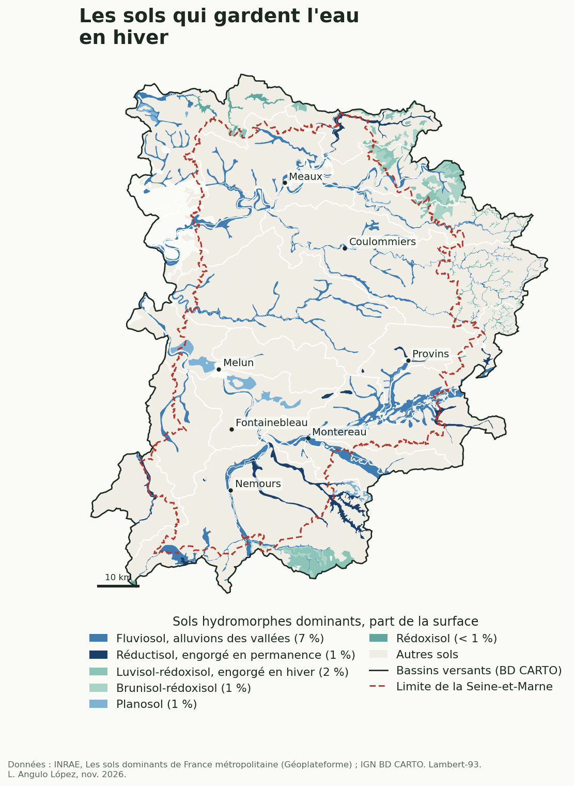

# Day 5, soil: the wet soils of the valleys in November

**Fluviosols, réductisols and rédoxisols**, the hydromorphic soils of the valleys.

## The post

> 🟫💧 What does a wetland look like underground?
>
> Dig an auger into a valley floor in Seine-et-Marne in November and the soil tells you how long it stays wet. Rust-coloured spots mean the water table rises and falls, so iron is dissolved and then oxidised again: a rédoxisol. Grey-blue earth near the surface means water that rarely leaves, so iron stays reduced: a réductisol. With autumn rain the water table is rising now, and these marks are what botanists and soil scientists read. In the catchments that drain the department, soils of this kind dominate 12.3 % of the area: fluviosols on river alluvium 7 %, réductisols 1 %, mostly along the Loing, the Lunain, the Orvanne and the Bassée.
>
> In French law the soil is enough to make a wetland, even without wetland plants: vegetation or soil, one criterion is enough (Code de l'environnement, article L.211-1). These soils hold water in winter and give it back slowly in summer, and they carry the mégaphorbiaies, the ponds and the alder woods of the whole week. The same alluvium has also been dug for gravel, and the pits became the lakes where the little grebes winter.
>
> Day 5 of a week on the wetlands of Seine-et-Marne as winter sets in: a plant, a bird, an insect, an animal and a soil, then the whole ecosystem tomorrow.
>
> Maps and sources: 👉 https://lindangulopez.github.io/wetlands-seine-et-marne/story/day-5-wet-soils/
>
> #ZonesHumides #Wetlands #SeineEtMarne #Soils #SoilScience #Pedology #WaterTable #INRAE #OpenData #GIS

**Author comment, under the post:**

> The French method reads the soil to about 1.20 m with an auger; rust marks that start within 25 cm of the surface and continue down are a wetland sign.
>
> Have you ever seen a grey-blue soil come up on an auger?

## Cultural value and status

**Culture.** Valley soils have shaped land use for centuries: hay meadows and grazing on the alluvium, then gravel extraction for building, especially in the Bassée, and today the lakes left behind, used for fishing and birdwatching.

**Status.** Soils have no red list, but in France they carry legal weight. A wetland can be delimited on its soil alone (law of 24 July 2019 restoring the alternative criteria in article L.211-1), following the soil classes set by the arrêté of 24 June 2008 (modified 2009): histosols, réductisols, and rédoxisols with rust marks close to the surface.

## Sources for the facts

(i) Soil shares: INRAE, *Les sols dominants de France métropolitaine*, clipped to the 14 catchments; see [Soils](../soils.md) and [Catchments](../catchments.md).

(ii) Wetland criteria and soil classes: Code de l'environnement, article L.211-1 (as amended by the law of 24 July 2019), and the arrêté of 24 June 2008 modified on 1 October 2009, annex I.

(iii) Gravel-pit lakes of the Bassée and the Marne: CORINE Land Cover 2018 on this site ([Vegetation](../vegetation.md)).
