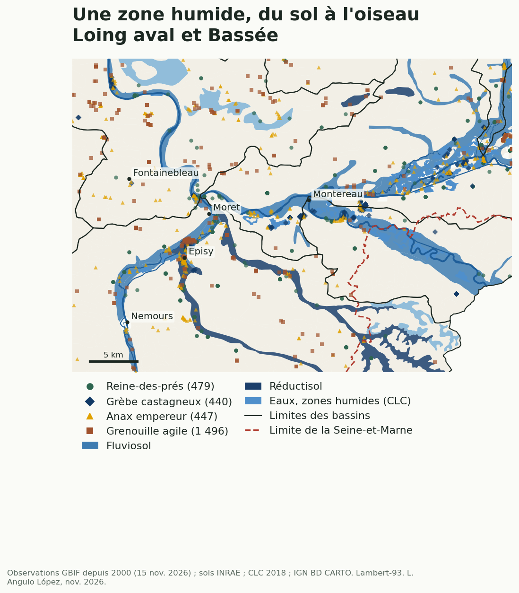

# Jour 6, écosystème : une zone humide, du sol à l'oiseau

**Le Loing aval et la Bassée en novembre**, cinq pièces d'une même zone humide.

## Le récit

*Qu'est-ce qui tient une zone humide ensemble en novembre ?*

Cette semaine, j'ai suivi une zone humide de Seine-et-Marne à l'entrée de l'hiver, pièce par pièce. Dessous, le sol : fluviosols et réductisols qui se gorgent d'eau quand les pluies d'automne font monter la nappe. Sur les berges, la mégaphorbiaie et son espèce phare, la reine-des-prés, aujourd'hui des tiges brunes qui resteront debout tout l'hiver. Dans les mares, les larves de l'anax empereur qui chassent dans la vase. Dans les bois voisins, les grenouilles agiles qui attendent de pondre dans ces mêmes mares en février. Sur l'eau libre, les grèbes castagneux qui plongent pour les larves et les petits poissons. Autour d'Episy et de Moret, là où se rejoignent le Loing, le Lunain et la Seine, le GBIF compte des observations des quatre espèces à quelques kilomètres les unes des autres.

Chaque pièce dépend des autres. Drainez le sol, et les hautes herbes laissent place aux cultures ; fauchez les tiges chaque année, et la libellule n'a plus rien où grimper pour sortir de l'eau ; comblez la mare, et la grenouille n'a plus où pondre, ni le grèbe de quoi manger. Aucune de ces espèces n'est rare ni menacée sur la Liste rouge de l'UICN, mais la grenouille et le grèbe sont protégés, et les habitats qu'ils partagent couvrent une petite part de bassins où les terres arables occupent 58,7 % de la surface. Une zone humide se lit bassin versant par bassin versant, parce que ce qui se passe en amont arrive ici.

## Valeur culturelle et statut

**Ce que montre la semaine.** Sur les cinq pièces, deux espèces sont protégées en France (la grenouille agile, avec son habitat, et le grèbe castagneux), et les trois autres sont communes et en préoccupation mineure. L'habitat qui les relie, la mégaphorbiaie, est inscrit à l'annexe I de la directive Habitats (6430), et les sites Natura 2000 couvrent 8,6 % des bassins, surtout en forêt de Fontainebleau et dans la Bassée.

| Pièce | Espèce ou objet | Statut |
| --- | --- | --- |
| Habitat | Mégaphorbiaie, 6430 | Annexe I, directive Habitats |
| Plante | Reine-des-prés, *Filipendula ulmaria* | LC, non protégée |
| Oiseau | Grèbe castagneux, *Tachybaptus ruficollis* | LC, protégé en France (2009) |
| Insecte | Anax empereur, *Anax imperator* | LC (monde et France), non protégé |
| Animal | Grenouille agile, *Rana dalmatina* | LC, protégée en France (2021), annexe IV |
| Sol | Fluviosols, réductisols, rédoxisols | Critère réglementaire des zones humides, L.211-1 |

## Sources des faits

(i) Chaque fait sur les espèces et les sols : voir les sources sous le [jour 1](day-1-meadowsweet.md), le [jour 2](day-2-little-grebe.md), le [jour 3](day-3-emperor-dragonfly.md), le [jour 4](day-4-agile-frog.md), le [jour 5](day-5-wet-soils.md) et le [récit sur l'habitat](megaphorbiaie.md).

(ii) La carte : observations GBIF depuis 2000 (15 nov. 2026) des quatre espèces dans la fenêtre du Loing aval et de la Bassée, sur les sols de l'INRAE et les plans d'eau de CORINE.

(iii) Parts d'occupation du sol et de Natura 2000 : [Bassins versants](../catchments.md) et [Végétation](../vegetation.md).
