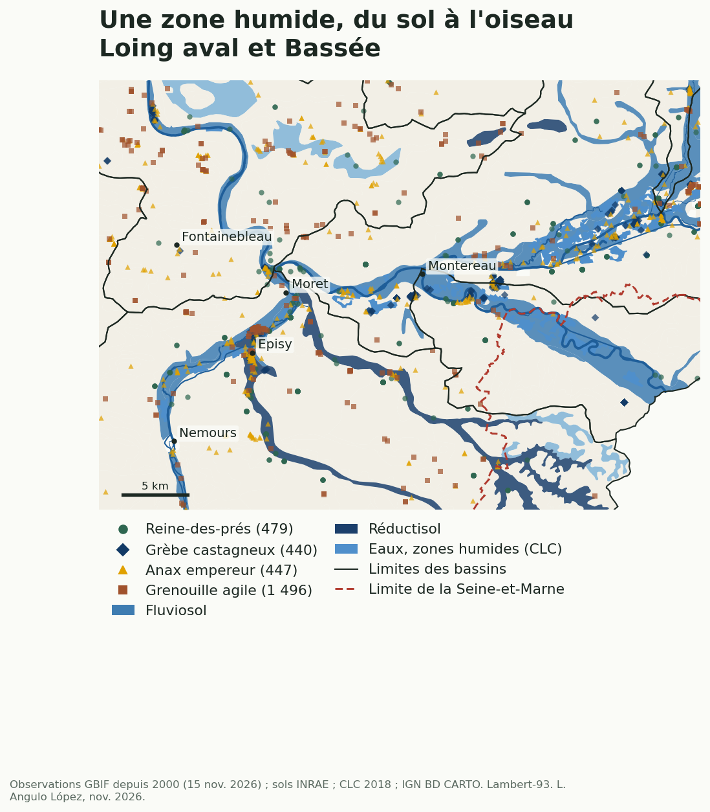

# Day 6, ecosystem: one wetland, from soil to bird

**The lower Loing and the Bassée in November**, five pieces of one wetland.

## The story

*What holds a wetland together in November?*

Each piece depends on the others. Drain the soil and the tall herbs give way to crops; cut the stems every year and the dragonfly has nothing to climb out on; fill the pond and the frog has nowhere to spawn and the grebe nothing to eat. None of these species is rare or threatened on the IUCN Red List, but the frog and the grebe are protected, and the habitats they share cover a small part of catchments where arable land takes 58.7 % of the area. A wetland is read catchment by catchment, because what happens upstream arrives here.

## Cultural value and status

**What the week shows.** Of the five pieces, two species are protected in France (the agile frog, with its habitat, and the little grebe), and the other three species are common and Least Concern. The habitat that links them, the mégaphorbiaie, is listed in Annex I of the EU Habitats Directive (6430), and Natura 2000 sites cover 8.6 % of the catchments, concentrated in the Fontainebleau forest and the Bassée.

| Piece | Species or object | Status |
| --- | --- | --- |
| Habitat | Mégaphorbiaie, 6430 | Annex I, EU Habitats Directive |
| Plant | Meadowsweet, *Filipendula ulmaria* | Least Concern, not protected |
| Bird | Little grebe, *Tachybaptus ruficollis* | Least Concern, protected in France (2009) |
| Insect | Emperor dragonfly, *Anax imperator* | Least Concern (world and France), not protected |
| Animal | Agile frog, *Rana dalmatina* | Least Concern, protected in France (2021), Annex IV |
| Soil | Fluviosols, réductisols, rédoxisols | Legal criterion for wetlands, L.211-1 |

## Sources for the facts

(i) Each species and soil fact: see the sources under [Day 1](day-1-meadowsweet.md), [Day 2](day-2-little-grebe.md), [Day 3](day-3-emperor-dragonfly.md), [Day 4](day-4-agile-frog.md), [Day 5](day-5-wet-soils.md) and the [habitat story](megaphorbiaie.md).

(ii) The map: GBIF records since 2000 (15 Nov 2026) for the four species in the window of the lower Loing and the Bassée, over the INRAE soils and CORINE water bodies.

(iii) Land cover and Natura 2000 shares: [Catchments](../catchments.md) and [Vegetation](../vegetation.md).
