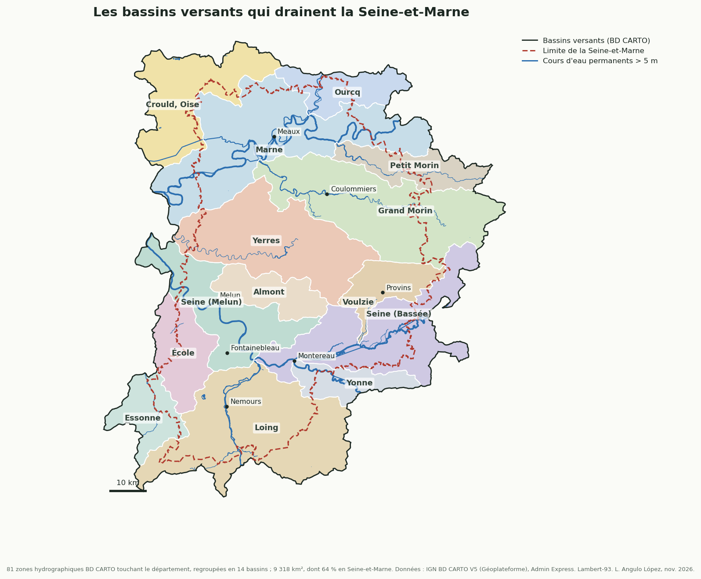

# A November week in the wetlands of Seine-et-Marne

One story a day for six days, each a piece of the same wetland as winter sets in, read catchment by catchment. Day 6 puts the pieces together into one ecosystem story. The habitat story opens the week.

| Day | Theme | Species or object | What it is doing in November |
| --- | --- | --- | --- |
| — | Habitat | Mégaphorbiaie, habitat 6430, flagship species meadowsweet | The tall-herb fringe turns to brown stems that will stand all winter. [Read the story](megaphorbiaie.md) |
| 1 | Plant | Reine-des-prés, meadowsweet, *Filipendula ulmaria* | Stems browning, seed heads ripe; they mark the mégaphorbiaie until spring. [Read the story](day-1-meadowsweet.md) |
| 2 | Bird | Grèbe castagneux, little grebe, *Tachybaptus ruficollis* | Gathering on the ponds and gravel-pit lakes of the Bassée and the Loing for the winter. [Read the story](day-2-little-grebe.md) |
| 3 | Insect | Anax empereur, emperor dragonfly, *Anax imperator* | The adults are gone; the larvae hunt in the pond mud until next summer. [Read the story](day-3-emperor-dragonfly.md) |
| 4 | Animal | Grenouille agile, agile frog, *Rana dalmatina* | Settling into its winter shelter; back at the ponds to spawn from February. [Read the story](day-4-agile-frog.md) |
| 5 | Soil | Fluviosols and réductisols of the valleys | Autumn rain lifts the water table; waterlogged soils show their grey and rust marks. [Read the story](day-5-wet-soils.md) |
| 6 | Ecosystem | One wetland, from soil to bird | How the five pieces depend on each other in a catchment at the start of winter. [Read the story](day-6-ecosystem.md) |

Every story has its facts checked against a named source, listed under it.

## The four seasons

The same format, one series per season, with photos of plants, animals and fungi: [winter](winter.md) (from 21 December 2026), [spring](spring.md) (from 20 March 2027), [summer](summer.md) (from 21 June 2027) and [autumn](autumn.md) (from 23 September 2027). And a story: [mushroom hunting in the wetlands](mushrooms.md), and [four Art Nouveau posters](posters.md), one per season.

## Maps used in the series

