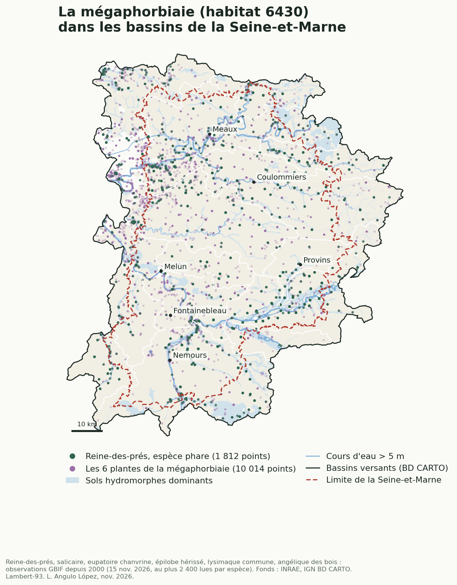

# Habitat : la mégaphorbiaie, avec la reine-des-prés pour espèce phare

**Mégaphorbiaie**, mégaphorbiaie hygrophile, habitat d'intérêt communautaire 6430. Espèce phare : **reine-des-prés**, *Filipendula ulmaria*.

## Le post

> 🌾🦋 Pourquoi une bande de hautes herbes humides compte-t-elle dans un paysage de champs ?
>
> La mégaphorbiaie est la frange de hautes herbes des sols humides, le long des rivières, des fossés et des lisières, que la directive Habitats de l'UE classe comme habitat 6430. Son espèce phare est la reine-des-prés (Filipendula ulmaria), qui pousse avec la salicaire, l'eupatoire chanvrine, l'épilobe hérissé, la lysimaque commune et l'angélique des bois. En Seine-et-Marne, le GBIF compte entre 3 477 et 6 788 observations depuis 2000 pour chacune de ces six plantes. En novembre, l'habitat devient une bande de tiges brunes qui resteront debout tout l'hiver, facile à lire depuis le chemin.
>
> La bande est étroite, souvent quelques mètres, et n'apparaît donc jamais sur les cartes d'occupation du sol, qui s'arrêtent à 25 hectares. Dans les bassins versants qui drainent le département, les terres arables couvrent 58,7 % de la surface et les sols humides n'en dominent que 12,3 %, le long des vallées. C'est là que la mégaphorbiaie tient la berge, freine le ruissellement des champs et abrite les insectes pendant l'hiver qui vient. Elle disparaît avec le drainage, avec une fauche chaque année, et sous les saules quand plus personne ne fauche, tandis que la balsamine de l'Himalaya et la renouée du Japon gagnent les berges remaniées. Aucune de ces plantes n'est menacée : la reine-des-prés est en préoccupation mineure sur la Liste rouge de l'UICN. C'est l'habitat que l'on perd.
>
> Cartes de l'habitat et sources : 👉 https://lindangulopez.github.io/wetlands-seine-et-marne/fr/story/megaphorbiaie/
>
> #ZonesHumides #SeineEtMarne #Megaphorbiaie #Natura2000 #Habitat6430 #ReineDesPres #FilipendulaUlmaria #Biodiversite #GBIF #DonneesOuvertes

**Commentaire de l'autrice, sous le post :**

> Les gestionnaires fauchent en général une mégaphorbiaie seulement tous les quelques ans, tard dans la saison, pour la garder ouverte sans la raser.
>
> Laquelle de ces six plantes sauriez-vous reconnaître à ses tiges d'hiver ?

## Les six plantes, observations en Seine-et-Marne depuis 2000

| Plante | Observations depuis 2000 |
| --- | ---: |
| Eupatoire chanvrine, *Eupatorium cannabinum* | 6 788 |
| Salicaire, *Lythrum salicaria* | 6 255 |
| Épilobe hérissé, *Epilobium hirsutum* | 5 389 |
| Angélique des bois, *Angelica sylvestris* | 4 949 |
| **Reine-des-prés, *Filipendula ulmaria*** | **4 656** |
| Lysimaque commune, *Lysimachia vulgaris* | 3 477 |

## Valeur culturelle et statut

**La reine-des-prés dans la culture.** Son nom anglais, *meadowsweet*, vient de l'hydromel (*mead*) : en vieil anglais *medowyrt*, « herbe à hydromel », une plante qui parfumait l'hydromel, puis la bière et le vin. On la répandait sur les sols pour son parfum, et dans les églises pour les mariages, d'où son ancien nom anglais *bridewort*. Dans les années 1830, des chimistes ont obtenu de l'acide salicylique de ses boutons floraux, et en 1899 Bayer a nommé l'aspirine d'après son ancien nom botanique, *Spiraea ulmaria*. Dans la légende galloise, Blodeuwedd est créée à partir des fleurs du chêne, du genêt et de la reine-des-prés. En France, elle se vend toujours séchée, en tisane.

**Statut.** Aucune des six plantes n'est menacée ni protégée. Cinq sont en préoccupation mineure (LC) sur la Liste rouge mondiale de l'UICN ; l'eupatoire chanvrine n'a pas été évaluée. Aucune ne figure sur la liste des plantes déterminantes de ZNIEFF en Île-de-France. Ce qui est menacé, c'est l'habitat : drainage, fauche annuelle, abandon aux saules et espèces envahissantes.

| Plante | Liste rouge UICN (monde) | Déterminante ZNIEFF en Île-de-France |
| --- | --- | --- |
| Reine-des-prés, *Filipendula ulmaria* | préoccupation mineure (LC) | non |
| Salicaire, *Lythrum salicaria* | préoccupation mineure (LC) | non |
| Eupatoire chanvrine, *Eupatorium cannabinum* | non évaluée | non |
| Épilobe hérissé, *Epilobium hirsutum* | préoccupation mineure (LC) | non |
| Lysimaque commune, *Lysimachia vulgaris* | préoccupation mineure (LC) | non |
| Angélique des bois, *Angelica sylvestris* | préoccupation mineure (LC) | non |

Par contraste, la sabline à grandes fleurs de Fontainebleau, *Arenaria grandiflora* : extrêmement rare (RRR) et protégée en Île-de-France, préoccupation mineure sur la liste rouge nationale (2018) mais **en danger critique (CR)** sur la liste rouge d'Île-de-France.

## Sources des faits

(i) GBIF.org, recherche d'occurrences, 15 nov. 2026, Seine-et-Marne (GADM FRA.8.4_1), avec coordonnées, 2000 à 2026. Voir [Espèces](../species.md).

(ii) Habitat 6430, mégaphorbiaies hygrophiles : Manuel d'interprétation des habitats de l'Union européenne (Commission européenne) et *Cahiers d'habitats* Natura 2000, qui donnent aussi la gestion par fauche tardive et espacée.

(iii) Parts d'occupation du sol et de sols : CORINE Land Cover 2018 et carte des sols dominants de l'INRAE, découpées aux 14 bassins. Voir [Bassins versants](../catchments.md).

(iv) Usages culturels : [Filipendula ulmaria, Wikipédia en anglais](https://en.wikipedia.org/wiki/Filipendula_ulmaria) et [GWCT, meadowsweet](https://gwct.org.uk/wildlife/species-of-the-month/2020/meadowsweet/).

(v) Catégories UICN mondiales : API espèces du GBIF (`/species/{key}/iucnRedListCategory`), 15 nov. 2026. Statuts ZNIEFF et Île-de-France : DRIEAT Île-de-France, [*Actualisation de la liste des espèces de la flore vasculaire déterminante de ZNIEFF en Île-de-France*](https://www.drieat.ile-de-france.developpement-durable.gouv.fr/IMG/pdf/les_plantes_vasculaires_znieff_ile_de_france_2017_maj_2023.pdf), mars 2023 (liste rouge nationale UICN France et al. 2018 ; liste rouge régionale Auvert et al. 2011, Filoche 2014).
