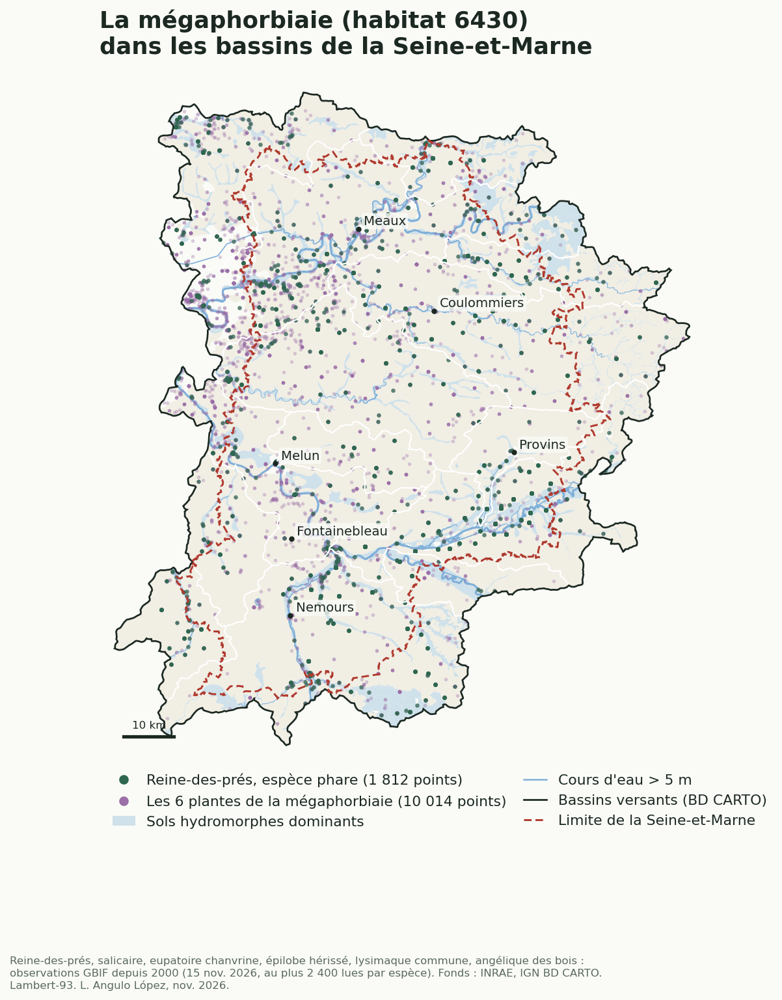

# Habitat: the mégaphorbiaie, with meadowsweet as its flagship species

**Mégaphorbiaie**, hydrophilous tall-herb fringe, EU habitat 6430. Flagship species (espèce phare): **reine-des-prés**, meadowsweet, *Filipendula ulmaria*.

## The story

*Why does a strip of tall wet grass matter in a landscape of fields?*

The mégaphorbiaie is the tall-herb fringe of wet soils along rivers, ditches and wood edges, listed by the EU Habitats Directive as habitat 6430. Its flagship species is meadowsweet, reine-des-prés (Filipendula ulmaria), growing with purple loosestrife, hemp-agrimony, great willowherb, yellow loosestrife and wild angelica. In Seine-et-Marne, GBIF holds between 3,477 and 6,788 records since 2000 for each of these six plants. In November the habitat is turning into a band of brown stems that will stand all winter, easy to read from the path.

The band is narrow, often a few metres wide, so it never shows on land cover maps, which stop at 25 hectares. In the catchments that drain the department, arable land covers 58.7 % of the area, and wet soils dominate only 12.3 %, along the valleys. That is where the mégaphorbiaie holds the bank, slows runoff from the fields and shelters insects through the coming winter. It is lost to drainage, to mowing every year, and to willow scrub when nobody mows at all, while Himalayan balsam and Japanese knotweed take over disturbed banks. None of these plants is threatened: meadowsweet is Least Concern on the IUCN Red List. It is the habitat that we lose.

## The six plants, records in Seine-et-Marne since 2000

| Plant | Records since 2000 |
| --- | ---: |
| Eupatoire chanvrine, hemp-agrimony, *Eupatorium cannabinum* | 6,788 |
| Salicaire, purple loosestrife, *Lythrum salicaria* | 6,255 |
| Épilobe hérissé, great willowherb, *Epilobium hirsutum* | 5,389 |
| Angélique des bois, wild angelica, *Angelica sylvestris* | 4,949 |
| **Reine-des-prés, meadowsweet, *Filipendula ulmaria*** | **4,656** |
| Lysimaque commune, yellow loosestrife, *Lysimachia vulgaris* | 3,477 |

## Cultural value and status

**Meadowsweet in culture.** Its English name goes back to mead: Old English *medowyrt*, "mead herb", for a plant used to flavour mead, and later also beer and wine. It was a strewing herb, spread on floors for its scent, and was strewn in churches for weddings, hence the old name bridewort. In the 1830s chemists obtained salicylic acid from its flower buds, and in 1899 Bayer named aspirin after its old botanical name, *Spiraea ulmaria*. In Welsh legend, Blodeuwedd is made from the flowers of oak, broom and meadowsweet. In France it is still sold dried as *reine-des-prés*, a herbal tea.

**Status.** None of the six plants is threatened or protected. Five are Least Concern on the IUCN Red List; hemp-agrimony has not been evaluated. None is on the list of plants that define a ZNIEFF in Île-de-France. What is threatened is the habitat, through drainage, yearly mowing, abandonment to scrub and invasive species.

| Plant | IUCN Red List (global) | ZNIEFF-determinant in Île-de-France |
| --- | --- | --- |
| Reine-des-prés, *Filipendula ulmaria* | Least Concern | no |
| Salicaire, *Lythrum salicaria* | Least Concern | no |
| Eupatoire chanvrine, *Eupatorium cannabinum* | not evaluated | no |
| Épilobe hérissé, *Epilobium hirsutum* | Least Concern | no |
| Lysimaque commune, *Lysimachia vulgaris* | Least Concern | no |
| Angélique des bois, *Angelica sylvestris* | Least Concern | no |

For contrast, the large-flowered sandwort of Fontainebleau, *Arenaria grandiflora*: extremely rare (RRR) and protected in Île-de-France, Least Concern on the French red list (2018) but **Critically Endangered** on the Île-de-France red list.

## Sources for the facts

(i) GBIF.org occurrence search, 15 Nov 2026, Seine-et-Marne (GADM FRA.8.4_1), with coordinates, 2000 to 2026. See [Species](../species.md).

(ii) Habitat 6430, hydrophilous tall herb fringe communities: Interpretation Manual of European Union Habitats (European Commission) and the French *Cahiers d'habitats* Natura 2000, which also give the management by occasional late mowing.

(iii) Land cover and soil shares: CORINE Land Cover 2018 and the INRAE dominant soils map, clipped to the 14 catchments. See [Catchments](../catchments.md).

(iv) Cultural uses: [Filipendula ulmaria, Wikipedia](https://en.wikipedia.org/wiki/Filipendula_ulmaria) and [GWCT, species of the month: meadowsweet](https://gwct.org.uk/wildlife/species-of-the-month/2020/meadowsweet/).

(v) IUCN global categories: GBIF species API (`/species/{key}/iucnRedListCategory`), 15 Nov 2026. ZNIEFF and Île-de-France statuses: DRIEAT Île-de-France, [*Actualisation de la liste des espèces de la flore vasculaire déterminante de ZNIEFF en Île-de-France*](https://www.drieat.ile-de-france.developpement-durable.gouv.fr/IMG/pdf/les_plantes_vasculaires_znieff_ile_de_france_2017_maj_2023.pdf), March 2023 (national red list UICN France et al. 2018; regional red list Auvert et al. 2011, Filoche 2014).
