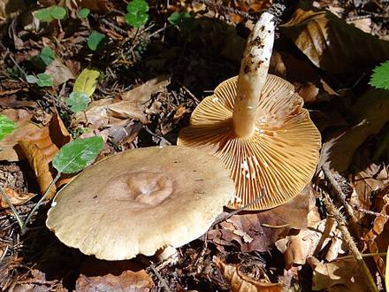
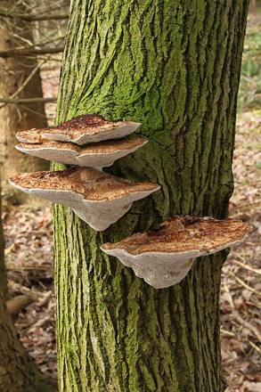
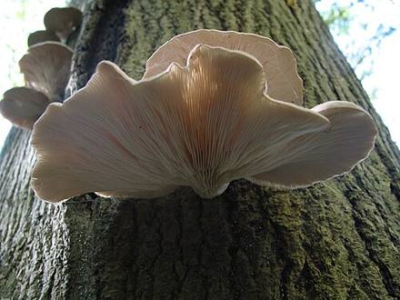
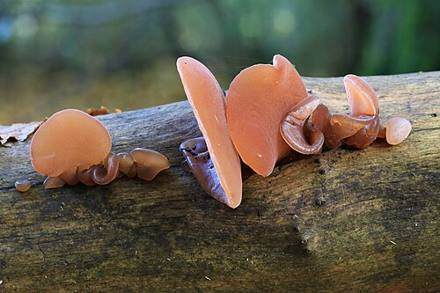
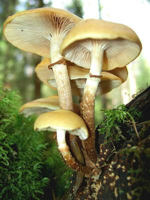
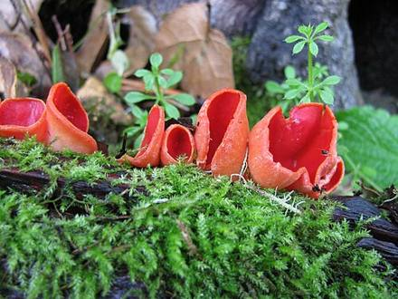

# Aux champignons dans les zones humides de Seine-et-Marne

Une balade d'octobre en fond de vallée, des saules à l'aulnaie, à lire les champignons du sol mouillé et du bois mort. Un récit pour reconnaître, pas pour la poêle.

## Le récit

Le chemin quitte le village et descend vers la rivière. Après une semaine de pluie d'octobre, le sol est mou, et la première chose qu'on remarque, c'est l'odeur : litière, écorce mouillée, déjà un peu de champignon.

Sur le premier vieux saule au bord du fossé, une rangée de consoles gris pâle sort tout droit de l'écorce : la **pleurote en huître** (*Pleurotus ostreatus*), sur ses arbres préférés, saules et peupliers. Un peu plus loin, sur une branche morte du même saule, des consoles plates au dessus zoné : frottez les pores du pouce, ils rougissent. C'est la **tramète rougissante** (*Daedaleopsis confragosa*), le champignon du saule.

Le chemin traverse une ornière où l'eau est restée tout l'été. Au bord, sous les aulnes, un petit chapeau orangé creusé au centre ; cassez-le, une goutte de lait blanc apparaît. C'est le **lactaire des flaques** (*Lactarius lacunarum*), dont le nom latin veut dire « des flaques ». Il vit avec les racines des aulnes et des saules, et ne pousse que là où le sol reste mouillé.

On entre dans l'aulnaie. Sur un sureau en lisière pendent des oreilles brunes et caoutchouteuses : l'**oreille-de-Judas** (*Auricularia auricula-judae*), présente toute l'année quand l'air est humide. Sur les souches, des touffes de chapeaux couleur miel, bicolores en séchant : la **pholiote changeante** (*Kuehneromyces mutabilis*). Ici, la balade cesse d'être un jeu. Elle pousse exactement aux mêmes endroits que la **galère marginée** (*Galerina marginata*), qui contient les mêmes toxines mortelles que l'amanite phalloïde. Chaque année en France, des personnes s'intoxiquent sur ce genre de confusion.

De retour en terrain découvert, une dernière trouvaille sur une souche en lisière : une console laquée, brillante, rouge-brun, le **ganoderme luisant** (*Ganoderma lucidum*), le reishi de la médecine traditionnelle chinoise. Il est ligneux : ce n'est pas un aliment.

Le panier reste presque vide, et c'est tout le sens de la balade. Dans une zone humide, les champignons font le travail lent : ils ramollissent les feuilles tombées dans les ruisseaux, décomposent le bois mort qui devient abri pour les insectes et les oiseaux, et nourrissent les racines des aulnes et des saules qui tiennent les berges.

{ width="300" } { width="300" }

{ width="300" } { width="300" }

{ width="300" } { width="300" }

## Les champignons de la balade

| Champignon | Où dans la zone humide | Comestible ? | Observations GBIF en Seine-et-Marne depuis 2000 |
| --- | --- | --- | ---: |
| Pleurote en huître, *Pleurotus ostreatus* | Sur saules et peupliers, de l'automne à l'hiver | Comestible, bien cuit | 29 |
| Tramète rougissante, *Daedaleopsis confragosa* | Sur saules et aulnes | Non comestible | 22 |
| Lactaire des flaques, *Lactarius lacunarum* | Creux humides, ornières, sous saules et aulnes | Non comestible | 37 |
| Oreille-de-Judas, *Auricularia auricula-judae* | Sur sureau, toute l'année par temps humide | Comestible, bien cuit | 66 |
| Pholiote changeante, *Kuehneromyces mutabilis* | En touffes sur souches | À éviter : sosie mortel | 24 |
| Ganoderme luisant, *Ganoderma lucidum* | Sur souches | Non comestible (ligneux) | 21 |
| Pézize écarlate, *Sarcoscypha coccinea* | Brindilles mouillées, fin d'hiver | Non recommandée | 50 |

Le GBIF compte 18 296 observations de champignons en Seine-et-Marne depuis 2000, dont 53 % de septembre à novembre (4 248 rien qu'en octobre). Peu viennent des zones humides : ces champignons sont sous-observés, et chaque photo datée et localisée compte.

## Avant de partir

(i) **Ne mangez jamais un champignon qui n'a pas été vérifié.** En France, les pharmaciens examinent les paniers, et les sociétés mycologiques locales organisent des déterminations et des sorties à l'automne. En cas de malaise après un repas de champignons sauvages, appelez le centre antipoison ou le 15.

(ii) **Vérifiez les règles du lieu.** Les réserves naturelles peuvent interdire la cueillette ; en forêt, le gestionnaire ou la préfecture peuvent limiter les quantités à un usage familial ; sur un terrain privé, il faut l'accord du propriétaire.

(iii) **Laissez-en le plus possible.** Prenez une photo plutôt que le champignon, ne coupez rien que vous ne mangerez pas, et restez sur les chemins dans les prés humides, où le piétinement abîme le sol.

(iv) **Partagez l'observation.** Une photo datée et localisée sur iNaturalist ou un atlas régional finit dans le GBIF, et dans des cartes comme celles-ci.

## Sources

(i) GBIF.org, recherche d'occurrences, 15 nov. 2026 : champignons (règne Fungi) et chaque espèce en Seine-et-Marne (GADM FRA.8.4_1), 2000 à 2026, avec coordonnées ; comptes par mois.

(ii) Comestibilité, sosies et habitats : références mycologiques générales ; les étiquettes de comestibilité sont prudentes et ne sont pas un guide de consommation.

(iii) Photos : images principales des articles de Wikipédia en anglais, issues de Wikimedia Commons ; lactaire des flaques sur Wikimedia Commons ([page du fichier](https://commons.wikimedia.org/wiki/File:Lactarius_lacunarum_a1_(1).JPG), CC BY-SA 4.0). Tous les crédits : [crédits photo](../sources.md#photo-credits).
