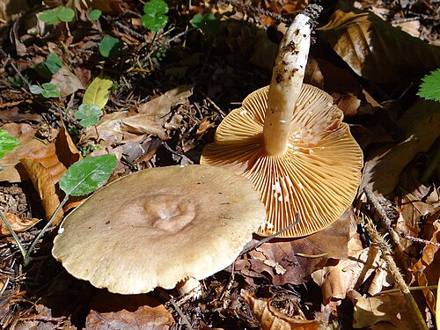
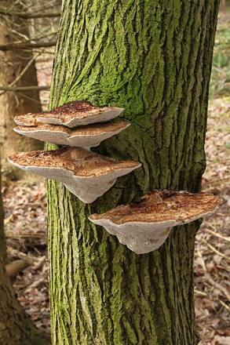
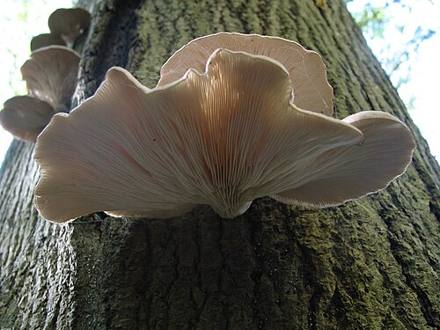
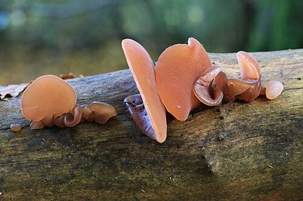
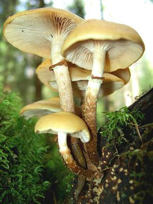
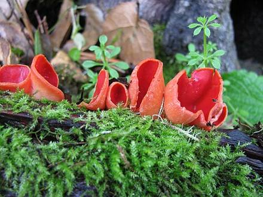

# Mushroom hunting in the wetlands of Seine-et-Marne

An October walk along a valley floor, from the willows to the alder wood, reading the fungi that live on wet ground and dead wood. A story for recognition, not for the pan.

## The story

The path leaves the village and drops towards the river. After a wet week in October the ground is soft, and the first thing you notice is the smell: leaf litter, wet bark, something like mushrooms already.

On the first old willow by the ditch, a row of pale grey shelves grows straight out of the bark: **pleurote en huître**, oyster mushroom (*Pleurotus ostreatus*), on its favourite trees, willow and poplar. A little further, on a dead branch of the same willow, flat brackets with a zoned top: rub the pores underneath with a thumb and they turn pinkish red. That is the **tramète rougissante**, blushing bracket (*Daedaleopsis confragosa*), and it is the willow's own fungus.

The path crosses a muddy rut where water stood all summer. At its edge, under the alders, a small orange cap with a dip in the middle; break it and a drop of white milk appears. This is the **lactaire des flaques**, puddle milkcap (*Lactarius lacunarum*), whose Latin name means "of the puddles". It lives with the roots of the alders and willows, and it only grows where the ground stays wet.

Into the alder wood. On an elder at the edge, brown, rubbery ears hang from the branches: **oreille-de-Judas**, jelly ear (*Auricularia auricula-judae*), found all year when the air is damp. On the stumps, tufts of honey-coloured caps, two-toned as they dry: **pholiote changeante**, sheathed woodtuft (*Kuehneromyces mutabilis*). Here the walk stops being a game. It grows in exactly the same places as the **galère marginée** (*Galerina marginata*), which carries the same deadly toxins as the death cap. Every year, people in France are poisoned by mistakes like this one.

Back on the open ground, one last find on a stump at the edge of the wood: a glossy, lacquered, red-brown bracket, the **ganoderme luisant** (*Ganoderma lucidum*), the reishi of Chinese traditional medicine. It is woody, not food.

The basket stays almost empty, and that is the point. In a wetland, fungi do the slow work: they soften the leaves that fall into the streams, rot the dead wood that becomes shelter for insects and birds, and feed the roots of the alders and willows that hold the banks.

{ width="300" } { width="300" }

{ width="300" } { width="300" }

{ width="300" } { width="300" }

## The fungi of the walk

| Fungus | Where in the wetland | Edible? | GBIF records in Seine-et-Marne since 2000 |
| --- | --- | --- | ---: |
| Pleurote en huître, *Pleurotus ostreatus* | On willow and poplar, autumn to winter | Edible, well cooked | 29 |
| Tramète rougissante, *Daedaleopsis confragosa* | On willow and alder | Not edible | 22 |
| Lactaire des flaques, *Lactarius lacunarum* | Wet hollows, ruts, under willow and alder | Not edible | 37 |
| Oreille-de-Judas, *Auricularia auricula-judae* | On elder, all year in damp weather | Edible, well cooked | 66 |
| Pholiote changeante, *Kuehneromyces mutabilis* | Tufts on stumps | Avoid: deadly look-alike | 24 |
| Ganoderme luisant, *Ganoderma lucidum* | On stumps | Not edible (woody) | 21 |
| Pézize écarlate, *Sarcoscypha coccinea* | Wet twigs, end of winter | Not recommended | 50 |

GBIF holds 18,296 records of fungi in Seine-et-Marne since 2000, and 53 % of them were made from September to November (4,248 in October alone). Few of them come from wetlands: these fungi are under-recorded, and every photo with a date and a place helps.

## Before you go

(i) **Never eat a mushroom you have not had checked.** In France, pharmacists will look at your basket, and local mycological societies run identification sessions and walks in autumn. If someone feels ill after eating wild mushrooms, call the poison control centre (*centre antipoison*) or 15.

(ii) **Check the rules of the place.** Nature reserves can forbid picking; in forests the manager or the prefecture can limit quantities to personal use; on private land, you need the owner's permission.

(iii) **Leave most of it.** Take a photo rather than the mushroom, cut nothing that you will not eat, and keep to paths in wet meadows, where trampling damages the soil.

(iv) **Share the record.** A photo with a date and a place on iNaturalist or a regional atlas ends up in GBIF, and in maps like these.

## Sources

(i) GBIF.org occurrence search, 15 Nov 2026: fungi (kingdom Fungi) and each species in Seine-et-Marne (GADM FRA.8.4_1), 2000 to 2026, with coordinates; counts by month.

(ii) Edibility, look-alikes and habitats: general mycological references; the edibility tags are cautious and are not a guide for eating.

(iii) Photos: lead images of the English Wikipedia articles, from Wikimedia Commons; puddle milkcap from Wikimedia Commons ([file page](https://commons.wikimedia.org/wiki/File:Lactarius_lacunarum_a1_(1).JPG), CC BY-SA 4.0). All credits: [photo credits](../sources.md#photo-credits).
