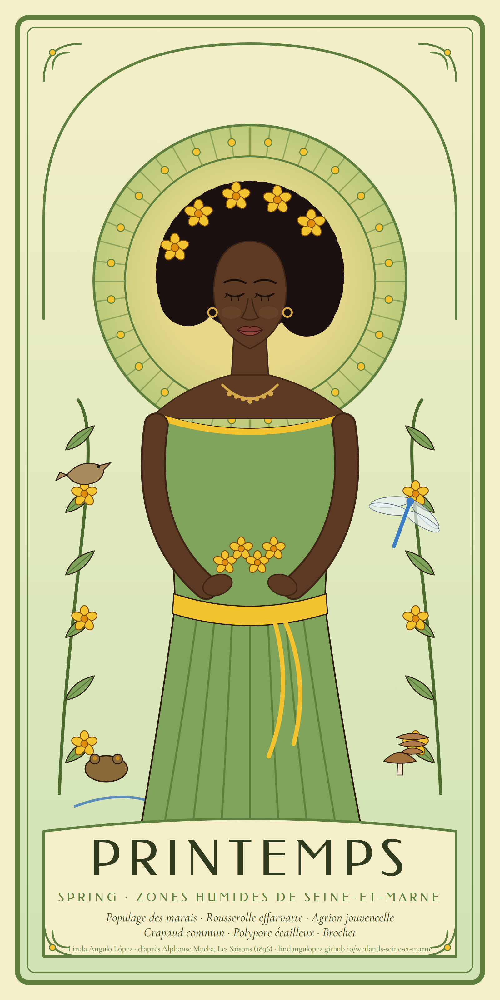
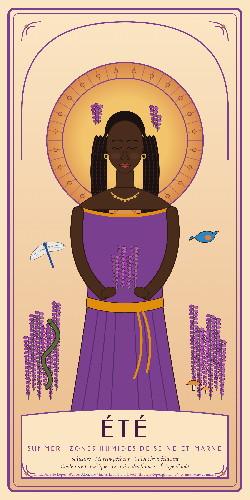
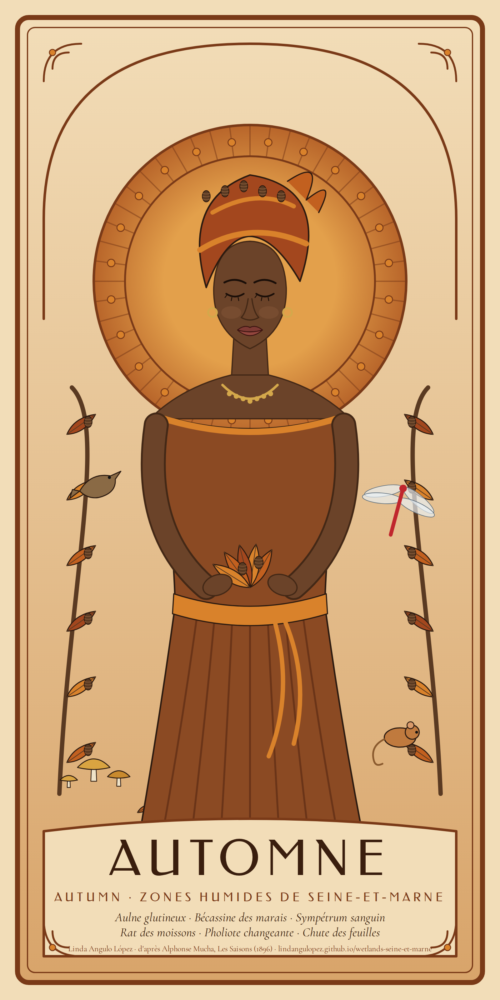
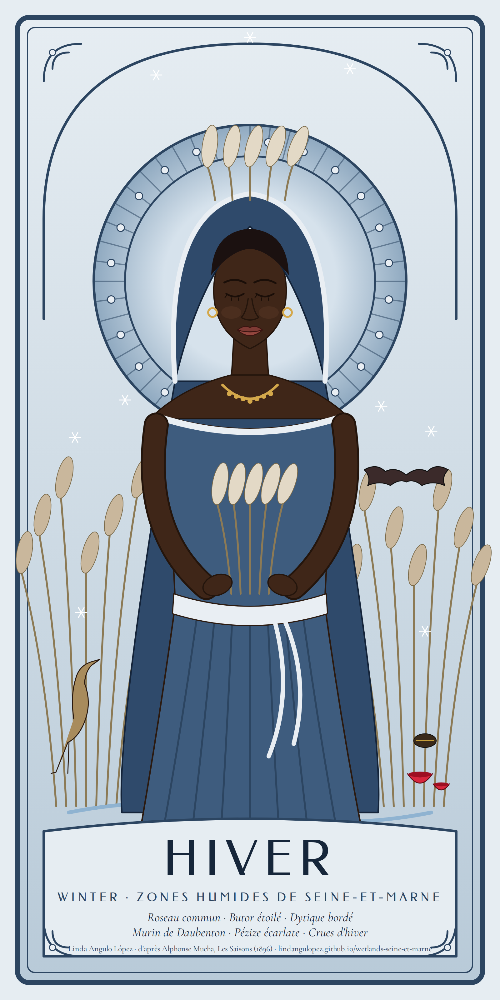

# Quatre saisons, quatre affiches

Quatre panneaux Art nouveau, un par série saisonnière, d'après la composition des *Saisons* d'Alphonse Mucha (1896) : une femme encadrée d'une auréole en arc, les plantes, animaux et champignons de la saison mêlés à la bordure, et le nom de la saison dans un cartouche. Ici, les quatre femmes sont noires, chacune avec sa coiffure et les couleurs de sa saison.

[{ width="300" }](spring.md)
[{ width="300" }](summer.md)
[{ width="300" }](autumn.md)
[{ width="300" }](winter.md)

| Saison | Coiffure et couronne | Dans la bordure | Récit |
| --- | --- | --- | --- |
| Printemps | Afro couronnée de populages | Rousserolle effarvatte, agrion jouvencelle, crapaud commun, polypore écailleux, un ruisseau pour le brochet | [Printemps](spring.md) |
| Été | Longues tresses à la salicaire | Martin-pêcheur, caloptéryx éclatant, couleuvre helvétique, lactaires des flaques | [Été](summer.md) |
| Automne | Foulard noué aux cônes d'aulne | Bécassine, sympétrum sanguin, rat des moissons, pholiote changeante, feuilles qui tombent | [Automne](autumn.md) |
| Hiver | Capuche et plumets de roseau | Butor étoilé, murin de Daubenton, dytique bordé, pézizes écarlates, neige | [Hiver](winter.md) |

**Téléchargements.** Chaque affiche en fichier vectoriel pour l'impression (SVG), en image 1600 × 3200 (PNG) et en image 4:5 pour LinkedIn (JPG) : [printemps](../img/posters/poster-spring.svg) · [été](../img/posters/poster-summer.svg) · [automne](../img/posters/poster-autumn.svg) · [hiver](../img/posters/poster-winter.svg) ; [printemps, LinkedIn](../img/posters/poster-spring-linkedin.jpg) · [été, LinkedIn](../img/posters/poster-summer-linkedin.jpg) · [automne, LinkedIn](../img/posters/poster-autumn-linkedin.jpg) · [hiver, LinkedIn](../img/posters/poster-winter-linkedin.jpg).

*Illustrations vectorielles dessinées en code (`scripts/posters.py`), Linda Angulo López, novembre 2026. Les* Saisons *de Mucha sont dans le domaine public ; ce sont de nouvelles compositions dans leur esprit, pas des copies.*
