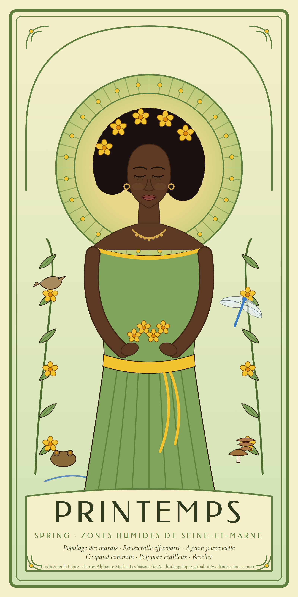
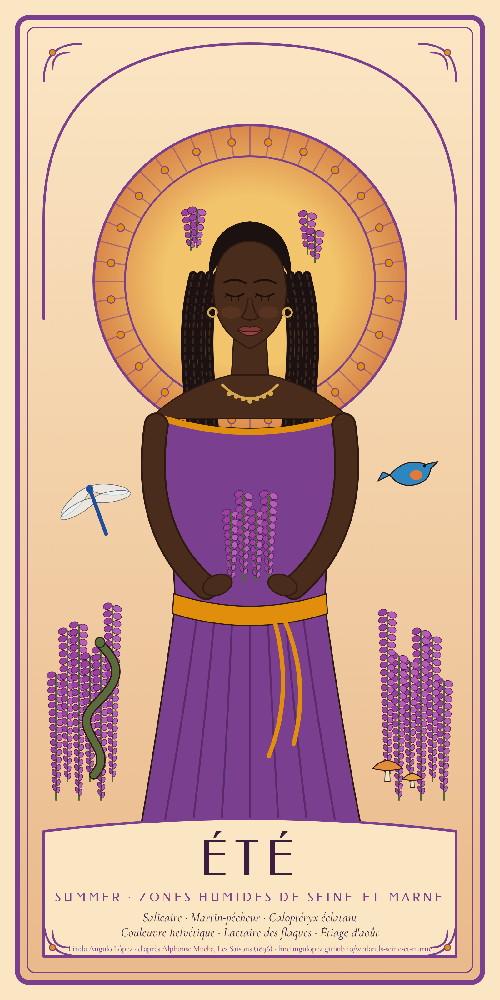
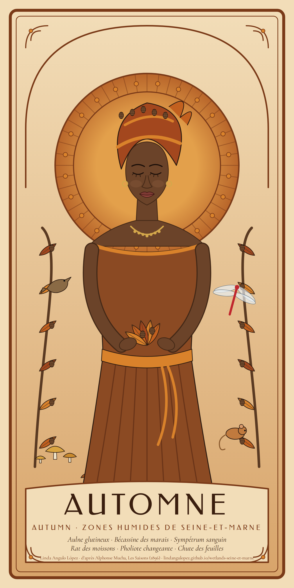
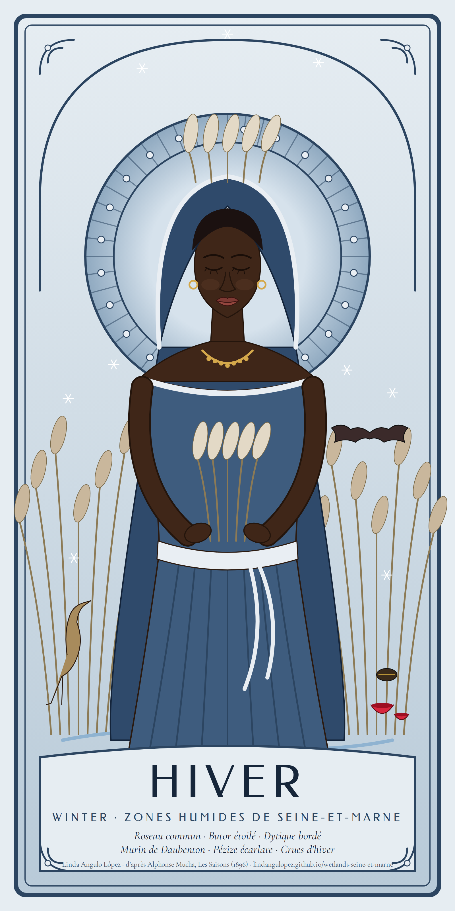

# Four seasons, four posters

Four Art Nouveau panels, one for each seasonal series, after the composition of Alphonse Mucha's *The Seasons* (1896): a woman framed by a halo arch, the plants, animals and fungi of the season woven into the border, and the name of the season in a lettered panel. Here the four women are Black, each with her own hair and her season's palette.

[{ width="300" }](spring.md)
[{ width="300" }](summer.md)
[{ width="300" }](autumn.md)
[{ width="300" }](winter.md)

| Season | Hair and crown | In the border | Story |
| --- | --- | --- | --- |
| Spring | Afro crowned with marsh marigolds | Reed warbler, azure damselfly, common toad, dryad's saddle, a stream for the pike | [Spring](spring.md) |
| Summer | Long braids with purple loosestrife | Kingfisher, banded demoiselle, barred grass snake, puddle milkcaps | [Summer](summer.md) |
| Autumn | Headwrap with alder cones | Snipe, ruddy darter, harvest mouse, sheathed woodtuft, falling leaves | [Autumn](autumn.md) |
| Winter | Hooded cloak with reed plumes | Bittern, Daubenton's bat, diving beetle, scarlet elf cups, snow | [Winter](winter.md) |

**Downloads.** Each poster as a vector file for print (SVG), a 1600 × 3200 image (PNG) and a 4:5 image for LinkedIn (JPG): [spring](../img/posters/poster-spring.svg) · [summer](../img/posters/poster-summer.svg) · [autumn](../img/posters/poster-autumn.svg) · [winter](../img/posters/poster-winter.svg); [spring, LinkedIn](../img/posters/poster-spring-linkedin.jpg) · [summer, LinkedIn](../img/posters/poster-summer-linkedin.jpg) · [autumn, LinkedIn](../img/posters/poster-autumn-linkedin.jpg) · [winter, LinkedIn](../img/posters/poster-winter-linkedin.jpg).

*Drawn as vector illustrations with code (`scripts/posters.py`), Linda Angulo López, November 2026. Mucha's* The Seasons *is in the public domain; these are new compositions in its spirit, not copies.*
