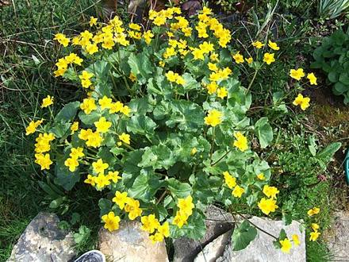
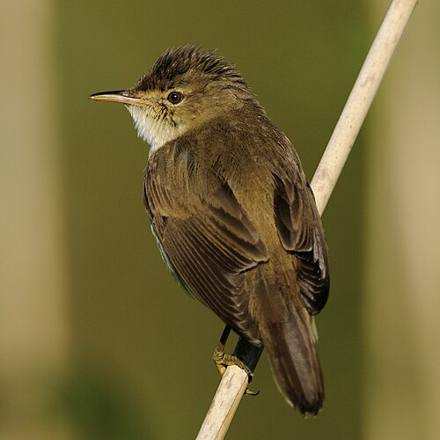
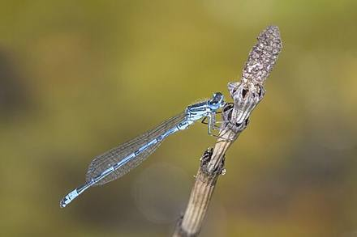
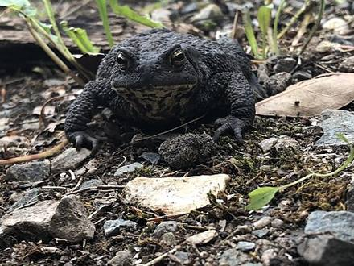
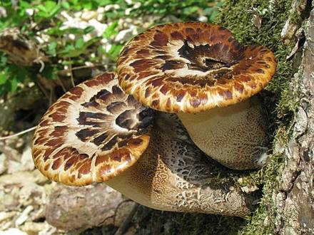
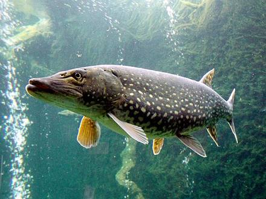

# Le printemps dans les zones humides de Seine-et-Marne

Six récits pour mars à mai : les premières fleurs, les migrateurs revenus d'Afrique, les demoiselles, les crapauds en route, un champignon de printemps et les prés inondés où fraie le brochet.

**Saison :** à partir de l'équinoxe de printemps, samedi 20 mars 2027, une histoire par jour.

## Jour 1, plante: Populage des marais, souci d'eau

{ width="320" }

*Quelle fleur s'ouvre la première dans un pré humide ?*

Le populage des marais (Caltha palustris), ou souci d'eau, ouvre de grandes coupes jaunes et brillantes le long des fossés et dans les aulnaies en mars et avril, avant que le reste du pré ne se réveille. Le GBIF en compte 654 observations en Seine-et-Marne depuis 2000, dont 343 (52 %) de mars à mai.

Il lui faut un sol qui reste mouillé au printemps : c'est un bon signe d'un pré humide intact. Comme beaucoup de renoncules, il est toxique frais, pour l'homme comme pour le bétail.

*Statut :* Préoccupation mineure (UICN).

## Jour 2, oiseau: Rousserolle effarvatte

{ width="320" }

*Qui chante au cœur des roseaux en avril ?*

La rousserolle effarvatte (Acrocephalus scirpaceus) passe l'hiver en Afrique au sud du Sahara et revient dans les roselières en avril. On l'entend bien plus qu'on ne la voit : un chant régulier et bavard, du fond des roseaux. Le GBIF en compte 6 119 observations en Seine-et-Marne depuis 2000, dont 2 653 (43 %) de mars à mai.

Elle tisse son nid autour de trois ou quatre tiges de roseau au-dessus de l'eau : une roselière doit donc rester debout et en eau au printemps. C'est un hôte fréquent du coucou.

*Statut :* Préoccupation mineure (UICN) ; protégée en France.

## Jour 3, insecte: Agrion jouvencelle

{ width="320" }

*Quelles sont ces petites aiguilles bleues au-dessus de la mare en mai ?*

L'agrion jouvencelle (Coenagrion puella) est l'une des premières demoiselles de l'année, bleue et noire, avec une petite marque en U à la base de l'abdomen du mâle. Le GBIF en compte 5 465 observations en Seine-et-Marne depuis 2000, dont 1 663 (30 %) de mars à mai.

Ses larves ont passé l'hiver dans la mare ; au printemps, elles grimpent sur une tige et les adultes émergent. Commune, mais seulement là où les mares gardent leurs plantes aquatiques.

*Statut :* Préoccupation mineure (UICN) ; non protégée.

## Jour 4, animal: Crapaud commun

{ width="320" }

*Pourquoi les crapauds traversent-ils la route les soirs de pluie de mars ?*

Dès les premières nuits douces et pluvieuses de l'année, le crapaud commun (Bufo bufo) quitte son abri d'hiver dans les bois et retourne à la mare où il est né, parfois à plus d'un kilomètre. Le GBIF en compte 14 534 observations en Seine-et-Marne depuis 2000, dont 11 005 (76 %) de mars à mai.

Les routes coupent ce chemin, et chaque printemps des bénévoles installent des crapauducs, des filets et des seaux pour leur faire traverser. Une mare ne vaut que par les bois et les chemins qui l'entourent.

*Statut :* Préoccupation mineure (UICN) ; protégé en France.

## Jour 5, champignon: Polypore écailleux

{ width="320" }

*Quel champignon pousse sur les saules au printemps ?*

Le polypore écailleux (Cerioporus squamosus) forme de grandes consoles brunes couvertes d'écailles sombres sur les saules, frênes et ormes des vallées, dès avril. Il sent l'écorce de pastèque. Le GBIF en compte 29 observations en Seine-et-Marne depuis 2000, dont 12 (41 %) de mars à mai.

Il décompose le bois des arbres vieux ou mourants et ouvre des cavités pour les oiseaux et les insectes. Comestible seulement très jeune et bien cuit ; pour la reconnaissance seulement, ne mangez jamais un champignon sans l'avis d'un pharmacien ou d'un mycologue.

*Statut :* Comestible jeune, bien cuit. Non évalué (UICN).

## Jour 6, écosystème: Le pré inondé, avec le brochet

{ width="320" }

*Pourquoi un poisson a-t-il besoin d'un pré ?*

À la fin de l'hiver et au début du printemps, le brochet (Esox lucius) quitte la rivière pour les prairies inondées et les marais peu profonds, et fraie dans l'herbe noyée. Ses alevins grandissent dans une eau chaude et peu profonde que seule une plaine d'inondation offre.

Le crapaud, le populage et le brochet dépendent donc de la même chose au printemps : des prés qu'on laisse inonder. Dans les bassins versants qui drainent la Seine-et-Marne, zones humides avérées et probables couvrent 27,8 % de la partie francilienne, en bonne part dans les plaines d'inondation de la Bassée et de la Marne.

*Statut :* Brochet : préoccupation mineure (UICN).

## Sources

(i) GBIF.org, recherche d'occurrences, 15 nov. 2026 : observations avec coordonnées en Seine-et-Marne (GADM FRA.8.4_1), 2000 à 2026, comptées par mois ; catégories UICN via l'API espèces du GBIF.

(ii) Protection en France : arrêté du 29 octobre 2009 (oiseaux), arrêté du 8 janvier 2021 (amphibiens et reptiles), arrêté du 23 avril 2007 (mammifères, dont toutes les chauves-souris). Parts de zones humides : [diapositive 6](../wetlands.md).

(iii) Photos : images principales des articles de Wikipédia en anglais, issues de Wikimedia Commons ; une photo Commons pour le lactaire des flaques. Crédits : [crédits photo](../sources.md#photo-credits).
