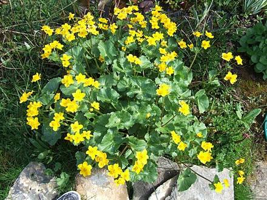
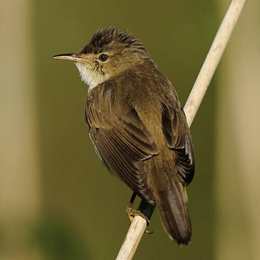
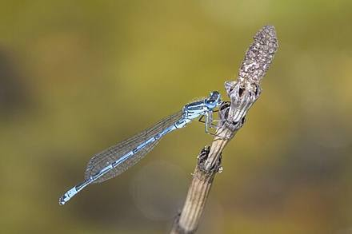
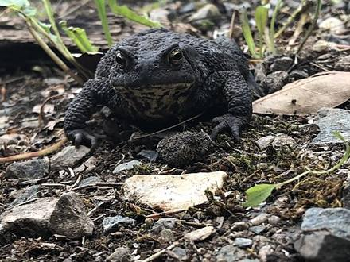
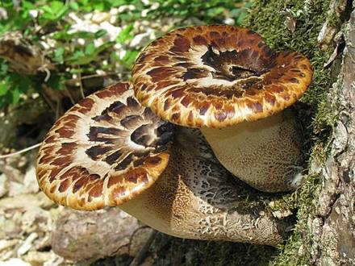
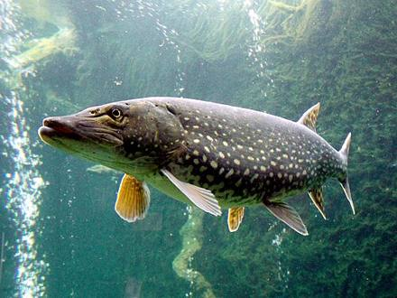

# Spring in the wetlands of Seine-et-Marne

Six stories for March to May: the first flowers, the migrants back from Africa, the damselflies, the toads on the move, a spring fungus and the flooded meadows where pike spawn.

**Season:** from the spring equinox, Saturday 20 March 2027, one story a day.

## Day 1, plant: Marsh marigold, populage des marais

{ width="320" }

*Which flower opens first in a wet meadow?*

The populage des marais, marsh marigold (Caltha palustris), opens large, glossy yellow cups along ditches and in alder woods in March and April, before most of the meadow has woken up. GBIF holds 654 records of it in Seine-et-Marne since 2000; 343 of them (52 %) were made from March to May.

It needs soil that stays wet in spring, so it is a good sign of an intact wet meadow. Like many buttercups, it is poisonous when fresh, to people and to livestock.

*Status:* Least Concern (IUCN).

## Day 2, bird: Reed warbler, rousserolle effarvatte

{ width="320" }

*Who is singing inside the reeds in April?*

The rousserolle effarvatte, reed warbler (Acrocephalus scirpaceus), spends the winter in Africa south of the Sahara and comes back to the reedbeds in April. It is heard far more than seen: a steady, chattering song from deep in the reeds. GBIF holds 6,119 records of it in Seine-et-Marne since 2000; 2,653 of them (43 %) were made from March to May.

It weaves its nest around three or four reed stems above the water, which is why a reedbed must stay standing and wet in spring. It is a frequent host of the cuckoo.

*Status:* Least Concern (IUCN); protected in France.

## Day 3, insect: Azure damselfly, agrion jouvencelle

{ width="320" }

*What are the small blue needles over the pond in May?*

The agrion jouvencelle, azure damselfly (Coenagrion puella), is one of the first damselflies of the year, blue and black, with a small U-shaped mark at the base of the male's abdomen. GBIF holds 5,465 records of it in Seine-et-Marne since 2000; 1,663 of them (30 %) were made from March to May.

Its larvae have spent the winter in the pond; in spring they climb a stem and the adults emerge. Common, but only where ponds keep water plants.

*Status:* Least Concern (IUCN); not protected.

## Day 4, animal: Common toad, crapaud commun

{ width="320" }

*Why do toads cross the road on rainy March nights?*

On the first mild, rainy nights of the year, the crapaud commun, common toad (Bufo bufo), leaves its winter shelter in the woods and walks back to the pond where it was born, sometimes more than a kilometre away. GBIF holds 14,534 records of it in Seine-et-Marne since 2000; 11,005 of them (76 %) were made from March to May.

Roads cut that path, and every spring volunteers set up toad crossings, fences and buckets to carry them over. A pond is only as good as the woods and the paths around it.

*Status:* Least Concern (IUCN); protected in France.

## Day 5, fungus: Dryad's saddle, polypore écailleux

{ width="320" }

*Which mushroom grows on willows in spring?*

The polypore écailleux, dryad's saddle (Cerioporus squamosus), forms large brown brackets with darker scales on willows, ash and elms in the valleys, from April. It smells of watermelon rind. GBIF holds 29 records of it in Seine-et-Marne since 2000; 12 of them (41 %) were made from March to May.

It rots the wood of old and dying trees and opens cavities for birds and insects. Edible only when very young and well cooked; for recognition only, never eat a mushroom without a check by a pharmacist or a mycologist.

*Status:* Edible when young, well cooked. Not evaluated (IUCN).

## Day 6, ecosystem: The flooded meadow, with the pike

{ width="320" }

*Why does a fish need a meadow?*

At the end of winter and in early spring, the brochet, pike (Esox lucius), leaves the river for flooded grassland and shallow marshes to spawn among drowned grass. Its young grow in warm, shallow water that only a floodplain gives.

So the toads, the marsh marigold and the pike all depend on the same thing in spring: meadows that are allowed to flood. In the catchments that drain Seine-et-Marne, confirmed and probable wetlands cover 27.8 % of the Île-de-France part, much of it in the floodplains of the Bassée and the Marne.

*Status:* Pike: Least Concern (IUCN).

## Sources

(i) GBIF.org occurrence search, 15 Nov 2026: records with coordinates in Seine-et-Marne (GADM FRA.8.4_1), 2000 to 2026, counted by month; IUCN categories from the GBIF species API.

(ii) Protection in France: arrêté of 29 October 2009 (birds), arrêté of 8 January 2021 (amphibians and reptiles), arrêté of 23 April 2007 (mammals, including all bats). Wetland shares: [slide 6](../wetlands.md).

(iii) Photos: lead images of the English Wikipedia articles, from Wikimedia Commons; one Commons photo for the puddle milkcap. Credits: [photo credits](../sources.md#photo-credits).
