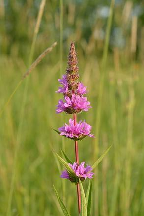
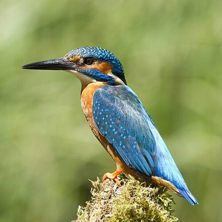
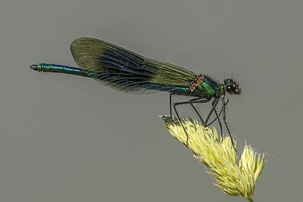
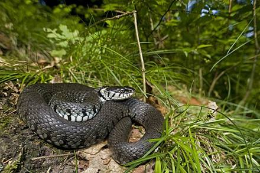
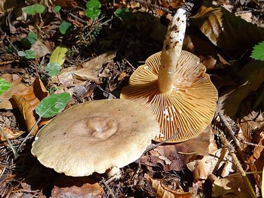
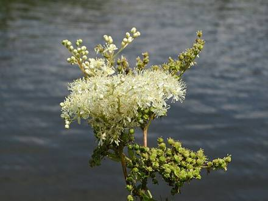

# L'été dans les zones humides de Seine-et-Marne

Six posts pour juin à août : la salicaire en fleur, le martin-pêcheur, le caloptéryx, une couleuvre nageuse, un lactaire des creux humides et l'étiage d'août.

**Quand publier :** à partir du solstice d'été, lundi 21 juin 2027, un post par jour.

## Jour 1, plante: Salicaire

{ width="320" }

> 💜🐝 Qu'est-ce qui colore les berges de violet en juillet ?
>
> La salicaire (Lythrum salicaria) dresse de hauts épis violets le long des berges et des fossés dès juillet, dans la même frange de hautes herbes que la reine-des-prés. Le GBIF en compte 6 256 observations en Seine-et-Marne depuis 2000, dont 3 792 (61 %) de juin à août.
>
> Abeilles, syrphes et papillons la visitent tout l'été. Indigène ici, elle est devenue l'une des plantes envahissantes les plus connues des zones humides d'Amérique du Nord après y avoir été introduite.
>
> Jour 1 sur six, les zones humides de Seine-et-Marne en été : une plante, un oiseau, un insecte, un animal, un champignon, puis tout l'écosystème.
>
> Cartes et sources: 👉 https://lindangulopez.github.io/wetlands-seine-et-marne/fr/story/summer/
>
> #ZonesHumides #SeineEtMarne #Biodiversite #GBIF #DonneesOuvertes #PurpleLoosestrife #Pollinators

*Statut :* Préoccupation mineure (UICN).

## Jour 2, oiseau: Martin-pêcheur d'Europe

{ width="320" }

> 💙🐟 Quel est cet éclair bleu au-dessus de la rivière ?
>
> Le martin-pêcheur (Alcedo atthis) file au ras de l'eau avec un cri aigu et plonge d'une branche sur les petits poissons. Le GBIF en compte 11 228 observations en Seine-et-Marne depuis 2000, dont 3 273 (29 %) de juin à août.
>
> Il lui faut une eau claire pour voir ses proies et des berges de terre verticales pour creuser son terrier. Berges bétonnées et eau trouble : c'est là qu'il disparaît.
>
> Jour 2 sur six, les zones humides de Seine-et-Marne en été : une plante, un oiseau, un insecte, un animal, un champignon, puis tout l'écosystème.
>
> Cartes et sources: 👉 https://lindangulopez.github.io/wetlands-seine-et-marne/fr/story/summer/
>
> #ZonesHumides #SeineEtMarne #Biodiversite #GBIF #DonneesOuvertes #Kingfisher #Birds #Rivers

*Statut :* Préoccupation mineure (UICN) ; protégé en France ; annexe I de la directive Oiseaux.

## Jour 3, insecte: Caloptéryx éclatant

{ width="320" }

> 🦋💎 Papillon ou libellule ?
>
> Le caloptéryx éclatant (Calopteryx splendens) volette comme un papillon au-dessus des rivières lentes ; le mâle est bleu métallique, avec une bande sombre sur chaque aile. Le GBIF en compte 6 657 observations en Seine-et-Marne depuis 2000, dont 5 041 (76 %) de juin à août.
>
> Ses larves vivent dans les herbiers des eaux courantes : c'est un bon signe d'une berge vivante.
>
> Jour 3 sur six, les zones humides de Seine-et-Marne en été : une plante, un oiseau, un insecte, un animal, un champignon, puis tout l'écosystème.
>
> Cartes et sources: 👉 https://lindangulopez.github.io/wetlands-seine-et-marne/fr/story/summer/
>
> #ZonesHumides #SeineEtMarne #Biodiversite #GBIF #DonneesOuvertes #Damselflies #Odonata #Rivers

*Statut :* Préoccupation mineure (UICN) ; non protégé.

## Jour 4, animal: Couleuvre helvétique

{ width="320" }

> 🐍💧 Pourquoi un serpent nage-t-il dans la mare ?
>
> La couleuvre helvétique (Natrix helvetica) nage très bien et chasse grenouilles, crapauds et petits poissons dans les mares et les fossés en été. Le GBIF en compte 1 310 observations en Seine-et-Marne depuis 2000, dont 617 (47 %) de juin à août.
>
> Elle est inoffensive pour l'homme ; menacée, elle peut faire la morte. Elle dépend des mêmes mares que les amphibiens qu'elle mange.
>
> Jour 4 sur six, les zones humides de Seine-et-Marne en été : une plante, un oiseau, un insecte, un animal, un champignon, puis tout l'écosystème.
>
> Cartes et sources: 👉 https://lindangulopez.github.io/wetlands-seine-et-marne/fr/story/summer/
>
> #ZonesHumides #SeineEtMarne #Biodiversite #GBIF #DonneesOuvertes #Snakes #Reptiles

*Statut :* Préoccupation mineure (UICN) ; protégée en France.

## Jour 5, champignon: Lactaire des flaques

{ width="320" }

> 🍄💦 Quel champignon pousse là où sèchent les flaques ?
>
> Le lactaire des flaques (Lactarius lacunarum) est un petit lactaire orangé des creux humides, des bords de mares et des ornières, sous les saules et les aulnes. Son nom latin signifie « des flaques ». Le GBIF en compte 37 observations en Seine-et-Marne depuis 2000, dont 11 (30 %) de juin à août.
>
> Il vit en association avec les racines de ces arbres, une mycorhize. Non comestible.
>
> Jour 5 sur six, les zones humides de Seine-et-Marne en été : une plante, un oiseau, un insecte, un animal, un champignon, puis tout l'écosystème.
>
> Cartes et sources: 👉 https://lindangulopez.github.io/wetlands-seine-et-marne/fr/story/summer/
>
> #ZonesHumides #SeineEtMarne #Biodiversite #GBIF #DonneesOuvertes #Fungi #Mushrooms #Mycorrhiza

*Statut :* Non comestible. Non évalué (UICN).

## Jour 6, écosystème: L'étiage d'août

{ width="320" }

> 🌞💧 D'où une rivière tire-t-elle son eau en août ?
>
> À la fin de l'été, la pluie se fait rare et les rivières de Seine-et-Marne atteignent leur débit le plus bas. Les mares rétrécissent, se réchauffent et perdent leur oxygène ; larves et grenouilles se serrent dans ce qui reste.
>
> C'est là que les zones humides font leur travail : les sols et les prés gorgés d'eau en hiver la rendent lentement aux rivières. Dans les bassins qui drainent le département, zones humides avérées et probables couvrent 27,8 % de la partie francilienne.
>
> Jour 6 sur six, les zones humides de Seine-et-Marne en été : une plante, un oiseau, un insecte, un animal, un champignon, puis tout l'écosystème.
>
> Cartes et sources: 👉 https://lindangulopez.github.io/wetlands-seine-et-marne/fr/story/summer/
>
> #ZonesHumides #SeineEtMarne #Biodiversite #GBIF #DonneesOuvertes #LowFlow #Drought #Ecosystems

## Sources

(i) GBIF.org, recherche d'occurrences, 15 nov. 2026 : observations avec coordonnées en Seine-et-Marne (GADM FRA.8.4_1), 2000 à 2026, comptées par mois ; catégories UICN via l'API espèces du GBIF.

(ii) Protection en France : arrêté du 29 octobre 2009 (oiseaux), arrêté du 8 janvier 2021 (amphibiens et reptiles), arrêté du 23 avril 2007 (mammifères, dont toutes les chauves-souris). Parts de zones humides : [diapositive 6](../wetlands.md).

(iii) Photos : images principales des articles de Wikipédia en anglais, issues de Wikimedia Commons ; une photo Commons pour le lactaire des flaques. Crédits : [crédits photo](../sources.md#photo-credits).
