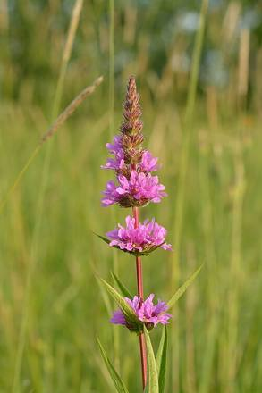
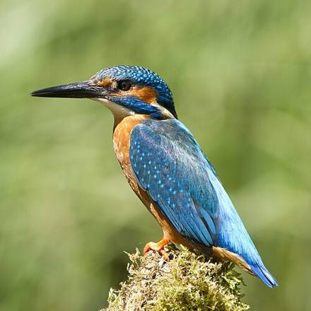
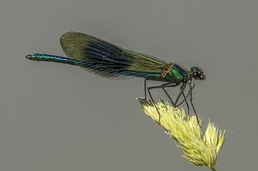
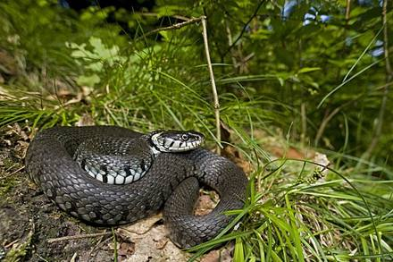
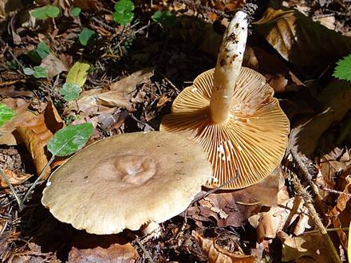
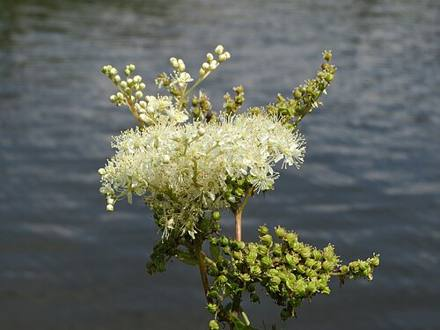

# Summer in the wetlands of Seine-et-Marne

Six posts for June to August: purple loosestrife in flower, the kingfisher, the banded demoiselle, a water snake, a milkcap of wet hollows and the low water of August.

**When to post:** from the summer solstice, Monday 21 June 2027, one post a day.

## Day 1, plant: Purple loosestrife, salicaire

{ width="320" }

> 💜🐝 What turns the riverbanks purple in July?
>
> The salicaire, purple loosestrife (Lythrum salicaria), raises tall purple spikes along banks and ditches from July, in the same tall-herb fringe as meadowsweet. GBIF holds 6,256 records of it in Seine-et-Marne since 2000; 3,792 of them (61 %) were made from June to August.
>
> Bees, hoverflies and butterflies visit it all summer. Native here, it became one of the best-known invasive plants of North American wetlands after it was introduced there.
>
> Day 1 of six on the wetlands of Seine-et-Marne in summer: a plant, a bird, an insect, an animal, a fungus, then the whole ecosystem.
>
> Maps and sources: 👉 https://lindangulopez.github.io/wetlands-seine-et-marne/story/summer/
>
> #ZonesHumides #Wetlands #SeineEtMarne #Biodiversity #GBIF #OpenData #PurpleLoosestrife #Pollinators

*Status:* Least Concern (IUCN).

## Day 2, bird: Kingfisher, martin-pêcheur

{ width="320" }

> 💙🐟 What was that blue flash over the river?
>
> The martin-pêcheur, kingfisher (Alcedo atthis), flies low and fast along the water with a sharp call, and dives from a branch for small fish. GBIF holds 11,228 records of it in Seine-et-Marne since 2000; 3,273 of them (29 %) were made from June to August.
>
> It needs clear water to see its prey and vertical earth banks to dig its nesting burrow. Stabilised, concreted banks and cloudy water are where it disappears.
>
> Day 2 of six on the wetlands of Seine-et-Marne in summer: a plant, a bird, an insect, an animal, a fungus, then the whole ecosystem.
>
> Maps and sources: 👉 https://lindangulopez.github.io/wetlands-seine-et-marne/story/summer/
>
> #ZonesHumides #Wetlands #SeineEtMarne #Biodiversity #GBIF #OpenData #Kingfisher #Birds #Rivers

*Status:* Least Concern (IUCN); protected in France; Annex I of the EU Birds Directive.

## Day 3, insect: Banded demoiselle, caloptéryx éclatant

{ width="320" }

> 🦋💎 Is it a butterfly or a dragonfly?
>
> The caloptéryx éclatant, banded demoiselle (Calopteryx splendens), flutters like a butterfly over slow rivers; the male is metallic blue with a dark band across each wing. GBIF holds 6,657 records of it in Seine-et-Marne since 2000; 5,041 of them (76 %) were made from June to August.
>
> Its larvae live among the water plants of flowing rivers, so it is a good sign of a living riverbank.
>
> Day 3 of six on the wetlands of Seine-et-Marne in summer: a plant, a bird, an insect, an animal, a fungus, then the whole ecosystem.
>
> Maps and sources: 👉 https://lindangulopez.github.io/wetlands-seine-et-marne/story/summer/
>
> #ZonesHumides #Wetlands #SeineEtMarne #Biodiversity #GBIF #OpenData #Damselflies #Odonata #Rivers

*Status:* Least Concern (IUCN); not protected.

## Day 4, animal: Barred grass snake, couleuvre helvétique

{ width="320" }

> 🐍💧 Why is there a snake swimming in the pond?
>
> The couleuvre helvétique, barred grass snake (Natrix helvetica), swims well and hunts frogs, toads and small fish in ponds and ditches in summer. GBIF holds 1,310 records of it in Seine-et-Marne since 2000; 617 of them (47 %) were made from June to August.
>
> It is harmless to people; when threatened it may play dead. It depends on the same ponds as the amphibians it eats.
>
> Day 4 of six on the wetlands of Seine-et-Marne in summer: a plant, a bird, an insect, an animal, a fungus, then the whole ecosystem.
>
> Maps and sources: 👉 https://lindangulopez.github.io/wetlands-seine-et-marne/story/summer/
>
> #ZonesHumides #Wetlands #SeineEtMarne #Biodiversity #GBIF #OpenData #Snakes #Reptiles

*Status:* Least Concern (IUCN); protected in France.

## Day 5, fungus: Puddle milkcap, lactaire des flaques

{ width="320" }

> 🍄💦 Which mushroom grows where puddles dry out?
>
> The lactaire des flaques, puddle milkcap (Lactarius lacunarum), is a small orange milkcap of wet hollows, pond edges and ruts under willows and alders. Its Latin name means "of the puddles". GBIF holds 37 records of it in Seine-et-Marne since 2000; 11 of them (30 %) were made from June to August.
>
> It lives in partnership with the roots of these trees, a mycorrhiza. Not edible.
>
> Day 5 of six on the wetlands of Seine-et-Marne in summer: a plant, a bird, an insect, an animal, a fungus, then the whole ecosystem.
>
> Maps and sources: 👉 https://lindangulopez.github.io/wetlands-seine-et-marne/story/summer/
>
> #ZonesHumides #Wetlands #SeineEtMarne #Biodiversity #GBIF #OpenData #Fungi #Mushrooms #Mycorrhiza

*Status:* Not edible. Not evaluated (IUCN).

## Day 6, ecosystem: Low water in August

{ width="320" }

> 🌞💧 Where does a river get its water in August?
>
> In late summer, rain is scarce and the rivers of Seine-et-Marne reach their lowest flow. Ponds shrink, warm up and lose oxygen; damselfly larvae and frogs crowd into what is left.
>
> This is when wetlands earn their keep: the wet soils and meadows that filled in winter give their water back slowly to the rivers. In the catchments draining the département, confirmed and probable wetlands cover 27.8 % of the Île-de-France part.
>
> Day 6 of six on the wetlands of Seine-et-Marne in summer: a plant, a bird, an insect, an animal, a fungus, then the whole ecosystem.
>
> Maps and sources: 👉 https://lindangulopez.github.io/wetlands-seine-et-marne/story/summer/
>
> #ZonesHumides #Wetlands #SeineEtMarne #Biodiversity #GBIF #OpenData #LowFlow #Drought #Ecosystems

## Sources

(i) GBIF.org occurrence search, 15 Nov 2026: records with coordinates in Seine-et-Marne (GADM FRA.8.4_1), 2000 to 2026, counted by month; IUCN categories from the GBIF species API.

(ii) Protection in France: arrêté of 29 October 2009 (birds), arrêté of 8 January 2021 (amphibians and reptiles), arrêté of 23 April 2007 (mammals, including all bats). Wetland shares: [slide 6](../wetlands.md).

(iii) Photos: lead images of the English Wikipedia articles, from Wikimedia Commons; one Commons photo for the puddle milkcap. Credits: [photo credits](../sources.md#photo-credits).
