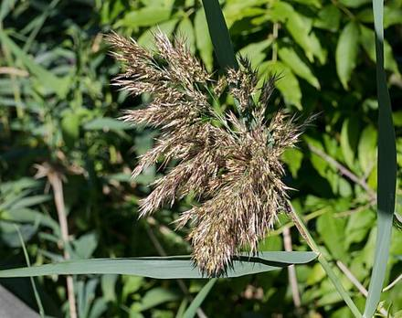
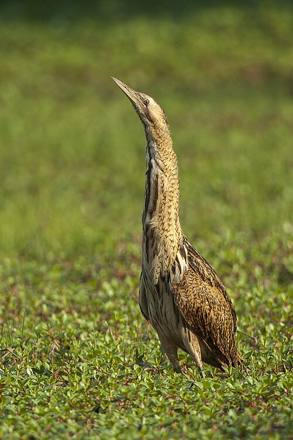
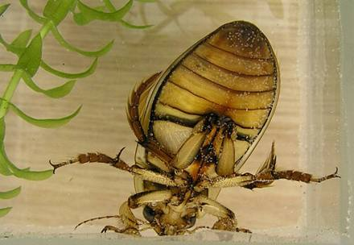
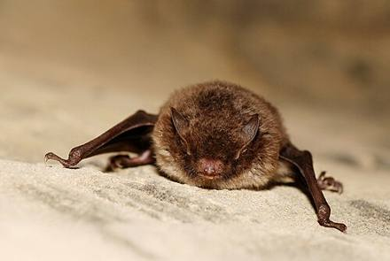
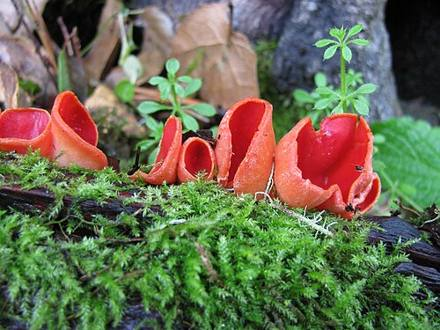
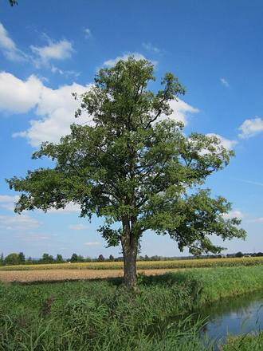

# L'hiver dans les zones humides de Seine-et-Marne

Six posts pour décembre à février : la roselière debout, le butor étoilé, un coléoptère sous la glace, les chauves-souris endormies, une coupe écarlate sur les brindilles mouillées, et les crues d'hiver.

**Quand publier :** à partir du solstice d'hiver, lundi 21 décembre 2026, un post par jour.

## Jour 1, plante: Roseau commun, phragmite

{ width="320" }

> 🌾❄️ Pourquoi laisser les roseaux debout tout l'hiver ?
>
> En hiver, la roselière de roseau commun (Phragmites australis) est une forêt de tiges sèches et pâles, coiffées de plumets, encore debout dans l'eau. Le GBIF en compte 3 422 observations en Seine-et-Marne depuis 2000, dont 225 (7 %) de décembre à février.
>
> Les tiges abritent insectes et oiseaux, et la roselière filtre l'eau qui la traverse ; on construit même des filtres plantés de roseaux pour épurer les eaux usées. Le roseau se coupait en hiver pour les toits de chaume ; là où on le coupe encore, on en laisse une partie chaque année.
>
> Jour 1 sur six, les zones humides de Seine-et-Marne en hiver : une plante, un oiseau, un insecte, un animal, un champignon, puis tout l'écosystème.
>
> Cartes et sources: 👉 https://lindangulopez.github.io/wetlands-seine-et-marne/fr/story/winter/
>
> #ZonesHumides #SeineEtMarne #Biodiversite #GBIF #DonneesOuvertes #Reedbed #Phragmites

*Statut :* Préoccupation mineure (UICN).

## Jour 2, oiseau: Butor étoilé

{ width="320" }

> 🐦🌾 Voyez-vous le héron caché dans les roseaux ?
>
> Le butor étoilé (Botaurus stellaris) est un héron rayé de brun comme les roseaux secs ; inquiet, il pointe le bec vers le ciel et se balance avec les tiges. Des oiseaux venus du nord et de l'est rejoignent en hiver les rares résidents. Le GBIF en compte 664 observations en Seine-et-Marne depuis 2000, dont 404 (61 %) de décembre à février.
>
> Il lui faut de grandes roselières en eau, l'habitat humide le plus rare ; au printemps, le chant grave des mâles porte à des kilomètres.
>
> Jour 2 sur six, les zones humides de Seine-et-Marne en hiver : une plante, un oiseau, un insecte, un animal, un champignon, puis tout l'écosystème.
>
> Cartes et sources: 👉 https://lindangulopez.github.io/wetlands-seine-et-marne/fr/story/winter/
>
> #ZonesHumides #SeineEtMarne #Biodiversite #GBIF #DonneesOuvertes #Bittern #Birds #Reedbed

*Statut :* Préoccupation mineure (UICN) ; protégé en France ; annexe I de la directive Oiseaux.

## Jour 3, insecte: Dytique bordé

{ width="320" }

> 🪲🧊 Qu'est-ce qui nage sous la glace ?
>
> Le dytique bordé (Dytiscus marginalis) reste actif tout l'hiver, même sous la glace, en emportant une bulle d'air sous ses élytres. Le GBIF en compte 173 observations en Seine-et-Marne depuis 2000, dont 9 (5 %) de décembre à février.
>
> Adultes et larves sont de redoutables prédateurs de têtards, de larves d'insectes et de petits poissons. Une mare à dytiques est une mare pleine de vie.
>
> Jour 3 sur six, les zones humides de Seine-et-Marne en hiver : une plante, un oiseau, un insecte, un animal, un champignon, puis tout l'écosystème.
>
> Cartes et sources: 👉 https://lindangulopez.github.io/wetlands-seine-et-marne/fr/story/winter/
>
> #ZonesHumides #SeineEtMarne #Biodiversite #GBIF #DonneesOuvertes #WaterBeetles #Insects #Ponds

*Statut :* Non évalué (UICN).

## Jour 4, animal: Murin de Daubenton

{ width="320" }

> 🦇❄️ Où sont les chauves-souris qui chassent au-dessus de la rivière en été ?
>
> Le murin de Daubenton (Myotis daubentonii) rase l'eau au crépuscule en été et attrape les insectes juste au-dessus de la surface. En hiver, il hiberne dans les grottes, les caves, les carrières et sous les vieux ponts. Le GBIF en compte 835 observations en Seine-et-Marne depuis 2000, dont 200 (24 %) de décembre à février.
>
> Chaque hiver, des bénévoles comptent les chauves-souris dans leurs gîtes ; une chauve-souris réveillée en hiver brûle des réserves qu'elle ne peut pas reconstituer, alors les comptages sont brefs et silencieux.
>
> Jour 4 sur six, les zones humides de Seine-et-Marne en hiver : une plante, un oiseau, un insecte, un animal, un champignon, puis tout l'écosystème.
>
> Cartes et sources: 👉 https://lindangulopez.github.io/wetlands-seine-et-marne/fr/story/winter/
>
> #ZonesHumides #SeineEtMarne #Biodiversite #GBIF #DonneesOuvertes #Bats #Mammals #Hibernation

*Statut :* Préoccupation mineure (UICN) ; protégé en France, comme toutes les chauves-souris.

## Jour 5, champignon: Pézize écarlate

{ width="320" }

> 🍄❤️ Quelle est cette coupe rouge sur la brindille tombée ?
>
> La pézize écarlate (Sarcoscypha coccinea) pousse sur les brindilles tombées, moussues et mouillées des bois humides dès la fin de l'hiver, une coupe rouge vif quand presque rien d'autre ne fructifie. Le GBIF en compte 50 observations en Seine-et-Marne depuis 2000, dont 30 (60 %) de décembre à février.
>
> Elle décompose le petit bois mort et a besoin d'air humide et d'un milieu propre. Consommation non recommandée.
>
> Jour 5 sur six, les zones humides de Seine-et-Marne en hiver : une plante, un oiseau, un insecte, un animal, un champignon, puis tout l'écosystème.
>
> Cartes et sources: 👉 https://lindangulopez.github.io/wetlands-seine-et-marne/fr/story/winter/
>
> #ZonesHumides #SeineEtMarne #Biodiversite #GBIF #DonneesOuvertes #Fungi #Mushrooms #WinterFungi

*Statut :* Non recommandée. Non évaluée (UICN).

## Jour 6, écosystème: Les crues d'hiver

{ width="320" }

> 🌊❄️ Où va une rivière quand elle déborde ?
>
> En hiver, la pluie tombe sur des sols déjà gorgés d'eau, et les rivières montent. Là où la vallée est restée ouverte, elles s'étalent sur les prés et les aulnaies au lieu de filer vers l'aval.
>
> Ces terres inondées stockent l'eau, ralentissent la crue pour les villes en aval et rechargent la nappe pour l'été. C'est aussi là que le brochet fraiera et que les crapauds pondront dans quelques semaines.
>
> Jour 6 sur six, les zones humides de Seine-et-Marne en hiver : une plante, un oiseau, un insecte, un animal, un champignon, puis tout l'écosystème.
>
> Cartes et sources: 👉 https://lindangulopez.github.io/wetlands-seine-et-marne/fr/story/winter/
>
> #ZonesHumides #SeineEtMarne #Biodiversite #GBIF #DonneesOuvertes #Floods #Floodplain #Ecosystems

## Sources

(i) GBIF.org, recherche d'occurrences, 15 nov. 2026 : observations avec coordonnées en Seine-et-Marne (GADM FRA.8.4_1), 2000 à 2026, comptées par mois ; catégories UICN via l'API espèces du GBIF.

(ii) Protection en France : arrêté du 29 octobre 2009 (oiseaux), arrêté du 8 janvier 2021 (amphibiens et reptiles), arrêté du 23 avril 2007 (mammifères, dont toutes les chauves-souris). Parts de zones humides : [diapositive 6](../wetlands.md).

(iii) Photos : images principales des articles de Wikipédia en anglais, issues de Wikimedia Commons ; une photo Commons pour le lactaire des flaques. Crédits : [crédits photo](../sources.md#photo-credits).
