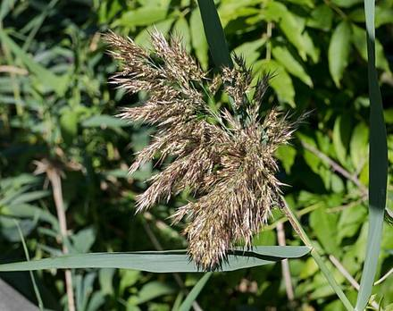
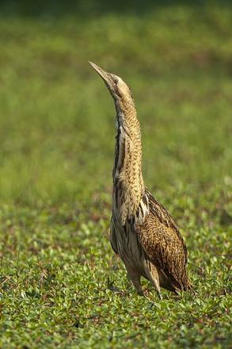
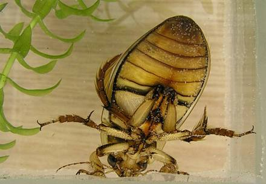
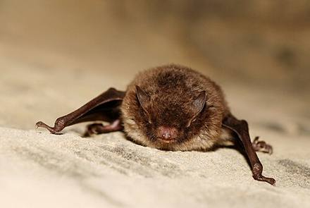
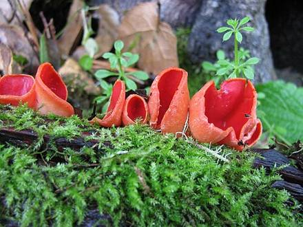
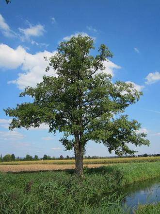

# Winter in the wetlands of Seine-et-Marne

Six stories for December to February: the standing reedbed, the bittern, a beetle under the ice, bats asleep, a scarlet cup on wet twigs, and the winter floods.

**Season:** from the winter solstice, Monday 21 December 2026, one story a day.

## Day 1, plant: Common reed, roseau commun

{ width="320" }

*Why leave the reeds standing all winter?*

In winter the roselière, the reedbed of roseau commun (Phragmites australis), is a forest of dry, pale stems topped with feathery plumes, still standing in the water. GBIF holds 3,422 records of it in Seine-et-Marne since 2000; 225 of them (7 %) were made from December to February.

The stems shelter insects and birds, and the reedbed filters the water that runs through it; reed beds are also built on purpose to clean wastewater. Reed was cut in winter for thatch; where it is still cut, a part is left uncut each year.

*Status:* Least Concern (IUCN).

## Day 2, bird: Eurasian bittern, butor étoilé

{ width="320" }

*Can you see the heron hiding in the reeds?*

The butor étoilé, Eurasian bittern (Botaurus stellaris), is a heron striped brown like dry reeds; when alarmed it points its bill to the sky and sways with the stems. Wintering birds from further north and east join the few residents. GBIF holds 664 records of it in Seine-et-Marne since 2000; 404 of them (61 %) were made from December to February.

It needs large, wet reedbeds, the rarest of wetland habitats; in spring the males' booming call carries for kilometres.

*Status:* Least Concern (IUCN); protected in France; Annex I of the EU Birds Directive.

## Day 3, insect: Great diving beetle, dytique bordé

{ width="320" }

*What swims under the ice?*

The dytique bordé, great diving beetle (Dytiscus marginalis), stays active all winter, even under ice, carrying a bubble of air under its wing cases. GBIF holds 173 records of it in Seine-et-Marne since 2000; 9 of them (5 %) were made from December to February.

Adults and larvae are fierce predators of tadpoles, insect larvae and small fish. A pond with dytiscus is a pond full of life.

*Status:* Not evaluated (IUCN).

## Day 4, animal: Daubenton's bat, murin de Daubenton

{ width="320" }

*Where are the bats that hunt over the river in summer?*

The murin de Daubenton, Daubenton's bat (Myotis daubentonii), skims the water at dusk in summer, catching insects just above the surface. In winter it hibernates in caves, cellars, quarries and under old bridges. GBIF holds 835 records of it in Seine-et-Marne since 2000; 200 of them (24 %) were made from December to February.

Volunteers count bats in their winter roosts each year; a bat woken in winter burns fat it cannot replace, so the counts are short and quiet.

*Status:* Least Concern (IUCN); protected in France, like all bats.

## Day 5, fungus: Scarlet elf cup, pézize écarlate

{ width="320" }

*What is the red cup on the fallen twig?*

The pézize écarlate, scarlet elf cup (Sarcoscypha coccinea), grows on fallen, mossy, wet twigs in damp woods from the end of winter, a bright red cup when little else is fruiting. GBIF holds 50 records of it in Seine-et-Marne since 2000; 30 of them (60 %) were made from December to February.

It decomposes small dead wood and needs damp air and clean surroundings. Not recommended for eating.

*Status:* Not recommended. Not evaluated (IUCN).

## Day 6, ecosystem: Winter floods

{ width="320" }

*Where does a river go when it floods?*

In winter, rain falls on soils that are already wet, and the rivers rise. Where the valley is still open, they spread over meadows and alder woods instead of running straight downstream.

That flooded ground stores water, slows the flood for the towns downstream and refills the water table for the summer. It is also where pike will spawn and toads will lay in a few weeks.

## Sources

(i) GBIF.org occurrence search, 15 Nov 2026: records with coordinates in Seine-et-Marne (GADM FRA.8.4_1), 2000 to 2026, counted by month; IUCN categories from the GBIF species API.

(ii) Protection in France: arrêté of 29 October 2009 (birds), arrêté of 8 January 2021 (amphibians and reptiles), arrêté of 23 April 2007 (mammals, including all bats). Wetland shares: [slide 6](../wetlands.md).

(iii) Photos: lead images of the English Wikipedia articles, from Wikimedia Commons; one Commons photo for the puddle milkcap. Credits: [photo credits](../sources.md#photo-credits).
