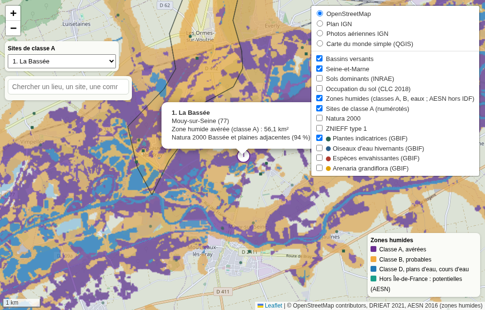
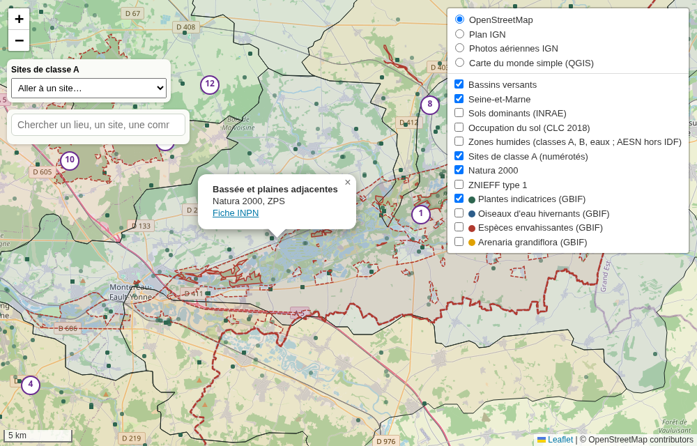

# Visite guidée : la Bassée sur la carte interactive

Une zone humide, sept étapes. La Bassée est la plus grande zone humide avérée des bassins versants qui drainent la Seine-et-Marne : 56 km² de classe A, dont 94 % dans le site Natura 2000 <i>Bassée et plaines adjacentes</i>. Voici comment la lire sur la carte.

[Ouvrir la carte en plein écran](carte.html){ .md-button .md-button--primary }

## 1 · Ouvrir la carte

La carte s'ouvre sur les 14 bassins versants, avec les observations de plantes indicatrices du GBIF et les douze sites de classe A numérotés. En haut à gauche : le menu des signets et la recherche. En haut à droite : fonds et couches.

## 2 · Aller au site avec les signets

Dans **Sites de classe A**, choisissez **1. La Bassée**. La carte zoome sur Mouy-sur-Seine, affiche la couche des zones humides et ouvre la fiche du site : 56,1 km² de zone humide avérée (classe A), dont 94 % en Natura 2000. Violet pour les avérées, ambre pour les probables, bleu pour l'eau libre ; la légende s'ouvre en bas à droite.

## 3 · Regarder sous le sol

Dans le menu des couches, décochez **Zones humides** et cochez **Sols dominants (INRAE)**. Le fond de vallée est un fluviosol, le sol des alluvions, entre les calcosols et brunisols des versants : la zone humide suit le sol.

## 4 · Vérifier la protection

Cochez **Natura 2000**, puis cliquez à l'intérieur du contour rouge. La fiche donne le nom du site, *Bassée et plaines adjacentes*, une ZPS (zone de protection spéciale pour les oiseaux), avec un lien vers sa fiche INPN.

## 5 · Chercher

Tapez **bassée** dans la case de recherche (les accents sont facultatifs). La liste montre le site de classe A, le bassin versant, trois sites Natura 2000, la ZNIEFF *Réserve de la Bassée et abords*, puis des communes et des adresses. Cliquez pour y aller.

## 6 · La voir d'avion

Dans les fonds, choisissez **Photos aériennes IGN** ; cochez **Oiseaux d'eau hivernants (GBIF)**. Les plans d'eau sont d'anciennes gravières creusées dans les alluvions ; les points bleus sont les observations d'oiseaux d'eau depuis 2000, nombre d'entre elles sur ces plans d'eau.

## 7 · Sur téléphone

Ouvrez la carte en plein écran et utilisez le même menu : les couches se replient en icône, et l'encadré d'information est masqué pour laisser la place à la carte.

{ width="280" }

!!! note "Bon à savoir"
    La couche des zones humides indique où chercher, pas des limites réglementaires : seul un test de terrain sur la végétation ou le sol délimite une zone humide (arrêté du 24 juin 2008). Les classes A et B ne couvrent que l'Île-de-France (DRIEAT, 2021). Voir la [diapositive 6](wetlands.md) pour la méthode et les onze autres sites.

