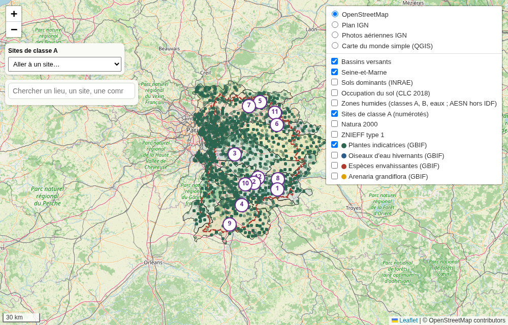
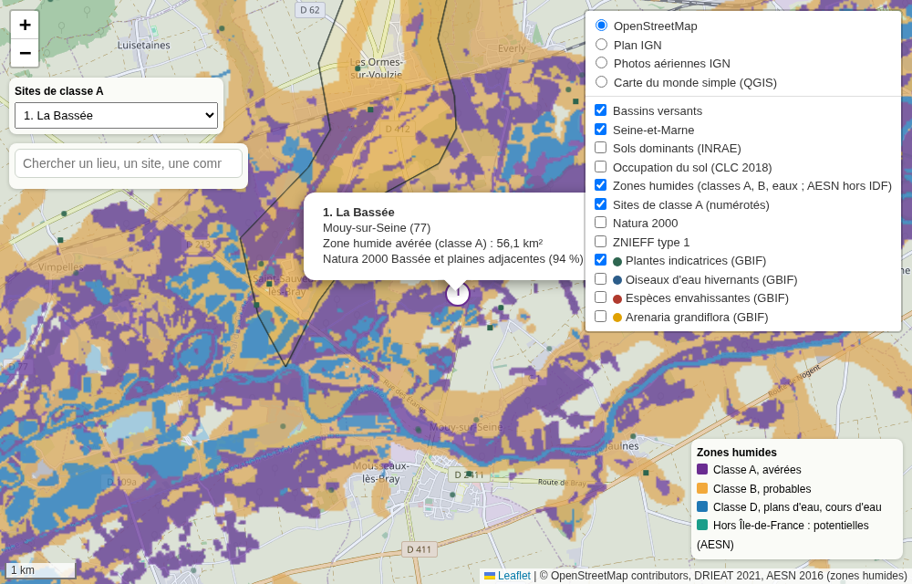
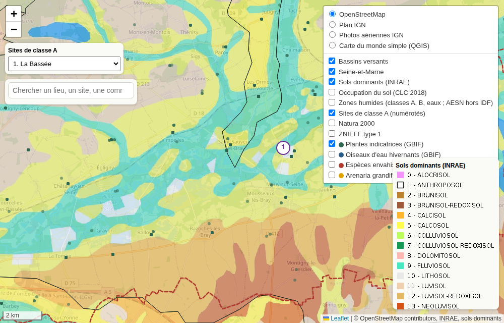
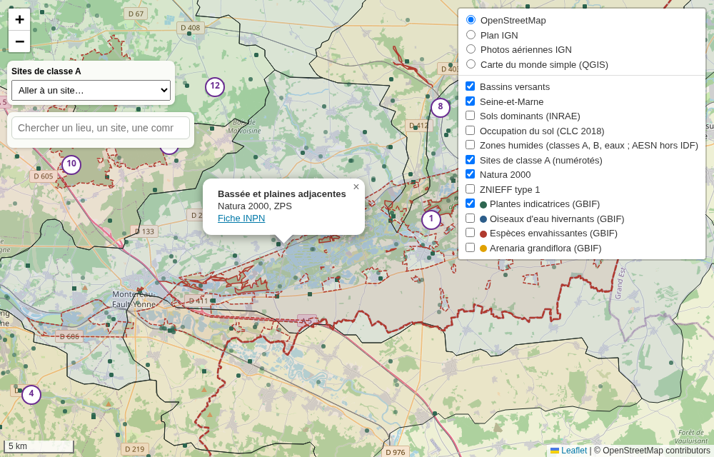
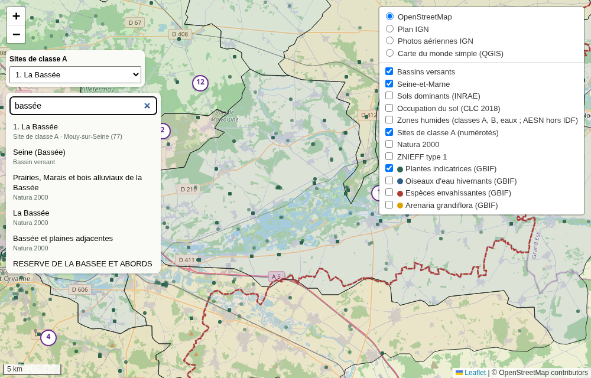
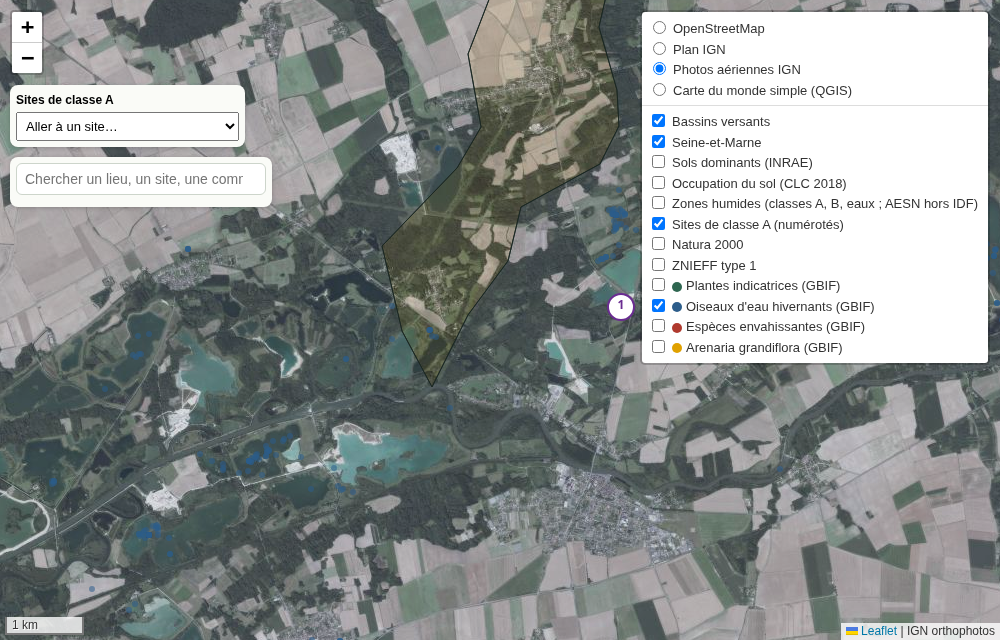
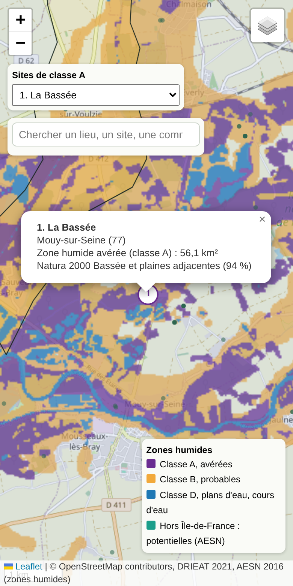

# Guided tour: La Bassée on the interactive map

One wetland, seven steps. La Bassée is the largest confirmed wetland in the catchments draining Seine-et-Marne: 56 km² of class A, 94 % of it inside the Natura 2000 site <i>Bassée et plaines adjacentes</i>. Here is how to read it on the map.

[Open the map full screen](carte.html){ .md-button .md-button--primary }

## 1 · Open the map

The map opens on the 14 catchments, with the indicator plant records from GBIF and the twelve numbered class A sites. Top left: the bookmarks menu and the search box. Top right: backgrounds and layers.

## 2 · Go to the site with the bookmarks

In **Sites de classe A**, choose **1. La Bassée**. The map zooms to Mouy-sur-Seine, switches on the wetland layer and opens the site's card: 56.1 km² of confirmed wetland (class A), 94 % in Natura 2000. Purple is confirmed, amber probable, blue open water; the legend opens bottom right.

## 3 · Look under the ground

In the layer menu, untick **Zones humides** and tick **Sols dominants (INRAE)**. The valley floor is Fluviosol, the soil of river alluvium, between the Calcosols and Brunisols of the slopes: the wetland follows the soil.

## 4 · Check the protection

Tick **Natura 2000**, then click inside the red outline. The card names the site, *Bassée et plaines adjacentes*, a ZPS (special protection area for birds), with a link to its INPN record.

## 5 · Search

Type **bassée** in the search box (accents are optional). The list shows the class A site, the catchment, three Natura 2000 sites, the ZNIEFF *Réserve de la Bassée et abords*, then communes and addresses. Click one to go there.

## 6 · See it from the air

In the backgrounds, choose **Photos aériennes IGN**; tick **Oiseaux d'eau hivernants (GBIF)**. The lakes are old gravel pits dug in the alluvium; the blue dots are waterbird records since 2000, many of them on those lakes.

## 7 · On a phone

Open the map full screen and use the same menu: the layers fold into an icon, and the information box is hidden to leave room for the map.

{ width="280" }

!!! note "Good to know"
    The wetland layer shows where to look, not legal limits: only a field test on vegetation or soil delimits a wetland (decree of 24 June 2008). Class A and B cover Île-de-France only (DRIEAT, 2021). See [slide 6](wetlands.md) for the method and the other eleven sites.

## The post

> 🗺️💧 How do you read a wetland on a map?
>
> I built an open, bilingual map of the wetlands in the 14 river catchments that drain Seine-et-Marne, and La Bassée is the best place to start. Pick it from the bookmarks and the map shows 56 km² of confirmed wetland, 94 % of it inside the Natura 2000 site Bassée et plaines adjacentes. Switch to the soil layer and the wetland follows the alluvium of the Seine, the Fluviosols, between the drier soils of the slopes. Switch to the aerial photo and the old gravel pits appear, with the waterbird records from GBIF on the lakes.
>
> Each layer answers one question: where is the water, what is underneath, what is protected, who lives there. None of them draws a legal limit, which still needs a field test on vegetation or soil, but together they show where to look first. All the data are open: DRIEAT, the Seine-Normandie water agency, INRAE, IGN, INPN and GBIF.
>
> Guided tour, in English and French: 👉 https://lindangulopez.github.io/wetlands-seine-et-marne/tour/
>
> #ZonesHumides #Wetlands #SeineEtMarne #LaBassee #GIS #OpenData #Natura2000 #GBIF #Mapping #OpenScience

**Author comment, under the post:**

> Try the search box with your own commune: it also finds Natura 2000 sites and ZNIEFF by name.
>
> Which wetland near you would you look up first?
