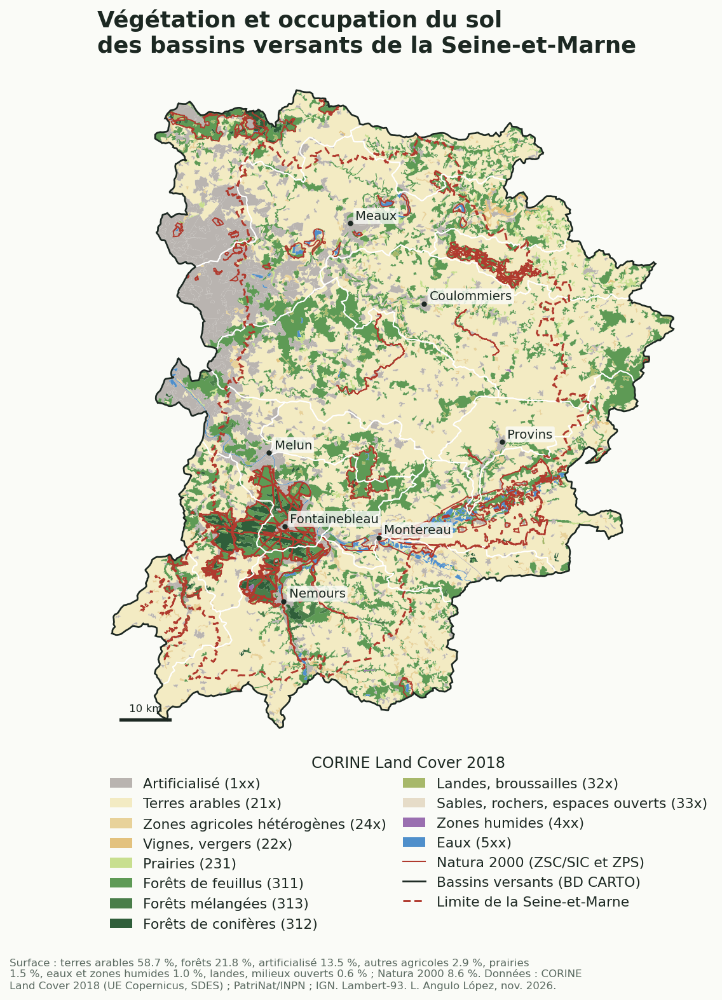

# 3 · Végétation et occupation du sol

Les terres arables couvrent 58,7 % des bassins et la forêt 21,8 %. Les eaux et zones humides cartographiées par CORINE ne font que 1,0 % : la plupart des zones humides sont trop petites pour une carte à 25 hectares.

(i) **Les plateaux ouverts.** Les bassins de la Voulzie (83 % de terres arables), de l'Essonne (79 %) et du Grand Morin (73 %) sont presque entièrement cultivés.

(ii) **Les massifs forestiers.** Fontainebleau et la Seine autour de Melun (44 % de forêt), l'École (40 %), et les forêts de Crécy, d'Armainvilliers et de Villefermoy sur le plateau briard.

(iii) **Les sites protégés.** Natura 2000 couvre 8,6 % de la surface, surtout à deux endroits : la forêt de Fontainebleau et la Bassée, où 28 % du bassin est en Natura 2000 pour ses prairies alluviales, ses marais et ses oiseaux hivernants.

!!! note "Échelle"
    CORINE Land Cover cartographie des unités de 25 hectares et plus. Roselières, cariçaies et mégaphorbiaies le long des fossés sont le plus souvent plus petites ; on les retrouve plutôt dans les observations d'espèces (diapositive suivante).

[Suite : les espèces →](species.md){ .md-button }
