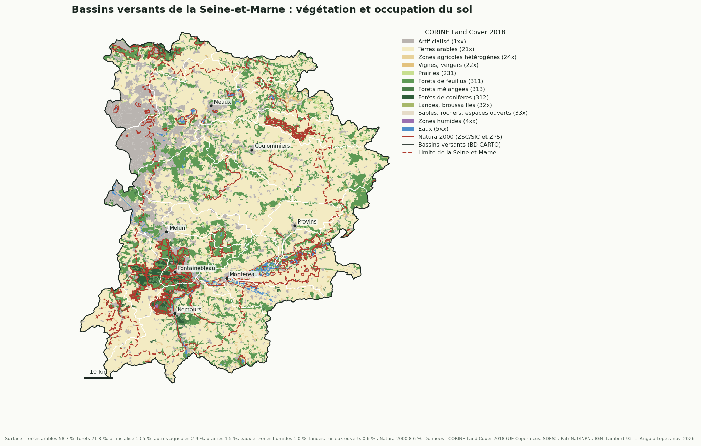

# 3 · Vegetation and land cover

Arable land covers 58.7 % of the catchments and forest 21.8 %. Water and wetlands mapped by CORINE add up to 1.0 %: most wetlands are too small for a 25-hectare map.

(i) **Open plateaus.** The Voulzie (83 % arable), Essonne (79 %) and Grand Morin (73 %) catchments are almost all field.

(ii) **Forest blocks.** Fontainebleau and the Seine around Melun (44 % forest), the École (40 %), and the forests of Crécy, Armainvilliers and Villefermoy on the Brie plateau.

(iii) **Protected sites.** Natura 2000 covers 8.6 % of the area, concentrated in two places: the Fontainebleau forest and the Bassée, where 28 % of the catchment is in Natura 2000 for its alluvial meadows, marshes and wintering birds.

!!! note "Scale"
    CORINE Land Cover maps units of 25 hectares and more. Reedbeds, sedge beds and tall-herb fringes along ditches are mostly below that size; they show up in the species records instead (next slide).

[Next: species →](species.md){ .md-button }
