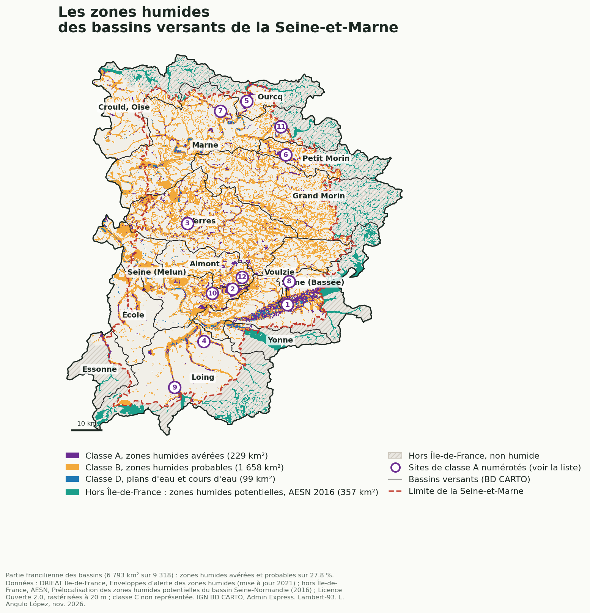

# 6 · Les zones humides des bassins versants

Dans les 14 bassins versants qui drainent la Seine-et-Marne, la cartographie régionale des zones humides d'Île-de-France recense 229 km² de zones humides avérées et 1 658 km² de zones humides probables, 27,8 % de la partie qu'elle couvre. Hors Île-de-France, l'agence de l'eau Seine-Normandie cartographie 357 km² de zones humides potentielles, 14,1 % du reste.

(i) **Bassin par bassin.** Zones humides avérées et probables couvrent 38,3 % du bassin de l'Yerres, 37,4 % de la Seine à Melun et 34,9 % de la Bassée, mais seulement 13,2 % de l'École et 12,5 % du Loing, où les sables et calcaires du sud drainent vite.

(ii) **Les sites de classe A nommés.** Les douze plus grandes surfaces de zones humides avérées (numérotées sur la carte) ne sont qu'en partie protégées : la Bassée à elle seule en compte 56 km², dont 94 % dans le site Natura 2000 *Bassée et plaines adjacentes*, mais la plupart des autres sont en grande partie hors des sites protégés.

(iii) **Pourquoi deux sources.** En France, les zones humides sont cartographiées région par région et bassin par bassin, avec des méthodes différentes. La carte d'Île-de-France (DRIEAT, 2021) a quatre classes, issues d'études de terrain et de modèles, mais s'arrête à la limite régionale. Pour les parties amont du Loing, de l'Ourcq, du Petit Morin, de la Bassée et de l'Yonne, dans le Loiret, l'Aisne, la Marne, l'Aube et l'Yonne, cette diapositive utilise la prélocalisation du bassin Seine-Normandie (AESN, 2016), qui n'a qu'une classe, « zones humides potentielles ». Les deux ne sont pas équivalentes : elles sont montrées dans des couleurs différentes et comptées à part.

*Sur téléphone, touchez la carte pour zoomer et faites glisser les tableaux.*

## Les douze plus grandes zones humides avérées

| N° | Site | Commune | Classe A, km² | Protection |
| ---: | --- | --- | ---: | --- |
| 1 | La Bassée | Mouy-sur-Seine | 56,1 | Natura 2000 Bassée et plaines adjacentes (94 %) |
| 2 | Secteur de Coutençon | Coutençon | 14,1 | en partie dans Natura 2000 Massif de Villefermoy (24 %) |
| 3 | Secteur de Liverdy-en-Brie | Liverdy-en-Brie | 13,8 | hors site protégé |
| 4 | Secteur de Villecerf | Villecerf | 8,3 | en partie dans Natura 2000 Rivières du Loing et du Lunain (17 %) |
| 5 | Secteur de May-en-Multien | May-en-Multien | 6,8 | en partie dans ZNIEFF 1 Le grand marais et marais associes (17 %) |
| 6 | Vallée du Petit Morin | Orly-sur-Morin | 6,2 | Natura 2000 Le Petit Morin de Verdelot à Saint-Cyr-sur-Morin (75 %) |
| 7 | Secteur d'Étrépilly | Étrépilly | 4,1 | en partie dans Natura 2000 Boucles de la Marne (9 %) |
| 8 | Secteur de Chalmaison | Chalmaison | 4,0 | en partie dans ZNIEFF 1 Ancienne tourbiere du ru de meances (9 %) |
| 9 | Secteur de Souppes-sur-Loing | Souppes-sur-Loing | 4,0 | en partie dans ZNIEFF 1 Marais de cercanceaux et plan d'eau de varennes (14 %) |
| 10 | Massif de Villefermoy | Valence-en-Brie | 3,9 | Natura 2000 Massif de Villefermoy (78 %) |
| 11 | Secteur de Méry-sur-Marne | Méry-sur-Marne | 3,7 | hors site protégé |
| 12 | Secteur de Fontains | Fontains | 3,7 | hors site protégé |

Les surfaces sont des zones humides avérées (classe A) à moins de 200 m les unes des autres, dans les bassins ; un site porte le nom d'un site protégé seulement quand celui-ci en couvre la plus grande part ; sinon, celui de la commune, avec la part en site protégé. Le numéro est placé sur une zone humide avérée, au plus près du centre du site.

## Par bassin versant

| Bassin | km² | Part en Île-de-France | Classe A, km² | Classe B, km² | A + B (partie francilienne) | Potentielles AESN (hors Île-de-France) |
| --- | ---: | ---: | ---: | ---: | ---: | ---: |
| Yerres | 1 011 | 100 % | 34,6 | 352,0 | 38,3 % | — |
| Seine (Melun) | 655 | 100 % | 30,8 | 214,1 | 37,4 % | — |
| Seine (Bassée) | 926 | 63 % | 59,4 | 145,5 | 34,9 % | 23,2 % |
| Petit Morin | 337 | 47 % | 7,5 | 46,8 | 34,3 % | 9,8 % |
| Almont | 305 | 100 % | 13,2 | 81,6 | 31,1 % | — |
| Voulzie | 287 | 98 % | 4,4 | 82,3 | 30,8 % | 12,2 % |
| Grand Morin | 1 196 | 71 % | 15,6 | 242,0 | 30,5 % | 10,8 % |
| Marne | 1 359 | 82 % | 22,3 | 271,5 | 26,5 % | 9,2 % |
| Ourcq | 316 | 36 % | 9,4 | 16,5 | 22,7 % | 9,8 % |
| Yonne | 250 | 24 % | 2,3 | 10,7 | 22,1 % | 22,5 % |
| Crould, Oise | 682 | 61 % | 5,2 | 62,8 | 16,2 % | 14,2 % |
| École | 390 | 100 % | 4,7 | 46,7 | 13,2 % | — |
| Loing | 1 300 | 59 % | 16,1 | 80,7 | 12,5 % | 17,4 % |
| Essonne | 303 | 29 % | 3,7 | 4,5 | 9,5 % | 3,6 % |

Données : [wetlands_catchments.json](maps/wetlands_catchments.json).

!!! note "Sources et méthode"
    DRIEAT Île-de-France, *Enveloppes d'alerte des zones humides d'Île-de-France*, mise à jour 2021 ([data.gouv.fr](https://www.data.gouv.fr/datasets/enveloppes-dalerte-des-zones-humides-dile-de-france-1)) ; Agence de l'eau Seine-Normandie, *Prélocalisation des zones humides potentielles dans le bassin Seine-Normandie*, 2016 ([data.gouv.fr](https://www.data.gouv.fr/datasets/prelocalisation-des-zones-humides-potentielles-dans-le-bassin-seine-normandie)) ; toutes deux sous Licence Ouverte 2.0. Rastérisées à 20 m et comptées dans chaque bassin ; classe C (faible probabilité) non représentée. Noms des sites : INPN (ZNIEFF, Natura 2000) et geo.api.gouv.fr (communes). Aucune de ces cartes n'est une délimitation réglementaire.

[Explorer les bassins sur la carte interactive →](map.md){ .md-button }
