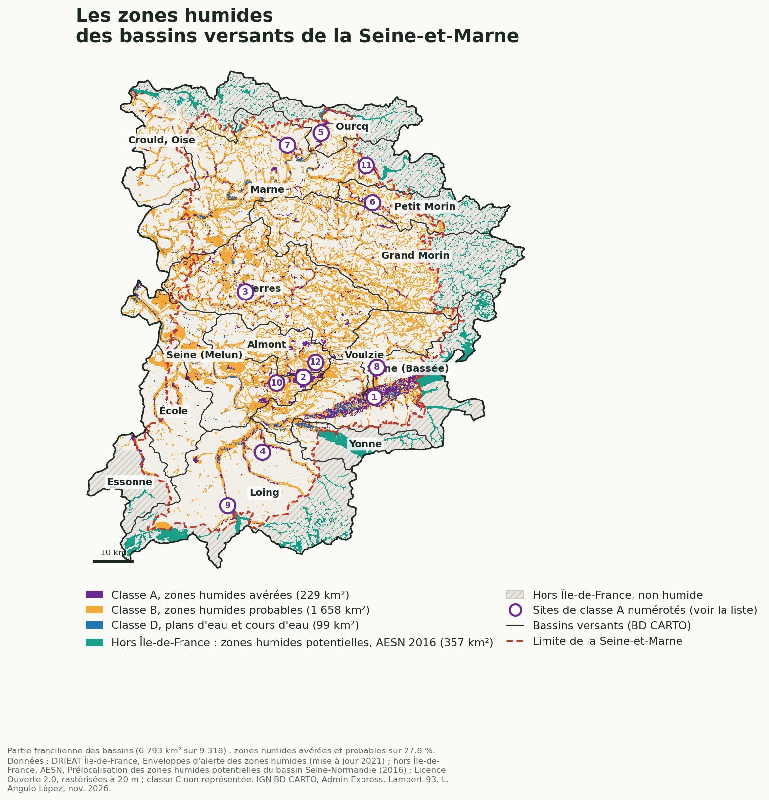

# 6 · The wetlands of the catchments

In the 14 catchments that drain Seine-et-Marne, the regional wetland map of Île-de-France finds 229 km² of confirmed wetlands and 1,658 km² of probable ones, 27.8 % of the part it covers. Outside Île-de-France, the Seine-Normandie water agency maps 357 km² of potential wetlands, 14.1 % of the rest.

(i) **Catchment by catchment.** Confirmed and probable wetlands cover 38.3 % of the Yerres catchment, 37.4 % of the Seine at Melun and 34.9 % of the Bassée, but only 13.2 % of the École and 12.5 % of the Loing, where the sands and limestone of the south drain fast.

(ii) **The named class A sites.** The twelve largest areas of confirmed wetlands (numbered on the map) are almost all protected sites already: the Bassée alone holds 56 km², inside the Natura 2000 site *Bassée et plaines adjacentes*.

(iii) **Why two sources.** Wetland mapping in France is done region by region and catchment by catchment, with different methods. The Île-de-France map (DRIEAT, 2021) has four classes from field studies and models, but stops at the regional border. For the upstream parts of the Loing, Ourcq, Petit Morin, Bassée and Yonne, in the Loiret, Aisne, Marne, Aube and Yonne départements, this slide uses the Seine-Normandie basin pre-localisation (AESN, 2016), which has a single class, "potential wetlands". The two are not equivalent, so they are shown in different colours and counted separately.

*On a phone, tap the map to zoom, and swipe the tables sideways.*

## The twelve largest confirmed wetlands

| N° | Site | Commune | Class A, km² | Protection |
| ---: | --- | --- | ---: | --- |
| 1 | La Bassée | Mouy-sur-Seine | 56.1 | Natura 2000 Bassée et plaines adjacentes |
| 2 | Étangs et mares de Villefermoy | Coutençon | 14.1 | Natura 2000 Massif de Villefermoy |
| 3 | Haute vallée de l'Yerres | Liverdy-en-Brie | 13.8 | near ZNIEFF Tourbière du Cormier |
| 4 | Vallée du Lunain | Villemer | 8.3 | Natura 2000 Rivières du Loing et du Lunain |
| 5 | Grand Marais de l'Ourcq | May-en-Multien | 6.8 | ZNIEFF Le Grand Marais et marais associés |
| 6 | Vallée du Petit Morin | Orly-sur-Morin | 6.2 | Natura 2000 Le Petit Morin de Verdelot à Saint-Cyr-sur-Morin |
| 7 | Boucles de la Marne, Grand-Voyeux | Étrépilly | 4.1 | Natura 2000 Boucles de la Marne |
| 8 | Anciennes tourbières de la Voulzie et du ru des Méances | Longueville | 4.0 | ZNIEFF |
| 9 | Marais de Cercanceaux | Souppes-sur-Loing | 4.0 | ZNIEFF Marais de Cercanceaux et plan d'eau de Varennes |
| 10 | Massif de Villefermoy | Valence-en-Brie | 3.9 | Natura 2000 Massif de Villefermoy |
| 11 | Vallée de la Marne | Méry-sur-Marne | 3.7 | near ZNIEFF Plan d'eau de Messy |
| 12 | Plateau de Brie | Fontains | 3.7 | no protected site |

Areas are confirmed wetland (class A) within 200 m of each other, inside the catchments; names from the protected site that covers most of the area, or the commune.

## By catchment

| Catchment | km² | Share in Île-de-France | Class A, km² | Class B, km² | A + B (Île-de-France part) | AESN potential (outside Île-de-France) |
| --- | ---: | ---: | ---: | ---: | ---: | ---: |
| Yerres | 1,011 | 100 % | 34.6 | 352.0 | 38.3 % | — |
| Seine (Melun) | 655 | 100 % | 30.8 | 214.1 | 37.4 % | — |
| Seine (Bassée) | 926 | 63 % | 59.4 | 145.5 | 34.9 % | 23.2 % |
| Petit Morin | 337 | 47 % | 7.5 | 46.8 | 34.3 % | 9.8 % |
| Almont | 305 | 100 % | 13.2 | 81.6 | 31.1 % | — |
| Voulzie | 287 | 98 % | 4.4 | 82.3 | 30.8 % | 12.2 % |
| Grand Morin | 1,196 | 71 % | 15.6 | 242.0 | 30.5 % | 10.8 % |
| Marne | 1,359 | 82 % | 22.3 | 271.5 | 26.5 % | 9.2 % |
| Ourcq | 316 | 36 % | 9.4 | 16.5 | 22.7 % | 9.8 % |
| Yonne | 250 | 24 % | 2.3 | 10.7 | 22.1 % | 22.5 % |
| Crould, Oise | 682 | 61 % | 5.2 | 62.8 | 16.2 % | 14.2 % |
| École | 390 | 100 % | 4.7 | 46.7 | 13.2 % | — |
| Loing | 1,300 | 59 % | 16.1 | 80.7 | 12.5 % | 17.4 % |
| Essonne | 303 | 29 % | 3.7 | 4.5 | 9.5 % | 3.6 % |

Data: [wetlands_catchments.json](maps/wetlands_catchments.json).

!!! note "Sources and method"
    DRIEAT Île-de-France, *Enveloppes d'alerte des zones humides d'Île-de-France*, 2021 update ([data.gouv.fr](https://www.data.gouv.fr/datasets/enveloppes-dalerte-des-zones-humides-dile-de-france-1)); Agence de l'eau Seine-Normandie, *Prélocalisation des zones humides potentielles dans le bassin Seine-Normandie*, 2016 ([data.gouv.fr](https://www.data.gouv.fr/datasets/prelocalisation-des-zones-humides-potentielles-dans-le-bassin-seine-normandie)); both Licence Ouverte 2.0. Rasterised at 20 m and counted inside each catchment; class C (low probability) not shown. Site names from INPN (ZNIEFF, Natura 2000) and geo.api.gouv.fr (communes). Neither map is a legal delimitation.

[Explore the catchments on the interactive map →](map.md){ .md-button }
